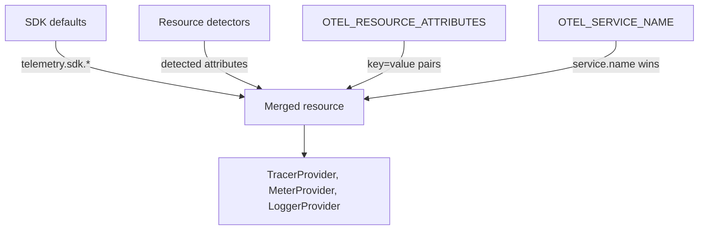

# Resources And Service Identity

A backend that stores telemetry must know which service produced each span, metric and log record. Without that, a latency graph cannot say which service is slow. OpenTelemetry solves this with a resource. This part shows what a resource is, where its attributes come from, which attributes identify a service and which values do not belong there.

A resource is a set of attributes that describes the entity producing telemetry. An attribute is a key with a typed value, for example `service.name` with the string `shuttle`. The SDK attaches one resource to a provider, and the provider attaches it to every trace, metric and log record it exports. The resource therefore describes the producer once and does not repeat inside each item.

## What a resource describes

A resource describes the thing that runs: a service, a process, a container, a Kubernetes pod or a host. Its attributes follow names from the semantic conventions, the shared list of attribute names and meanings that OpenTelemetry publishes. The most important group is the service group:

- `service.name` is the logical name of the service. Every service must have it.
- `service.namespace` groups related services, for example all services of one team or product.
- `service.version` is the version of the running code.
- `service.instance.id` identifies one running instance of the service. It must be unique for a combination of `service.namespace` and `service.name`.
- `deployment.environment.name` names the environment, for example `training` or `production`.

The SDK also adds `telemetry.sdk.name`, `telemetry.sdk.language` and `telemetry.sdk.version`. They say which SDK made the data. The Python SDK version used in the playground also generates a random `service.instance.id` when you do not set one.

## Where the attributes come from

The SDK builds the resource from several sources and merges them. Each source can add attributes. When two sources set the same key, a defined order decides which one wins.



The drawing shows that one merged resource feeds all three providers. `OTEL_SERVICE_NAME` sets only `service.name`, and it takes priority over a `service.name` inside `OTEL_RESOURCE_ATTRIBUTES`. If neither is set, the SDK falls back to `unknown_service`, and some SDKs add the process name, for example `unknown_service:python`. A backend then groups all such services under one name, which makes the data hard to use.

`OTEL_RESOURCE_ATTRIBUTES` is a list of `key=value` pairs separated by commas, with no spaces around the separators. Values are strings. The resource is built once when the provider starts. It does not change while the process runs, so you must restart the process to change it. In Kubernetes that means a new rollout of the Deployment.

## A worked merge

Take a service with these two variables:

- `OTEL_SERVICE_NAME=shuttle`
- `OTEL_RESOURCE_ATTRIBUTES=service.name=other,service.version=1.0.0`

The SDK reads `service.name=other` and `service.version=1.0.0` from the second variable. It then applies `OTEL_SERVICE_NAME`, which replaces the name. The final resource has `service.name` set to `shuttle` and `service.version` set to `1.0.0`. The conflicting value `other` disappears without a warning. This is why a configuration review must look at both variables together.

Now remove `OTEL_SERVICE_NAME` and the `service.name` pair. The resource has no service name, and the SDK fills in `unknown_service` (in Python, `unknown_service:python`). The service still works and still exports, but every backend view shows the unknown name. In Kubernetes, a Deployment that forgot the variable and a Deployment that set it correctly look the same to `kubectl get pods`. Only the telemetry shows the difference.

Resource attributes also decide how a backend can group and filter. A query such as "error rate of service `shuttle` in environment `training`" works only when every producer sets `service.name` and `deployment.environment.name` the same way. A different spelling, such as `Training` and `training`, creates two groups. Use the exact names and values from the semantic conventions and keep one spelling across all services.

## Reading the resource in a running service

The `shuttle` Deployment in the playground sets its resource through environment variables. Print them:

<!-- astrona:playground:renew -->

```sh
kubectl -n starfleet get deploy shuttle -o json | jq -r '.spec.template.spec.containers[0].env[] | .name + "=" + .value'
```

The output lists `OTEL_SERVICE_NAME=shuttle` and an `OTEL_RESOURCE_ATTRIBUTES` value with the namespace, the version and the environment. The same list contains the endpoint of the Collector, which the exporters use. The service needs a few minutes after the cluster starts, because the pod installs the SDK with `pip` before it runs the program.

Now read what the Collector received. The Collector is the component that receives OTLP, the OpenTelemetry Protocol, from the service and hands the data to its exporters. In the playground, the `debug` exporter prints every item to the log:

```sh
kubectl -n starfleet logs deploy/collector --since=30s | grep -A8 "^Resource attributes" | head -40
```

Each block starts with `Resource attributes:`. Below it you see one line for each attribute in the form `-> service.name: Str(shuttle)`. The `Str(...)` part is the value type. You also see `service.instance.id` and the `telemetry.sdk.*` attributes that you did not set. The block appears for traces, for metrics and for logs, and the attributes are the same in all three. That is the point of a resource: one description for all signals of the service.

To compare the three signals, count the blocks with the service name:

```sh
kubectl -n starfleet logs deploy/collector --since=30s | grep -c "service.name: Str(shuttle)"
```

The count is greater than zero when the service sends data. Every export request (a batch of spans, a metric export and a batch of log records) carries its own copy of the resource.

## What does not belong on a resource

A resource attribute describes a producer that stays the same during its life. A value that changes for every request breaks that rule. Suppose the `shuttle` sets `request.id=ord-4711` in `OTEL_RESOURCE_ATTRIBUTES`. All data now says that the producer is the service for order 4711, and the value never changes until the process restarts. A backend that groups by resource would see a new producer for each different value. The request identifier belongs on the span or the log record of that request.

A second wrong choice is putting an identifier that is unique per instance into `service.name`, such as `shuttle-pod-7f9c`. Then every pod looks like a different service and you cannot group by service. The instance identity has its own attribute, `service.instance.id`.

A third mistake is relying on a missing name. With no `service.name`, the data arrives with an `unknown_service` name. The export still succeeds, so the problem is invisible until someone looks for the service in the backend.

Before the closing section, here is what you now know. A resource describes the producer once for all signals. It is built from defaults, detectors, `OTEL_RESOURCE_ATTRIBUTES` and `OTEL_SERVICE_NAME`, in that priority order. It is fixed for the life of the process, and it must hold only stable producer facts. The open question is how OpenTelemetry describes the code that recorded the data, inside one producer. The next part answers that.

## Common pitfalls

> [!WARNING]
> `OTEL_SERVICE_NAME` overrides `service.name` in `OTEL_RESOURCE_ATTRIBUTES`, so two settings can disagree without an error. A resource is read once at startup: changing the Deployment environment only takes effect when the pod is replaced. Never put a per-request value, such as a request identifier, in the resource. Resource attributes are strings in `OTEL_RESOURCE_ATTRIBUTES`; the variable has no way to write a number or a list.
