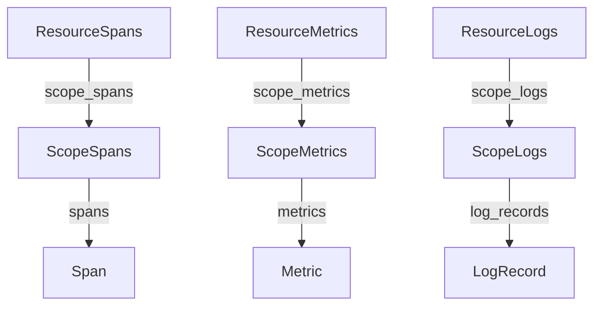

# Instrumentation Scope And Signal Envelopes

One service usually contains more than one source of telemetry: the code of the application itself, an HTTP client library, a database driver. When a span arrives in a backend, you want to know not only which service made it but also which piece of code recorded it. This part explains the instrumentation scope, which answers that question, and the nested structure, called the envelope, that OTLP uses to carry resource, scope and data together.

An instrumentation scope identifies the library or module that creates telemetry through the API. It has a name, an optional version, an optional schema URL and optional attributes. In the Python SDK you set the name and the version when you ask a provider for a tracer, a meter or a logger. The scope belongs to the code that records, and the resource belongs to the process that runs the code.

## Two scopes inside one resource

The `shuttle` program asks for two tracers. Their names and versions are:

- `starfleet.shuttle.orders`, version `1.2.0`, for the code that handles an order.
- `starfleet.shuttle.http`, version `0.9.0`, for the code that makes the outgoing HTTP call.

It also asks for a meter named `starfleet.shuttle.orders` with version `1.2.0`. The standard Python `logging` handler uses the logger name, `starfleet.shuttle`, as the scope name of its log records.

By convention, an instrumentation library names its scope after the library, such as the package name of the instrumentation. Application code uses the name of its own module or component. The name must be stable, because backends use it to filter and to find which library version produced a problem. A version change in a library then becomes visible in the data without any code change on the backend.

Scope attributes and the schema URL are less common. The schema URL names the version of the semantic conventions that the instrumentation used when it chose attribute names. A consumer can use it to translate old attribute names to new ones. The resource can carry its own schema URL for the same reason.

## The OTLP envelope

OTLP, the OpenTelemetry Protocol, sends data in a fixed nesting. The outer layer is the resource, the middle layer is the scope, and the inner layer is the list of signal items. The names differ by signal, but the shape is the same:



The drawing shows three parallel trees. A request to the Collector contains a list of resource entries. Each resource entry has a list of scope entries. Each scope entry has the items. An exporter writes the resource and the scope once for many items, so the batch stays small.

This structure has a consequence. When two services share a Collector, their data arrives in separate resource entries. When two libraries in one service record, their data arrives in separate scope entries inside one resource entry. A processor in the Collector can change the resource without touching each span.

## Reading the scopes in the Collector output

Read the scope lines of the spans the `shuttle` exports:

<!-- astrona:playground:renew -->

```sh
kubectl -n starfleet logs deploy/collector --since=30s | grep "InstrumentationScope" | sort | uniq -c
```

The `debug` exporter prints one line for each scope entry in the form `InstrumentationScope <name> <version>`. You see the two tracer scopes, the meter scope and the logger scope. The count column shows how many scope entries of each kind arrived in the last 30 seconds. The orders scope appears for traces and for metrics, because both use the same name and version. The scope name does not say which signal it is: the same scope name can appear under spans, metrics and logs.

Now look at the whole block of one trace export:

```sh
kubectl -n starfleet logs deploy/collector --since=30s | grep -B2 -A6 "ScopeSpans #" | head -60
```

The block starts with the resource attributes, then `ScopeSpans #0`, then the scope line, then the spans of that scope. Spans from `starfleet.shuttle.http` appear under their own scope entry even though they belong to the same trace as the orders span. A trace can therefore cross several scope entries, and a scope entry can hold spans from many traces.

## A worked failure: two libraries, one scope name

Suppose a team wraps two clients and gives both tracers the same scope name, `shuttle.client`, with no version. The data still arrives and nothing fails. Later, the team upgrades one client and sees more errors. The backend cannot split the errors by library, because both libraries share one scope entry key. The version also cannot show which release introduced the change.

The fix is a different name for each library and a version taken from the library itself. The scope then works as a filter: "show spans from `starfleet.shuttle.http` version `0.9.0` with status `Error`". The same idea applies to metrics: a counter named `requests` from two scopes is two streams, and a query can still choose one.

The SDK keeps the scope you pass at the time you ask for the tracer. It does not read the scope from an environment variable. That differs from the resource, which the operator can set outside the code. To change a scope name, you change the code of the instrumentation.

## Scope compared with resource, step by step

Use the `shuttle` to check your reading. Ask three questions about one span of `starfleet.shuttle.http`:

1. Which service ran? The resource of its `ResourceSpans` entry answers: `service.name` is `shuttle`.
2. Which code recorded it? The `ScopeSpans` entry answers: `starfleet.shuttle.http` version `0.9.0`.
3. What did it do? The span answers: kind `Client`, a name, the attribute `server.address`, and the times.

If the answer to a question is not on the expected level, the instrumentation put the data in the wrong place. For example, when the service name appears only as a span attribute and the resource has no name, backends that group by resource show an unknown service even though each span names a service.

## Choosing the right level

The three levels answer different questions, and a value goes to the level that answers its question.

- Resource: which producer ran this? Examples are `service.name`, `service.version`, `deployment.environment.name`, `k8s.pod.name`.
- Scope: which code recorded this? Examples are the instrumentation library name and its version.
- Item (span, data point or log record): what happened in this one operation? Examples are `http.route`, `http.response.status_code`, an order identifier.

A common failure is moving item data upward. If a team stores `http.route` on the resource, a service with many routes needs one resource per route, which is wrong, because the service is the same. Moving data downward fails too. If the service version is stored as an attribute on each span, the data uses more space, and metrics and logs of the same service do not show the version unless they repeat it.

You now know where identity is stored: the resource says who ran, the scope says which code recorded, and the item carries the details of one operation. The open question is how each signal identifies a single item or a single series, which is the topic of the next part.

## Common pitfalls

> [!WARNING]
> The scope name is not the service name. Two different libraries must not share one scope name, and one library should not change its scope name between versions, because a backend uses the name to group data. The same scope name can appear under traces, metrics and logs, so a scope entry does not tell you the signal. Do not copy resource attributes such as the service version into the scope or into every item to make a query work; fix the resource instead.
