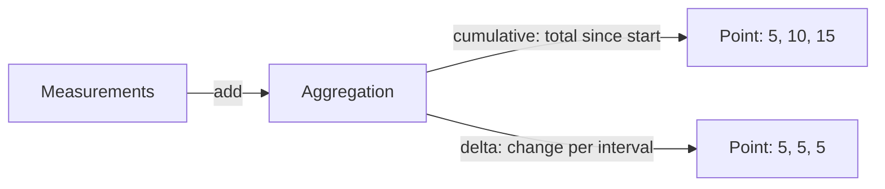

# Metric Data Points And Temporality

A program records measurements: one request handled, one request lasting 45 milliseconds, a queue that now holds 3 requests. The SDK cannot send each measurement, because that would be too much data. It aggregates the measurements into data points and exports those at a fixed interval. This part explains the kinds of data point, what the numbers in them mean, and the setting that decides whether a data point covers all time since the start or only the last interval.

The API side of a metric is an instrument, which is the object the program calls to record a measurement. The data model side is the data point that comes out of the SDK. The two sides connect through an aggregation, which is the rule that turns the measurements of one interval into one data point.

## From instrument to data type

Each instrument kind has a default aggregation, and each aggregation produces one data type in the model:

| Instrument | Data type | Meaning of the value |
| --- | --- | --- |
| Counter, asynchronous Counter | Sum, monotonic | A total that only grows |
| UpDownCounter, asynchronous UpDownCounter | Sum, not monotonic | A total that grows and shrinks |
| Gauge, asynchronous Gauge | Gauge | The last observed value |
| Histogram | Histogram | The distribution of recorded values |

A sum has a `is_monotonic` flag. A monotonic sum must not decrease, so a consumer may treat a decrease as a reset. A non-monotonic sum can move in both directions, so a decrease is a normal change. A gauge has no temporality and no sum: it says what a value was at one moment, such as a fuel level or a temperature. A histogram counts measurements into buckets and also carries a count, a sum and, when enabled, a minimum and a maximum. The explicit-bucket histogram uses boundaries that the SDK defines, and the exponential histogram uses a scale that adapts to the data.

Print the descriptors in the playground to see this:

<!-- astrona:playground:renew -->

```sh
kubectl -n starfleet logs deploy/collector --since=30s | grep -A8 "Name: shuttle" | grep -E "Name:|DataType:|IsMonotonic:|AggregationTemporality:" | sort -u
```

`shuttle.requests` shows `DataType: Sum`, `IsMonotonic: true`. `shuttle.queue.depth` shows `DataType: Sum`, `IsMonotonic: false`. `shuttle.fuel.level` shows `DataType: Gauge`, and the histogram `shuttle.request.duration` shows `DataType: Histogram`. Each of the sums and the histogram also shows an `AggregationTemporality` line. The gauge has none.

## Cumulative and delta temporality

Aggregation temporality says which time range one data point covers. A cumulative data point holds the value from the start time to the timestamp, where the start time stays fixed. A delta data point holds only the change in the interval from its start time to its timestamp, and the start time of the next point is the end time of the previous one.

Take the counter `shuttle.requests` with an export every 5 seconds, and 5 requests in each interval:

- Cumulative exports: 5, then 10, then 15. The start time is the same in all three.
- Delta exports: 5, then 5, then 5. The start time moves forward each time.



The drawing shows that both temporalities start from the same measurements. A consumer that wants a rate from cumulative data subtracts the previous value and divides by the time. A consumer of delta data divides the value by the interval. Both give one request per second here.

The two forms lose different things. A lost cumulative point costs only resolution, because the next point still has the full total. A lost delta point loses the measurements of that interval for good. A restart of the process resets a cumulative sum to zero, and the new start time shows that the reset happened, so a consumer can treat it correctly. A delta stream has nothing to reset, because each point stands on its own.

## Choosing a temporality

The temporality is a preference of the exporter, which the SDK sets per instrument kind. In the SDK, the variable `OTEL_EXPORTER_OTLP_METRICS_TEMPORALITY_PREFERENCE` accepts three values, ignoring case:

- `cumulative` uses cumulative temporality for every instrument kind. It is the default.
- `delta` uses delta for Counter, asynchronous Counter and Histogram, and cumulative for UpDownCounter and asynchronous UpDownCounter.
- `lowmemory` uses delta for Counter and Histogram, and cumulative for the rest, including the asynchronous Counter.

The reason for the split is that an UpDownCounter reports a level, and a delta of a level cannot be added up without knowing the starting level. A backend decides what it accepts. A Prometheus-style backend needs cumulative data, while some backends prefer delta data to save memory in the producer, because a delta aggregation can forget its history after each export. A Collector can also convert between the two with processors, but the conversion needs state and has limits, such as a first point that cannot be converted.

## Changing it in the playground

Set the preference on the `shuttle` Deployment and wait for the new pod. The metric provider reads the variable at startup, so the pod must be replaced:

```sh
kubectl -n starfleet set env deployment/shuttle OTEL_EXPORTER_OTLP_METRICS_TEMPORALITY_PREFERENCE=delta
kubectl -n starfleet rollout status deployment/shuttle --timeout=300s
```

The new pod installs the SDK, so wait a minute or two before you read the Collector output. Then print the temporality of each metric:

```sh
kubectl -n starfleet logs deploy/collector --since=20s | grep -A8 "Name: shuttle" | grep -E "Name:|AggregationTemporality:" | sort -u
```

`shuttle.requests` and `shuttle.request.duration` now show `AggregationTemporality: Delta`. `shuttle.queue.depth` still shows `Cumulative`, because the Python SDK keeps cumulative temporality for UpDownCounters under the `delta` preference. The Collector log still holds lines from the old pod for a short time, so use a short `--since` value right after the rollout.

Look at the start time and the value of two consecutive points of `shuttle.requests`:

```sh
kubectl -n starfleet logs deploy/collector --since=20s | grep -A18 "Name: shuttle.requests" | grep -E "StartTimestamp|^Timestamp|Value" | head -9
```

The `StartTimestamp` of each point is about equal to the `Timestamp` of the previous one, and the value counts only the requests of one interval, near 5 at one request per second. In the cumulative form the start time stayed fixed and the value kept growing.

You now know the kinds of data point and the two temporalities. The open question is how a single point of a histogram can point back to one concrete request.

## Common pitfalls

> [!WARNING]
> Do not add delta and cumulative points of one metric as if they were the same kind of number. A delta value cannot be turned into a rate without the interval length. A cumulative sum that drops can be a restart and not a negative change, but only for a monotonic sum. The `delta` preference leaves UpDownCounters cumulative, so a service can send both temporalities at once. A gauge has no temporality, so do not look for one.
