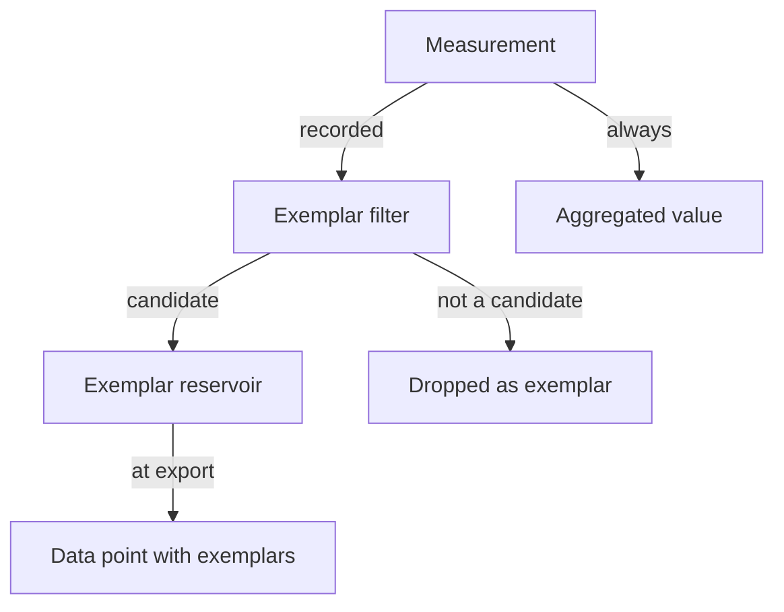

# Exemplars And Semantic Conventions

A histogram says that 2 percent of requests took more than a second. It does not say which request. An engineer who sees this wants one concrete slow request to open its trace. OpenTelemetry solves this with exemplars. A second problem is that two teams may name the same fact differently, so that dashboards and alerts do not work across services. Semantic conventions solve that. This part covers both.

An exemplar is a recorded example measurement that is attached to a metric data point. It holds the value that was measured, the time of the measurement, the trace ID and span ID of the span that was active, and the attributes of the measurement that the data point itself does not keep. Because it holds a trace ID and a span ID, it is the only link from a metric to a trace in the data model.

## How an exemplar is chosen

The SDK does not keep every measurement. Two components decide what becomes an exemplar:

- The exemplar filter decides which measurements may become exemplars. The setting `OTEL_METRICS_EXEMPLAR_FILTER` accepts `always_on`, `always_off` and `trace_based`. The default is `trace_based`. With `trace_based`, a measurement is a candidate only when the active span is sampled. With `always_on`, every measurement is a candidate, even without a span. With `always_off`, no measurement is a candidate.
- The exemplar reservoir keeps a small number of candidates per data point. The default reservoir of a histogram keeps at most one measurement for each bucket. The default reservoir of a sum or a gauge keeps a small fixed number.

At each export, the SDK adds the exemplars in the reservoir to the data point and then empties the reservoir. A data point without any candidate has no exemplars. The exemplar does not change the value of the metric. It is extra data next to it.



The drawing shows that every measurement reaches the aggregated value, and only the candidates reach the reservoir. The filter affects the exemplars only, never the metric numbers.

### Filtered attributes

An exemplar can carry attributes that the data point does not have. Suppose a view removes the attribute `http.route` from a metric to cut the number of series. The data point then has no route. The exemplar can still keep the full set of attributes of the original measurement, so the route of the slow request stays visible. These are called filtered attributes. An exemplar is a single example, so these attributes do not create new series.

The Collector prints the exemplars of a data point under an `Exemplars:` heading, one block for each exemplar.

## Why trace_based needs a span

With `trace_based`, the SDK looks at the active span at the moment of the measurement. The `shuttle` records its counter and histogram inside the server span of the request, so a span is active, and the default sampler records and exports it. The sampler is the SDK component that decides whether a trace is recorded. The default is to follow the parent, and to record when there is no parent. The exemplar then holds the trace ID and span ID of that server span, and the backend can open the trace.

If a program records a measurement outside any span, or the trace is not sampled, `trace_based` produces no exemplar. With a sampler that records 1 percent of traces, only about 1 percent of the measurements can become exemplars. That is usually enough, because an exemplar only needs to be an example.

Check the starting state of the playground. The `shuttle` starts with the filter set to `always_off`:

<!-- astrona:playground:renew -->

```sh
kubectl -n starfleet get deploy shuttle -o json | jq -r '.spec.template.spec.containers[0].env[] | select(.name=="OTEL_METRICS_EXEMPLAR_FILTER") | .name + "=" + .value'
kubectl -n starfleet logs deploy/collector --since=20s | grep -c "Exemplars:"
```

The first command prints `OTEL_METRICS_EXEMPLAR_FILTER=always_off`. The second prints `0`, because the Collector received no data point with an exemplar.

## Turning exemplars on

Set the filter to `trace_based` and wait for the new pod:

```sh
kubectl -n starfleet set env deployment/shuttle OTEL_METRICS_EXEMPLAR_FILTER=trace_based
kubectl -n starfleet rollout status deployment/shuttle --timeout=300s
```

After the pod has installed the SDK and sent its first exports, read the exemplars of the histogram:

```sh
kubectl -n starfleet logs deploy/collector --since=20s | grep -A90 "Name: shuttle.request.duration" | grep -A8 "Exemplar #" | head -30
```

Each exemplar shows a `Value` in seconds, a `Timestamp`, a `Trace ID` and a `Span ID`. Copy a trace ID and search for it in the span output of the Collector:

```sh
kubectl -n starfleet logs deploy/collector --since=60s | grep -B2 -A8 "<TRACE-ID>" | head -30
```

Replace `<TRACE-ID>` with the value from the exemplar. The search finds the span of the request, which has the same trace ID and the span ID of the exemplar. This is the link from a data point of the duration histogram to one trace. It exists only because the filter allowed the measurement.

## Semantic conventions

Semantic conventions are the published list of names, types, units and meanings for attributes, metrics, span names and log fields. They exist so that `http.request.method` means the same in every service and library. Instrumentation libraries follow them, and backends build their dashboards on them. The `shuttle` uses `http.request.method`, `http.route`, `http.response.status_code` and `server.address` on its spans and metrics for this reason.

Each convention has a stability level. Stable names do not change in a way that breaks users. Names in development may change or move. The HTTP conventions are an example of a change: the older attribute `http.method` became `http.request.method`, and `http.status_code` became `http.response.status_code`. A service that still sends the old names and a service that sends the new names look like two different kinds of data to a backend.

A schema URL tells the consumer which version of the conventions the data follows. The resource and each scope can carry one. A consumer can use the schema to translate between versions. The attribute rules apply to the names you choose yourself too: when the conventions have a name for a fact, use it, and when they have none, put your own attribute under your own prefix.

You now know how a metric can lead to a trace and why shared names matter. Both can be proven in the output of a running service.

## Common pitfalls

> [!WARNING]
> The exemplar filter does not change metric values, only which measurements can become exemplars. With `trace_based`, a measurement outside a span, or inside an unsampled span, never becomes an exemplar. The filter is read when the provider starts, so the Deployment needs a new pod after a change. Old and new attribute names for the same fact, such as `http.method` and `http.request.method`, are different attributes. A backend does not merge them.
