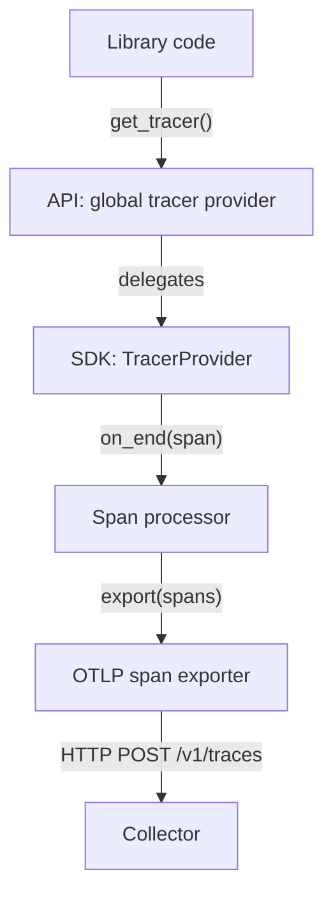

# API And SDK As Separate Packages

A web framework, a database driver and your own business code can all create spans. If each of them also picked an exporter, a sampling rate and a destination, one process would hold many competing telemetry pipelines and nobody could change the policy in one place. OpenTelemetry avoids this by splitting the project into two layers: the API, which instrumented code calls, and the SDK, which the application installs to decide what happens to the data.

## The two layers

The **API** (Application Programming Interface) is a set of interfaces and a few safe defaults. It lets code ask for a tracer, a meter or a logger, and then create spans, record measurements or emit log records. The API contains no exporter, no sampler and no network code. In Python it is the package `opentelemetry-api`, which provides modules such as `opentelemetry.trace`, `opentelemetry.metrics` and `opentelemetry.propagate`.

The **SDK** (Software Development Kit) is one implementation of those interfaces. It holds the providers, the processors, the readers, the samplers and the exporters. In Python it is the package `opentelemetry-sdk`, plus exporter packages such as `opentelemetry-exporter-otlp-proto-http`. The SDK depends on the API. The API never depends on the SDK.

That one-way dependency is the whole design. A library that imports only the API compiles and runs whether or not an SDK exists. An application that wants telemetry adds the SDK once, at start-up, and every library in the process uses it.

## The call path

The next diagram shows what happens when instrumented code starts a span. Read it from the top: the library talks to the API, the API hands the call to whatever provider the application registered, and the SDK pipeline moves the finished span to the Collector.



The diagram shows that the library only touches the first box. The provider, the processor and the exporter belong to the application, and the Collector is a separate process.

## A worked example from the shuttle service

The `shuttle` service in the playground is one Python file with two clearly separated parts. The function `plot_course` is the library part. It calls `trace.get_tracer("starfleet.navigation", "1.0.0")` and `metrics.get_meter("starfleet.navigation", "1.0.0")`, starts a span called `plot-course` and records a counter and a histogram. It never mentions an endpoint, a sampler or an exporter.

The function `configure_sdk` is the application part. It builds a `Resource`, a `TracerProvider`, a `MeterProvider` and a `LoggerProvider`, adds a span processor, a metric reader and a log record processor, and registers each provider as the global one with `trace.set_tracer_provider`, `metrics.set_meter_provider` and `set_logger_provider`. The endpoint, the protocol, the sampler and the export interval come from `OTEL_*` environment variables, so the code does not change when the configuration changes.

Start by looking at the playground. The next step resets the playground timer, and then lists the import lines and function names of the application file, which Kubernetes stores in the ConfigMap `shuttle-app`.

<!-- astrona:playground:renew -->

```sh
kubectl -n starfleet get configmap shuttle-app -o jsonpath='{.data.app\.py}' | grep -n "^from opentelemetry\|^def "
```

The top-level imports at the start of the file are API modules (`trace`, `metrics`, `propagate` and `_logs`). SDK modules are imported only inside `configure_sdk`. The two packages are also separate in the container. Ask `pip` what each package needs:

```sh
kubectl -n starfleet exec deploy/shuttle -- pip show opentelemetry-api opentelemetry-sdk
```

For each package `pip show` prints a `Requires:` line. The `opentelemetry-sdk` line lists `opentelemetry-api`. The `opentelemetry-api` line does not list `opentelemetry-sdk`. That is the one-way dependency from the previous section, read from the installed metadata.

## Which component does what

When something is missing from the telemetry, the first question is which layer failed. The layers have separate owners and separate failure signs.

- The **library** creates observations. If the library never calls the API, nothing exists to export.
- The **API** forwards each call to the registered provider. If no provider is registered, it forwards to a no-op implementation.
- The **SDK providers** create real spans, instruments and log records and attach the resource and the instrumentation scope.
- The **processors and readers** decide when data leaves the process. The **exporter** serialises it and sends it with the chosen protocol.
- The **Collector** receives the data. In the playground it prints every item to its own log through the `debug` exporter.

Look at the last link of the chain. The Collector log shows what arrived, including the resource and the scope that the SDK attached:

```sh
kubectl -n starfleet logs deploy/collector --since=60s | grep -m 6 "service.name\|InstrumentationScope\|telemetry.sdk"
```

You should see lines for `service.name`, the three `telemetry.sdk.*` attributes and an `InstrumentationScope` line with `starfleet.navigation`. The service name comes from the SDK resource. The scope name comes from the string the library passed to `get_tracer`. The SDK version attributes come from the installed `opentelemetry-sdk` package.

## Why the scope name matters

Every tracer, meter and logger belongs to an **instrumentation scope**: a name, and optionally a version, that identifies the code that produced the data. The library chooses the scope name when it calls `get_tracer`. By convention the name is the library's own package or module name, so that an operator can tell the data of the HTTP client from the data of the database driver.

The scope is the only identity a reusable library gives to its telemetry. The service name, the environment and the other resource attributes belong to the application, because the same library runs inside many different services. This is another reason the API stays free of deployment settings: the library cannot know them.

## What goes wrong when the layers mix

Three mistakes appear again and again. A library that depends on the SDK forces its version and its configuration on every application that uses it. A library that calls `trace.set_tracer_provider` replaces the provider the application installed; the API allows the global provider to be set only once, so the second call is ignored and logs a warning, and which call wins depends on import order. An application that installs two different SDK stacks splits its data across two pipelines with different resources.

The rule that follows is simple. Libraries import the API and obtain tracers and meters lazily. Applications install the SDK once, in one place, as early as possible, before the libraries create their first span.

## What you know now

You can name the two layers, say which one a library may import, and trace a span from `get_tracer` to the Collector. You also know how to read the installed packages and the Collector log to prove which layer produced a piece of data. The open question is what the API does when the application never installs an SDK at all, and that is the next topic.

## Common pitfalls

> [!WARNING]
> Do not add the SDK package to a reusable library; depend on the API only. Do not call a `set_*_provider` function from library code, because the global provider can be set only once and the first caller wins. Do not assume that an exporter error means the instrumentation is wrong: check the layer that failed before you change code.
