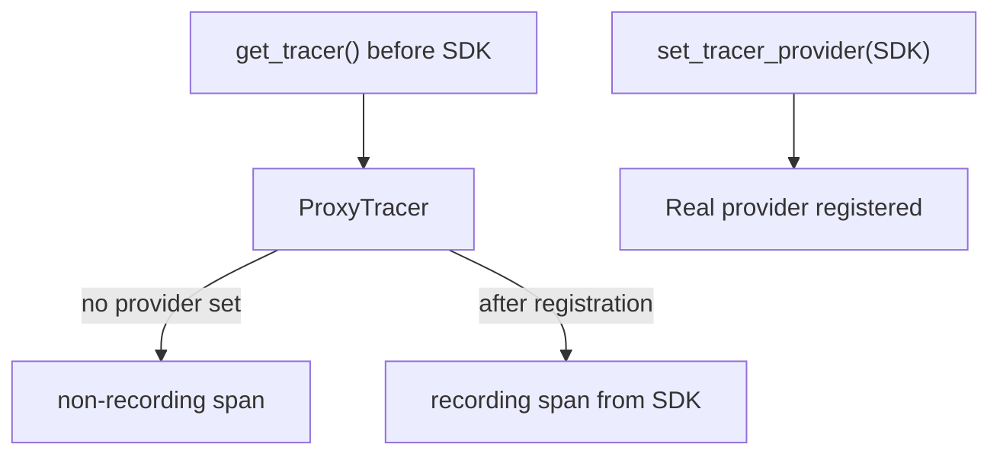

# The No-op API And Disabled SDKs

A library that creates spans must never crash, slow down or print errors because the application chose not to collect telemetry. The OpenTelemetry API solves this with a **no-op implementation**: a set of tracers, meters and loggers whose methods accept every call and do nothing. This chapter shows when the no-op implementation is active, how it hands over to a real SDK, and how `OTEL_SDK_DISABLED` switches a configured SDK back to no-op behaviour.

## What the API returns before an SDK exists

When the process starts, the API holds a default global provider. In Python the default tracer provider is a `ProxyTracerProvider`. A call to `trace.get_tracer(...)` returns a `ProxyTracer`. When that tracer starts a span, it looks for a real provider. If none is registered, it returns a non-recording span with an invalid span context. The call succeeds, costs very little and produces nothing.

The same pattern holds for metrics and logs. `metrics.get_meter(...)` returns a meter whose instruments accept `add` and `record` calls without storing anything. The specification calls this behaviour the no-op API, and every language implementation must provide it.

The proxy has one more job. Libraries often fetch a tracer at import time, before the application has configured the SDK. The proxy tracer remembers the request. After the application registers a real provider, the proxy delegates new spans to a real tracer. Code that obtained its tracer early therefore starts producing data as soon as the SDK appears, with no change in the library.



The diagram shows that the same tracer object changes behaviour when a provider is registered. Spans started before registration stay non-recording; spans started afterwards are recorded.

## Seeing the no-op API in the playground

The `shuttle` application has a switch of its own, `SHUTTLE_CONFIGURE_SDK`. When it is `false`, the application skips `configure_sdk`, so only the API is active. The next step resets the playground timer, turns the switch off and waits for the new pod. The Deployment uses the `Recreate` strategy, so the old pod stops before the new one starts, and the start takes a while because the pod installs the packages with `pip`.

<!-- astrona:playground:renew -->

```sh
kubectl -n starfleet set env deploy/shuttle SHUTTLE_CONFIGURE_SDK=false
kubectl -n starfleet rollout status deploy/shuttle --timeout=300s
```

The application prints one line at start-up that starts with `[shuttle] pipeline:`. Read it:

```sh
kubectl -n starfleet logs deploy/shuttle | grep "pipeline:"
```

The line now contains `tracer_provider=ProxyTracerProvider` and `tracer=ProxyTracer`. Both names are classes of the API package, not of the SDK. The application keeps running its loop, and the `plot_course` function keeps calling the API without any error. The next command shows what the Collector received in the last minute:

```sh
kubectl -n starfleet logs deploy/collector --since=60s | grep -c "starfleet.navigation"
```

The count is `0`. The code ran, the API accepted every call, and no data left the process because no SDK was registered. This is the correct behaviour of the no-op API, and it is also the most common explanation for the complaint "my service sends nothing".

## What `OTEL_SDK_DISABLED` changes

The specification defines the environment variable `OTEL_SDK_DISABLED`. When its value is `true`, the SDK must behave as a no-op implementation, even though the application installed it. The variable is case-insensitive in the Python SDK, and any other value, including an empty string, leaves the SDK enabled.

The difference to the previous case is where the decision happens. With `SHUTTLE_CONFIGURE_SDK=false`, the application never creates providers. With `OTEL_SDK_DISABLED=true`, the application creates the providers and registers them, and the SDK providers return no-op tracers, meters and loggers when asked. Turn the application switch back on and disable the SDK instead:

```sh
kubectl -n starfleet set env deploy/shuttle SHUTTLE_CONFIGURE_SDK=true OTEL_SDK_DISABLED=true
kubectl -n starfleet rollout status deploy/shuttle --timeout=300s
kubectl -n starfleet logs deploy/shuttle | grep "pipeline:"
```

Now the line shows `tracer_provider=TracerProvider`, which is the SDK class, but `tracer=NoOpTracer`. The provider exists, and it hands out a no-op tracer on purpose. Remove the variable to enable the SDK again and check the line once more:

```sh
kubectl -n starfleet set env deploy/shuttle OTEL_SDK_DISABLED-
kubectl -n starfleet rollout status deploy/shuttle --timeout=300s
kubectl -n starfleet logs deploy/shuttle | grep "pipeline:"
```

The tracer class is now `Tracer`, the SDK tracer. Within a few seconds the Collector log shows spans with the scope `starfleet.navigation` again.

## Why the disabled mode exists

Operators use `OTEL_SDK_DISABLED=true` to turn telemetry off without rebuilding or redeploying different code: during an incident where the export path is suspected, in a test environment, or in a batch job where telemetry is not wanted. The application code, the library code and the packages stay the same. Only the environment changes.

Disabling has limits. It stops recording inside the SDK, but it does not remove the instrumentation calls, and it does not remove the cost of importing the packages. It also does not change what other tools in the same container do. The Collector, an agent or a sidecar keeps running on its own settings.

## No-op spans and context

A non-recording span is not the same as no span at all. The API still keeps a current context, so code can read the current span and call methods on it. The span context of a no-op span is invalid, which means it has no trace identifier and no span identifier. A propagator that injects the context of an invalid span writes no `traceparent` header, so a downstream service starts its own trace.

The lesson for library authors is to treat every span method as optional work. Setting an attribute or recording an exception on a no-op span is allowed and does nothing. A library should never check whether an SDK exists before it calls the API, because that check would couple it to the application's setup.

## What you know now

You know that the API is safe to call with no SDK, that a proxy tracer upgrades itself when a provider is registered, and that `OTEL_SDK_DISABLED=true` makes a configured SDK hand out no-op components. You can tell the two cases apart by the class names in the start-up line. The open question is how long the API and the SDK stay compatible with each other, which depends on the stability rules of each package.

## Common pitfalls

> [!WARNING]
> Do not treat an empty Collector as proof that the exporter is broken: first check whether an SDK is registered and whether `OTEL_SDK_DISABLED` is `true`. Only the exact value `true` disables the SDK, so `1`, `yes` and `on` do nothing. A tracer fetched before the SDK is registered still records after registration, but spans started earlier are lost.
