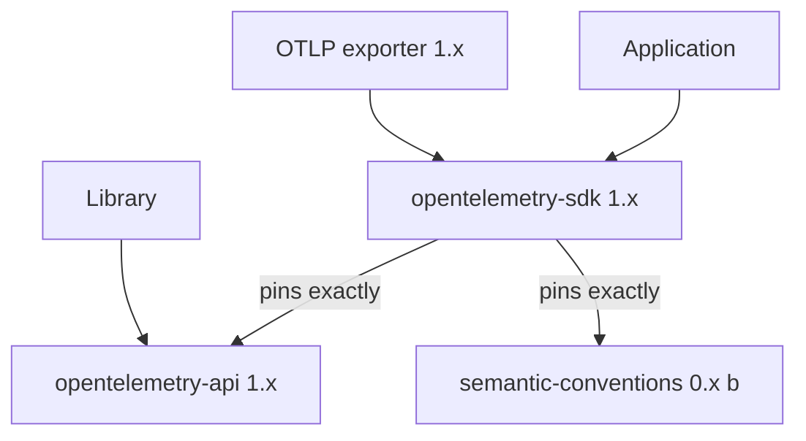

# API Packages, Stability And Versioning

An application upgrades the SDK on its own schedule, and a library upgrades the API on another schedule. Both must keep working together in one process. OpenTelemetry makes this possible with stability rules: a stable interface does not break within a major version, and an experimental interface may change in any release. This chapter reads those rules from the packages that run in the playground and explains which dependency choices they allow.

## Stability is a property of each signal and each layer

The specification gives every signal and every component a **status**. The main statuses are Experimental, Stable and Deprecated. A Stable status means that the project promises backward compatibility for the public interface within a major version. An Experimental status means that the interface can change, and that a release can break code that uses it. Deprecated means the interface still works but will be removed later.

The API and the SDK of one signal are versioned as two separate things. The tracing API can be Stable while a detail of the SDK, such as a configuration option, is still being defined. The promise to application owners is that code written against a stable API keeps compiling and running when the SDK underneath changes, because the SDK is only allowed to change inside the rules of the API contract.

A third kind of package follows its own rules. **Semantic conventions** define attribute names such as `http.request.method` and `service.name`. They are published as a separate versioned document and, in Python, as the package `opentelemetry-semantic-conventions`. Their stability is tracked per group of attributes, so one group can be Stable while another is still Experimental.

## How the Python packages show it

Python makes the split visible in version numbers. The API, the SDK and the OTLP exporters have versions that start with `1`, such as `1.45.2`. Those packages are marked Production/Stable. The semantic conventions package and most contributed instrumentation have versions with a `b`, such as `0.66b2`. The `b` means beta, so those packages can change between releases.

The release process publishes the API and the SDK together with the same number. The SDK package pins the API exactly. That pin is the practical rule for applications: install the API and the SDK at the same version and upgrade both in one step. The packages in the playground follow this rule, because the container installs `opentelemetry-sdk` and `opentelemetry-exporter-otlp-proto-http` at the same version.



The diagram shows that the library depends on the API only, while the application's SDK and exporter stack points at the same API version and at a beta conventions package.

## Reading the versions in the playground

The next step resets the playground timer and prints the exact dependency lines of the SDK package.

<!-- astrona:playground:renew -->

```sh
kubectl -n starfleet exec deploy/shuttle -- pip show opentelemetry-sdk
```

Find the `Version:` line and the `Requires:` line. The SDK requires the API package and the semantic conventions package. List every installed OpenTelemetry package with its version to see which ones are stable `1.x` packages and which ones are beta packages:

```sh
kubectl -n starfleet exec deploy/shuttle -- pip list 2>/dev/null | grep -i opentelemetry
```

The Collector reports the SDK version that produced the data, so the running system and the packages agree. The resource of every batch has the attributes `telemetry.sdk.language`, `telemetry.sdk.name` and `telemetry.sdk.version`:

```sh
kubectl -n starfleet logs deploy/collector --since=60s | grep -m 3 "telemetry.sdk"
```

The value of `telemetry.sdk.version` is the version of `opentelemetry-sdk`, not the version of the Collector. The Collector is a separate program with its own version, and the Deployment names it in the image tag:

```sh
kubectl -n starfleet get deploy collector -o jsonpath='{.spec.template.spec.containers[0].image}{"\n"}'
```

Keep the two numbers apart. A telemetry SDK version describes the code inside the application. A Collector version describes the pipeline that receives the data, and its components have their own stability levels.

## What the stability rules allow you to do

Three practical rules follow from what you just read.

First, a library may declare a range for the API package and does not have to match the application's SDK version exactly. The API is stable, so a library built against an older `1.x` API runs on a newer `1.x` API. The application owner picks the SDK version, and the SDK pins the API that fits it.

Second, an application should not mix SDK versions between processes of the same trace without testing, but different SDK versions can interoperate on the wire. They do so because the wire formats are standards: the OTLP protocol for export and the W3C Trace Context header for propagation. The packages can differ, and the data they exchange stays compatible.

Third, an experimental interface needs a plan. The logs SDK in Python is imported from `opentelemetry.sdk._logs`, and the exporter module is `_log_exporter`. The leading underscore is a naming convention that tells the reader not to treat the module path as a final public interface. Code that uses it needs a pinned version and a test that runs on every upgrade.

## Stability of Collector components

The Collector has its own stability levels. Each receiver, processor, exporter and extension is marked as development, alpha, beta or stable for each signal it supports. The `debug` exporter and the `otlp` receiver used here are the components the playground depends on. Before you rely on a Collector component in a production pipeline, check its level for the signal you use, because a component can be stable for traces and beta for logs.

## Failure cases from version drift

Mixing an old API with a new SDK usually fails at install time, because the SDK pins the API. Forcing the install with a tool option can leave a process with two incompatible copies of the interfaces, which shows up as `AttributeError` or as telemetry that never leaves the process. Reading `pip show` output is the quickest check.

Upgrading a beta package, such as an instrumentation library or the semantic conventions, can rename an attribute. Dashboards and alert rules that use the old name stop matching, although the telemetry still arrives. Pin the beta packages, read the changelog before an upgrade and compare attribute names before and after in the Collector log.

## What you know now

You can read a stability status, tell a stable `1.x` package from a beta `0.x b` package, and find the SDK, API and semantic conventions versions in a running container. You also know that the telemetry SDK version and the Collector version are different numbers. The open question is how the SDK itself is built from components that you can replace, which decides what an application can change without touching library code.

## Common pitfalls

> [!WARNING]
> Do not install the SDK and the API at different versions or force a mismatched install. Do not pin an exporter to one version and the SDK to another by habit: upgrade the stable `1.x` packages together. Do not rely on an experimental module path or on a beta attribute name without a pinned version and a check after each upgrade.
