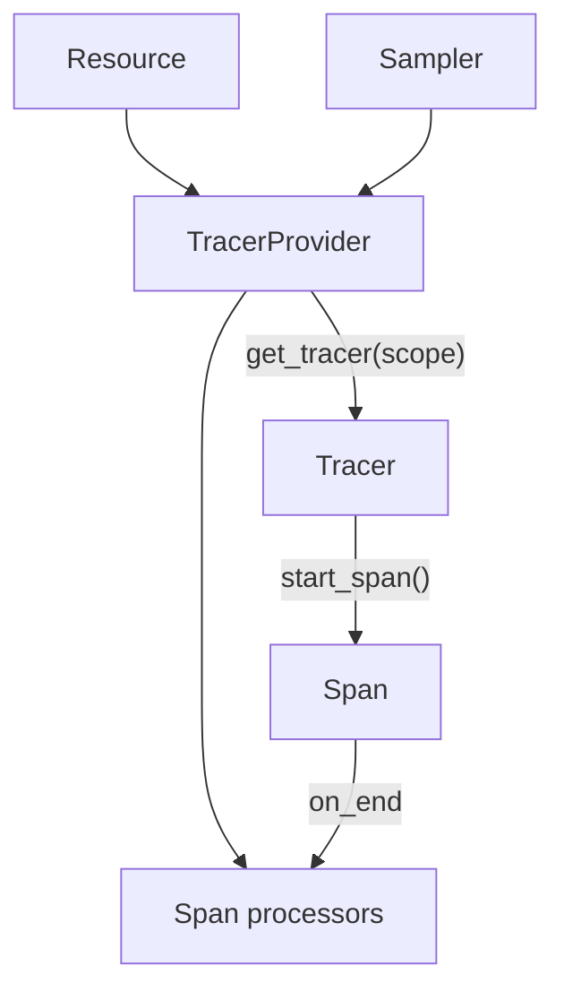

# Providers, Resources And Instrumentation Scope

Every piece of telemetry carries three kinds of identity: what produced it (the resource), which code created it (the instrumentation scope) and which signal it belongs to. The SDK attaches all three in one place, the provider. If you understand what the provider owns, you can explain most questions of the form "why does my data show the wrong service name?" without opening a backend.

## What a provider owns

A **provider** is the SDK object that creates the signal objects and holds their shared configuration. There is one provider type per signal: the `TracerProvider` creates tracers, the `MeterProvider` creates meters and the `LoggerProvider` creates loggers. The application creates each provider once and registers it as the global provider through the API.

A provider holds four things. First, the **resource**. Second, the pipeline: span processors for traces, metric readers for metrics, log record processors for logs. Third, policy objects such as the sampler for traces. Fourth, the lifecycle: the provider can flush buffered data and shut down.

Library code never sees these objects. It calls `trace.get_tracer(name, version)` through the API, and the global provider answers with a tracer that already knows the resource and the pipeline. Two tracers from the same provider share the same resource and the same processors.



The diagram shows that the resource, the sampler and the processors are properties of the provider, and that a tracer only adds the instrumentation scope.

## The resource

A **resource** is a set of attributes that describes the entity producing the telemetry: the service, its version, the host, the container or the Kubernetes pod. The resource is the same for every span, metric and log record that one provider creates. That is why attributes such as `service.name` live there and not on each span.

The Python SDK builds the resource with `Resource.create`. It merges three sources. The SDK adds the `telemetry.sdk.*` attributes (language, name and version). The environment variable `OTEL_RESOURCE_ATTRIBUTES` adds comma-separated `key=value` pairs, such as `deployment.environment.name=playground`. The variable `OTEL_SERVICE_NAME` sets `service.name`, and it wins over a `service.name` pair in `OTEL_RESOURCE_ATTRIBUTES`.

When nothing sets a service name, the SDK uses a default that starts with `unknown_service`, followed by the name of the process executable. In the playground that is a Python process, so the default value is `unknown_service:python`. Backends group data by service name, so this default hides the real owner of the data. The specification requires the default on purpose: it makes the missing name visible.

The `shuttle` application calls `Resource.create({})` once and passes the same resource to all three providers. Logs, metrics and spans from one process therefore agree on their identity.

## The instrumentation scope

The **instrumentation scope** names the code that produced the data. It is a name, an optional version and optional attributes, and the library passes them to `get_tracer`, `get_meter` or `get_logger`. In the Collector log the scope appears next to the data it describes: `ScopeSpans` and `InstrumentationScope starfleet.navigation 1.0.0` for spans, and the matching lines for metrics and log records.

Scope and resource answer different questions. The resource says which service instance sent the data. The scope says which library inside that instance created it. A service with an HTTP client library and a database library shows one resource and two scopes.

## Changing the resource in the playground

Start with the running service and read what the Collector received. The next step resets the playground timer, and then prints the resource lines and the scope line from the last minute of Collector output.

<!-- astrona:playground:renew -->

```sh
kubectl -n starfleet logs deploy/collector --since=60s | grep -m 6 "service.name\|deployment.environment\|InstrumentationScope"
```

The resource attributes show `service.name` with the value `shuttle` and the `deployment.environment.name` attribute with the value `playground`. Now change the resource only through environment variables. Set a new service name and a second attribute, and wait for the new pod:

```sh
kubectl -n starfleet set env deploy/shuttle OTEL_SERVICE_NAME=shuttle-nav OTEL_RESOURCE_ATTRIBUTES=deployment.environment.name=playground,starfleet.crew=alpha
kubectl -n starfleet rollout status deploy/shuttle --timeout=300s
```

The application code did not change. Run the first command again, with a pattern for the new attribute. Use `--since=40s` so that lines of the old pod are not included:

```sh
kubectl -n starfleet logs deploy/collector --since=40s | grep -m 4 "service.name\|starfleet.crew"
```

The service name is now `shuttle-nav` and the extra attribute is present. The Collector may still print a few older batches from the previous pod, so read the newest lines. Remove the service name to see the default:

```sh
kubectl -n starfleet set env deploy/shuttle OTEL_SERVICE_NAME-
kubectl -n starfleet rollout status deploy/shuttle --timeout=300s
kubectl -n starfleet logs deploy/collector --since=40s | grep -m 2 "service.name"
```

When the pod is new, the value is `unknown_service:python`. Set `OTEL_SERVICE_NAME=shuttle` again before you continue, so the playground returns to its normal state.

## Lifecycle: flush and shutdown

A provider buffers data. The batch span processor holds finished spans in a queue until its timer fires, and the periodic metric reader exports on an interval. Two calls control the buffers. `force_flush` exports what is queued now and returns. `shutdown` flushes, stops the processors and the exporters, and makes later calls fail or do nothing.

The Python `TracerProvider` registers a shutdown call to run when the interpreter exits, unless the application passes `shutdown_on_exit=False`. A short-lived program, such as a batch job or a command-line tool, must reach shutdown or call `force_flush` itself. If the process is killed, data in the queue is lost. A long-running service such as the `shuttle` rarely notices the difference, because its timer fires every few seconds.

## What you know now

You can say what a provider owns, where the resource comes from, how `OTEL_SERVICE_NAME` and `OTEL_RESOURCE_ATTRIBUTES` combine, and why `unknown_service` appears. You can also separate resource identity from instrumentation scope and explain why short-lived processes must flush. The open question is what happens to a finished span between the provider and the network, which depends on the processor and the exporter.

## Common pitfalls

> [!WARNING]
> Do not put deployment settings in library code: the library cannot know the service name or the environment. Do not create a second provider in the same process by accident, because its data has its own resource and its own pipeline. A new service name appears only after the pod restarts, because the resource is built once at start-up.
