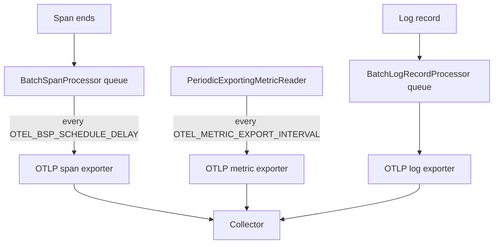

# Processors, Readers And Exporters

Between the moment a span ends and the moment the Collector prints it, three SDK components act in order: a processor decides when the span moves on, an exporter serialises it and sends it, and a transport carries the bytes. Metrics and logs have their own versions of the same chain. Knowing the contract of each component tells you which one to tune when data arrives late, arrives in bursts or does not arrive.

## Span processors

A **span processor** is a component that the tracer provider calls at two moments of a span's life. It calls `on_start(span, parent_context)` when the span starts and `on_end(span)` when it ends. It also calls `force_flush(timeout_millis)` and `shutdown()` on the lifecycle calls of the provider. Processors run in the order in which the application added them, and each processor sees every span.

The SDK ships two processors that send data to an exporter. The `SimpleSpanProcessor` calls the exporter inside `on_end`, once for every ended span, on the thread that ended the span. It is easy to reason about and it is only suitable for tests and debugging, because a slow exporter slows the application. The `BatchSpanProcessor` puts ended spans into a queue and returns at once. A background thread exports batches, so the cost to the application is one queue insert.

The batch processor has four settings, and each has a standard environment variable:

- `OTEL_BSP_SCHEDULE_DELAY`: milliseconds between two exports. The default is 5000.
- `OTEL_BSP_MAX_QUEUE_SIZE`: spans held in the queue. The default is 2048. When the queue is full, new spans are dropped.
- `OTEL_BSP_MAX_EXPORT_BATCH_SIZE`: spans in one export call. The default is 512.
- `OTEL_BSP_EXPORT_TIMEOUT`: milliseconds one export may take. The default is 30000.

The queue is the safety valve. If the exporter is slow or fails, the queue grows until it is full, and then the processor drops new spans instead of blocking the application. This is intended behaviour, and it means that dropped data is a possible outcome of a bad export path.

## Metric readers and log record processors

Metrics use a different component. A **metric reader** collects the current aggregated values from the meter provider and gives them to an exporter. The `PeriodicExportingMetricReader` does this on a timer, which is a push model. The interval comes from `OTEL_METRIC_EXPORT_INTERVAL` in milliseconds, with a default of 60000, and the timeout from `OTEL_METRIC_EXPORT_TIMEOUT`, with a default of 30000. A pull-based reader, such as a Prometheus reader, collects when a scrape request arrives.

A metric reader cannot replace a span processor, and the reverse is also true. They plug into different providers and have different methods. Spans are discrete events that a processor sees one by one. Metrics are aggregates that a reader collects on demand.

Logs use a **log record processor**. The `BatchLogRecordProcessor` queues log records and exports them in batches, and its settings are `OTEL_BLRP_SCHEDULE_DELAY`, `OTEL_BLRP_MAX_QUEUE_SIZE`, `OTEL_BLRP_MAX_EXPORT_BATCH_SIZE` and `OTEL_BLRP_EXPORT_TIMEOUT`.



The diagram shows three independent chains that end at the same Collector. A change to the span timer does not change the metric or the log chain.

## Exporters and the OTLP endpoint

An **exporter** turns SDK data into a wire format and sends it to a destination. Its contract is small: `export(batch)` returns a result that says success or failure, and `shutdown()` releases resources. The exporter does not decide when to export. The processor or the reader decides that.

The standard exporter speaks **OTLP** (the OpenTelemetry Protocol). OTLP has three transports: gRPC, HTTP with protobuf bodies and HTTP with JSON bodies. The variable `OTEL_EXPORTER_OTLP_PROTOCOL` selects one with the values `grpc`, `http/protobuf` and `http/json`. The variable `OTEL_EXPORTER_OTLP_ENDPOINT` names the destination. For the HTTP transports, the SDK appends the signal path to the endpoint, which gives `/v1/traces`, `/v1/metrics` and `/v1/logs`.

The Collector in the playground listens on port 4317 for gRPC and on port 4318 for HTTP. The `shuttle` application installs the `opentelemetry-exporter-otlp-proto-http` package, so its protocol is `http/protobuf` and its endpoint must use port 4318. A port or protocol that does not match gives a connection that opens but a request the server cannot read.

## Observing the processors in the playground

First, make the processor visible. The application reads the application-specific variable `SHUTTLE_SPAN_PROCESSORS` and builds the span processors in the order of the list. The next step resets the playground timer, switches to the simple processor and waits for the new pod.

<!-- astrona:playground:renew -->

```sh
kubectl -n starfleet set env deploy/shuttle SHUTTLE_SPAN_PROCESSORS=simple
kubectl -n starfleet rollout status deploy/shuttle --timeout=300s
```

With the simple processor, each span is exported when it ends. The Collector now receives one request for every ended span, so the child span `calculate-jump` and its parent `plot-course` arrive in separate requests. Count the lines that mention `plot-course` in the last half minute:

```sh
kubectl -n starfleet logs deploy/collector --since=30s | grep -c "plot-course"
```

Switch back to the batch processor and slow its timer down to ten seconds, so the effect is easy to see:

```sh
kubectl -n starfleet set env deploy/shuttle SHUTTLE_SPAN_PROCESSORS=batch OTEL_BSP_SCHEDULE_DELAY=10000
kubectl -n starfleet rollout status deploy/shuttle --timeout=300s
```

The Collector log now shows the spans in bursts, about ten seconds apart, and each burst contains several `plot-course` spans. The application loop is unchanged. Only the processor moved the export from the span end to the timer.

## A failing export path

Now break the exporter. Point the endpoint at the gRPC port, while the protocol stays HTTP:

```sh
kubectl -n starfleet set env deploy/shuttle OTEL_EXPORTER_OTLP_ENDPOINT=http://collector.starfleet.svc.cluster.local:4317
kubectl -n starfleet rollout status deploy/shuttle --timeout=300s
kubectl -n starfleet logs deploy/shuttle --since=60s | grep -i "export\|fail\|error" | head -5
```

The application keeps running and keeps printing its own lines, because export errors are logged and not raised. The grep shows warnings from the SDK about the failed export, and the Collector stops receiving new data from this pod. The application is healthy while the telemetry is lost, which is why the export path needs its own check. Set the endpoint back to port 4318 before you continue.

## What you know now

You can tell a processor from a reader and an exporter, name the standard variables that tune each one, and predict what a full queue or a wrong port does. A failing exporter does not stop the application, and a batch processor drops spans when its queue is full. The open question is how to change the policy itself: which spans to keep, how context travels between services, and how to add your own components safely.

## Common pitfalls

> [!WARNING]
> Do not use the simple span processor in production services, because the application thread waits for the exporter. Do not set the endpoint and the protocol independently: HTTP uses port 4318 and gRPC uses port 4317 on the Collector. A healthy application and a clean exit do not prove that telemetry arrived.
