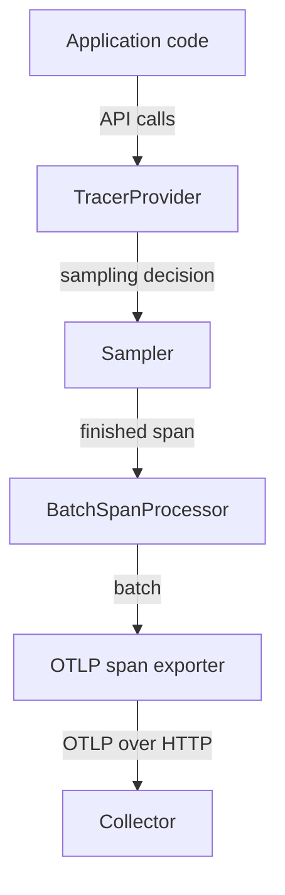

# How SDK Initialization Builds The Pipeline

An application that creates spans and metrics with the OpenTelemetry API produces nothing until somebody builds the machinery behind the API. That work is called SDK initialization. This part shows what initialization builds, in which order, and why a mistake here loses telemetry before any exporter setting matters.

## The API records nothing by itself

The OpenTelemetry API is the set of interfaces that application and library code calls: `trace.get_tracer(...)`, `tracer.start_as_current_span(...)`, `meter.create_counter(...)`. The API ships with a no-op implementation. A no-op (no operation) implementation accepts every call and does nothing with it. Instrumentation libraries can therefore call the API without knowing whether the application wants telemetry.

The SDK is the implementation of the API that records and exports data. It is a separate package: `opentelemetry-sdk` in Python. The application, and only the application, decides to install it. When the application registers an SDK provider as the global provider, every later API call goes to that provider instead of the no-op one.

## What initialization creates

A provider is the factory object of a signal. A `TracerProvider` creates tracers, and a `MeterProvider` creates meters. Each provider owns the settings of its signal: the resource, the sampler for traces, and the list of processors or readers that handle finished data.

Spans leave the process through a pipeline of three kinds of component:

1. The sampler decides when a span starts whether it is recorded.
2. A span processor receives every finished recorded span. The `BatchSpanProcessor` queues spans and sends them in groups.
3. A span exporter turns the group into a wire format and sends it. The OTLP exporter sends the OpenTelemetry Protocol (OTLP) to a Collector.

Metrics have a similar chain with different names. A metric reader collects the current values from the instruments. The `PeriodicExportingMetricReader` does this on a timer, and a metric exporter sends the result.



The diagram shows the trace path: the provider asks the sampler, hands recorded spans to the processor, and the exporter delivers batches to the Collector.

## Order matters

The application must register the provider before the instrumented work starts. A tracer that was fetched before registration is a proxy tracer. The API makes proxy tracers so that library code written at import time keeps working: once a provider is registered, the proxy forwards to it. A span that started before registration was created by the no-op tracer and is gone. Initialization cannot recreate it.

Initialization also happens once. The API allows setting the global tracer provider only one time. A second attempt logs a warning and keeps the first provider. If two parts of an application each build their own provider, the second one is silently unused unless the code passes it around by hand.

Here is the real initialization code of the `shuttle` service, shortened to the calls that build the trace pipeline:

```python
resource = Resource.create({})
tracer_provider = TracerProvider(resource=resource)
tracer_provider.add_span_processor(BatchSpanProcessor(OTLPSpanExporter()))
trace.set_tracer_provider(tracer_provider)
```

No endpoint, sampler or interval appears in this code. The constructors read them from environment variables, which the next part explains. The code decides which components exist, and the environment decides their settings.

## Seeing the pipeline run

The playground starts the `shuttle` service and the Collector. The service installs the OpenTelemetry packages with `pip` at start, so the pod needs about a minute before it prints its first line.

<!-- astrona:playground:renew -->

Wait for the service, then read its start-up lines:

```sh
kubectl -n starfleet rollout status deploy/shuttle --timeout=300s
kubectl -n starfleet logs deploy/shuttle --tail=6
```

The first lines start with `shuttle: resource` and `shuttle: sampler`. The service prints the resource attributes and the sampler description that the SDK built. Later lines start with `shuttle: run` and carry `recording=True` or `recording=False`, which is the answer of `span.is_recording()` for the span of that run.

The Collector receives the data and its `debug` exporter prints every span and metric. The Collector is a separate process, so it is the evidence of what left the application. Look for the span names:

```sh
kubectl -n starfleet logs deploy/collector --since=30s | grep -E 'Name +: (dock|scan)' | sort | uniq -c
```

You should see the span names `dock` and `scan`. Lines appear only when the SDK sampled the span, exported the batch and the Collector accepted it.

## What can be lost where

Each component can lose data for a different reason, and the evidence differs. A missing provider means the API calls hit the no-op implementation, so no span exists at all. A sampler that does not record means the span exists as a non-recording object that never reaches the processor. A full processor queue drops spans after they finished. An exporter that cannot deliver loses the batch after a timeout.

Knowing the order lets you ask the right question in the right place. If the service log says `recording=False`, the sampler removed the span, and no exporter change helps. If it says `recording=True` but the Collector shows nothing, look at the processor and exporter. Initialization is the first step of this chain, and it is the only step the application code controls directly.

This part showed what the SDK builds and where each setting lives. The open question is how the constructors find their settings when the code passes none, and what they do with a value they cannot read. The next part answers it.

## Common pitfalls

> [!WARNING]
> Registering the provider after the instrumented work starts loses the earlier spans without an error. Calling `set_tracer_provider` twice keeps the first provider. Installing the SDK package does not enable it: the application must create and register the providers.
