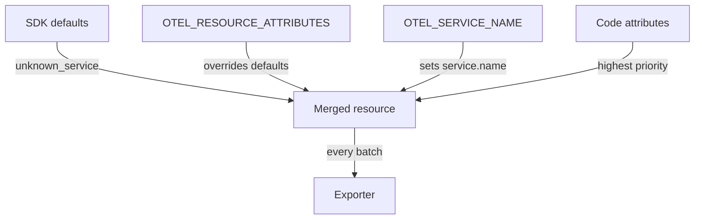

# Building The Resource

Every span and metric must say which service produced it. Without that, a backend cannot group telemetry, and an operator cannot tell the checkout service of production from the checkout service of a test cluster. The SDK carries this identity in the resource. This part explains what the resource holds, where its attributes come from and which source wins when two sources disagree.

## What a resource is

A resource is a set of attributes that describes the entity that produces telemetry: the service, the host, the container, the Kubernetes pod. The resource is created once at start-up and attached to every signal the provider exports. In OTLP, the resource appears once per batch, above the spans and metrics, and not on each span.

Resource attributes follow the semantic conventions, which are the agreed attribute names. These are the ones used in this section:

| Attribute | Meaning |
| --- | --- |
| `service.name` | Logical name of the service. Required. |
| `service.namespace` | Group of services that belong together. |
| `service.version` | Version of the deployed service. |
| `deployment.environment.name` | Environment such as `production` or `staging`. |
| `telemetry.sdk.name`, `telemetry.sdk.language`, `telemetry.sdk.version` | Added by the SDK itself. |

The SDK always adds the `telemetry.sdk.*` attributes. It also adds `service.name` when no source provides one, and the value is `unknown_service`. Some SDKs append the process name, so the value can look like `unknown_service:python`. A backend that shows `unknown_service` has received a resource with no configured name.

## The two environment variables

Two standard variables feed the resource. `OTEL_RESOURCE_ATTRIBUTES` holds comma-separated `key=value` pairs, for example `service.namespace=starfleet,service.version=2.4.1`. Keys and values must not contain unescaped commas or equals signs. The specification says to percent-encode such characters, so a comma inside a value is written as `%2C`.

`OTEL_SERVICE_NAME` sets only `service.name`. It exists because the service name is the one attribute every deployment needs, and a dedicated variable is simpler than a pair inside a list. When both variables set `service.name`, `OTEL_SERVICE_NAME` wins. The rule is in the specification, so every SDK follows it.

## Merging sources

The final resource is the merge of several sources. A resource detector is a component that finds attributes automatically, for example the host name, the operating system or the Kubernetes pod. The environment is itself a detector: it reads `OTEL_RESOURCE_ATTRIBUTES`. Code can also pass attributes by hand to `Resource.create(...)`.

When two sources set the same key, the specification gives the code-provided value higher priority than the value from the environment. In the `shuttle` service the code passes an empty set of attributes, so the environment decides the whole resource. If the code passed `service.name`, the environment variable would not change it, which is a common reason for "I set the variable and nothing changed".



The diagram shows the sources that feed the merged resource. Detectors are optional in many SDKs and the SDK documentation says which ones run by default.

## Reading the resource at the Collector

The Collector `debug` exporter prints the resource above each batch as lines that start with `-> `. Attribute values print with their type, for example `service.name: Str(shuttle)`. Use that text to check the identity that really arrived.

<!-- astrona:playground:renew -->

Read the resource attributes of the last batch:

```sh
kubectl -n starfleet logs deploy/collector --since=30s | grep -E 'service\.|deployment\.|telemetry\.sdk' | sort -u
```

The playground sets `service.namespace`, `service.version` and `deployment.environment.name` in `OTEL_RESOURCE_ATTRIBUTES` and `shuttle` in `OTEL_SERVICE_NAME`. You see those values and the three `telemetry.sdk` attributes that the SDK adds.

Now test the precedence. Add a conflicting `service.name` to the attribute list. The command sets one variable that holds three pairs, so keep the quotes:

```sh
kubectl -n starfleet set env deploy/shuttle OTEL_RESOURCE_ATTRIBUTES="service.name=shuttle-from-list,service.namespace=starfleet,service.version=2.4.1"
kubectl -n starfleet rollout status deploy/shuttle --timeout=300s
```

Wait about 20 seconds for fresh batches, then read the name again. The value is still `shuttle` because `OTEL_SERVICE_NAME` wins:

```sh
sleep 20; kubectl -n starfleet logs deploy/collector --since=15s | grep 'service.name' | sort -u
```

Remove the name variable and the list value takes over:

```sh
kubectl -n starfleet set env deploy/shuttle OTEL_SERVICE_NAME-
kubectl -n starfleet rollout status deploy/shuttle --timeout=300s
sleep 20; kubectl -n starfleet logs deploy/collector --since=15s | grep 'service.name' | sort -u
```

The name is now `shuttle-from-list`. Remove both variables in the same way and the Collector shows the `unknown_service` default, which is what a missing configuration looks like in a backend.

## A wrong list format

Pairs separated by a semicolon form one long pair. A value such as `deployment.environment.name=staging;service.version=2.4.0` gives the key `deployment.environment.name` the value `staging;service.version=2.4.0`, and `service.version` never appears. The service runs, the telemetry arrives and the identity is wrong. Only the resource lines at the Collector reveal it, so check them after every change to the identity.

A stable identity also matters for aggregation. A backend groups metrics by resource. If the version changes with each deployment, each version forms a separate series, which is useful for comparing releases. If the name changes by accident, the history of the service splits.

This part showed where the identity of a service comes from and which source wins. The module lab combines the environment parsing rules with the resource rules in one broken Deployment.

## Common pitfalls

> [!WARNING]
> `OTEL_SERVICE_NAME` overrides `service.name` in `OTEL_RESOURCE_ATTRIBUTES`, and attributes passed in code override both. Use commas, never semicolons. A missing name gives `unknown_service`, not an error. Check the resource at the Collector after every change, because the telemetry still arrives when the identity is wrong.
