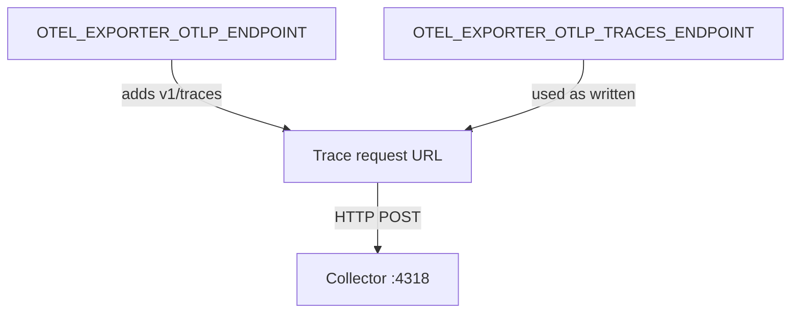

# Configuring The OTLP Exporter

A recorded span is useful only after it reaches a backend. The exporter does that work, and the most common configuration mistakes in an SDK happen here: a wrong port, a wrong protocol or a path that the SDK did or did not add. This part explains each exporter setting and what the receiving side must provide.

## OTLP and its two transports

The OpenTelemetry Protocol (OTLP) is the standard format for traces, metrics and logs. It has one data model and three transports. gRPC sends protobuf messages over HTTP/2, with the default port 4317. `http/protobuf` sends the same protobuf messages in the body of an HTTP POST request, with the default port 4318. `http/json` sends the JSON form of the messages over HTTP and is the least common.

`OTEL_EXPORTER_OTLP_PROTOCOL` selects the transport, with the values `grpc`, `http/protobuf` and `http/json`. The specification default is `http/protobuf`, and an SDK can choose another default, so set the variable explicitly when it matters. The variable names the transport. The code or distribution of the SDK must still ship an exporter for it. The Python service in the playground installs only the HTTP exporter, so its code refuses the value `grpc` and stops with a message.

A Collector listener accepts one transport. The `otlp` receiver of the playground opens two listeners: gRPC on 4317 and HTTP on 4318. An HTTP exporter that posts to port 4317 reaches a gRPC server that does not understand an HTTP/1.1 request, and the export fails. A gRPC exporter that calls port 4318 fails in the same way. A reachable address does not prove a compatible protocol.

## Endpoint and signal path

`OTEL_EXPORTER_OTLP_ENDPOINT` is a base URL such as `http://collector:4318`. For the HTTP transports the SDK appends a path per signal: `v1/traces`, `v1/metrics` or `v1/logs`. The Collector HTTP receiver serves exactly these paths. For gRPC the endpoint is a host and port, and the service name selects the signal.

Each signal can have its own endpoint, for example `OTEL_EXPORTER_OTLP_TRACES_ENDPOINT`. The specification says the SDK uses this value as written and adds no path. The value for traces must therefore be the complete URL, `http://collector:4318/v1/traces`. The value `http://collector:4318` sends the trace batch to the path `/`, and the Collector answers with an error. The same variable family has `..._METRICS_ENDPOINT` and `..._LOGS_ENDPOINT`, and a signal-specific variable wins over the general one for its signal.



The diagram shows that the signal-specific variable replaces the general one and that only the general one gets a path.

## Headers, compression and timeout

`OTEL_EXPORTER_OTLP_HEADERS` adds request headers, for example an API key. The format is comma-separated `key=value` pairs, so `x-starfleet-token=abc,x-region=eu` sets two headers. The signal-specific form `OTEL_EXPORTER_OTLP_TRACES_HEADERS` also exists. A header is a secret when it carries a token, so keep it out of a plain Deployment value, which anyone with read access can see. Kubernetes can fill the variable from a Secret with `valueFrom.secretKeyRef`, and the application sees the same variable.

`OTEL_EXPORTER_OTLP_COMPRESSION` takes `gzip` or `none`. Compression saves bandwidth at the cost of CPU, and the SDK chooses the default when the variable is unset.

`OTEL_EXPORTER_OTLP_TIMEOUT` is the maximum time for one export, in milliseconds. The specification default is ten seconds. The time covers the whole attempt including retries. A Collector that hangs makes each export take the full timeout, and the processor queue fills in the meantime.

TLS settings follow the URL scheme: an `https` endpoint uses TLS, and the variable `OTEL_EXPORTER_OTLP_CERTIFICATE` points at a trusted certificate file. The playground uses plain `http` inside the cluster.

## What the exporter does when delivery fails

The exporter runs in a background thread of the batch processor, so a failure never reaches the code that created the span. The exporter logs the failure and the batch is dropped or retried, depending on the error and on the SDK. The application keeps serving requests, which is the intended behavior, but it also means that nobody notices a broken exporter unless they read the application log or the Collector.

The same rule applies to the metric reader: it exports on its own timer and logs a failure. An HTTP status in the error text helps to find the layer. A connection error points at the address or the network. A 404 points at a wrong path. A 400 or a protocol error points at a transport that the listener does not speak.

## Trying the endpoint rules

The playground service starts with the HTTP endpoint on port 4318.

<!-- astrona:playground:renew -->

Point the general endpoint at the gRPC port and watch the Collector go quiet:

```sh
kubectl -n starfleet set env deploy/shuttle OTEL_EXPORTER_OTLP_ENDPOINT=http://collector:4317
kubectl -n starfleet rollout status deploy/shuttle --timeout=300s
```

The service keeps running and prints its `shuttle: run` lines, because exports happen in a background thread. Read the service log for export errors. The exact text depends on the SDK version, so search for the word `Failed`:

```sh
sleep 30; kubectl -n starfleet logs deploy/shuttle | grep -i -E 'failed|error|exception' | head -5
```

Spans no longer reach the Collector. Check the last half minute:

```sh
kubectl -n starfleet logs deploy/collector --since=30s | grep -Ec 'Name +: dock'
```

The count is zero. Restore port 4318, then add a signal-specific traces endpoint without the path:

```sh
kubectl -n starfleet set env deploy/shuttle OTEL_EXPORTER_OTLP_ENDPOINT=http://collector:4318 OTEL_EXPORTER_OTLP_TRACES_ENDPOINT=http://collector:4318
kubectl -n starfleet rollout status deploy/shuttle --timeout=300s
sleep 30; kubectl -n starfleet logs deploy/collector --since=30s | grep -E 'Name +: dock|Name: shuttle.docks' | sort | uniq -c
```

Metrics arrive because the general endpoint gets `v1/metrics`. Spans do not, because the traces endpoint is used as written. Set `OTEL_EXPORTER_OTLP_TRACES_ENDPOINT` to `http://collector:4318/v1/traces` and the spans return.

A Collector can also run as a node agent or a gateway. The exporter configuration is the same, and only the host changes. A Service name such as `collector` resolves inside the namespace, and a pod in another namespace needs `collector.starfleet`.

This part showed which exporter settings must match the receiving side. The open question is why spans can stay missing when delivery is correct. The next part covers the sampler.

## Common pitfalls

> [!WARNING]
> Port 4317 is gRPC and 4318 is HTTP, and a client of the wrong kind fails although the port is open. A signal-specific endpoint gets no `v1/traces` path from the SDK. Headers with tokens belong in a Secret. The timeout is in milliseconds.
