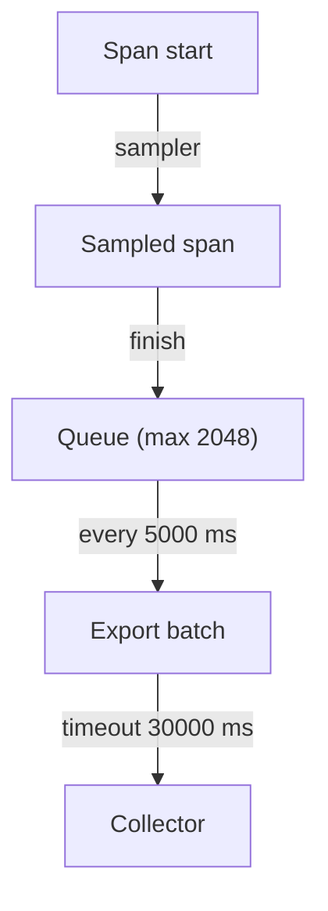

# Sampling And Export Intervals

Delivery settings decide how telemetry travels. Sampling and batching decide how much of it exists and when it leaves the process. A service that handles thousands of requests a second cannot export every span, and a service that exports too late loses data when it stops. This part explains the sampler, the batch span processor and the metric reader.

## What a sampler decides

A sampler is the component that decides, when a span starts, whether the SDK records it. The decision is made once, at span creation, from information that is available then: the trace identifier, the span name, the attributes and the parent. This is called head sampling, because the decision happens at the head of the trace, before the outcome is known.

A sampler returns one of three results. `DROP` creates a non-recording span: the object exists so the code can call it, but it stores nothing and the processor never sees it. `RECORD_ONLY` records the span but marks it not sampled, so it is not exported. `RECORD_AND_SAMPLE` records the span and marks it sampled, so the processor exports it. In the playground log, `recording=False` means the span is non-recording.

The sampled flag is part of the trace context that travels to the next service. A downstream service that honors the flag keeps the trace complete or drops it as a whole.

## The built-in samplers

`OTEL_TRACES_SAMPLER` takes one of these standard names, and the default is `parentbased_always_on`:

| Name | Decision |
| --- | --- |
| `always_on` | Sample every span. |
| `always_off` | Sample no span. |
| `traceidratio` | Sample a fixed fraction of traces, taken from the trace ID. |
| `parentbased_always_on` | Follow the parent; sample every root span. |
| `parentbased_always_off` | Follow the parent; sample no root span. |
| `parentbased_traceidratio` | Follow the parent; sample a fraction of root spans. |

`OTEL_TRACES_SAMPLER_ARG` carries the argument for the ratio samplers: a number from 0 to 1 such as `0.25`. A ratio sampler turns the trace ID into a number and compares it with the ratio. The result depends only on the trace ID, so every service that uses the same ratio makes the same decision for the same trace.

A parent-based sampler looks at the parent span first. A span with a sampled parent is sampled, and a span with an unsampled parent is dropped. It uses the configured root sampler only for spans without a parent. This keeps a trace consistent across services: the first service decides and the others follow. A plain `traceidratio` without a parent check can break a trace when services use different ratios.

The sampler applies to traces only. Metrics are aggregated in the SDK and have no sampler, and a sampled-out request still counts in a counter.

## Batching spans

The `BatchSpanProcessor` keeps finished sampled spans in a queue and exports them in groups. Four variables tune it:

| Variable | Default | Meaning |
| --- | --- | --- |
| `OTEL_BSP_SCHEDULE_DELAY` | 5000 ms | Time between two exports. |
| `OTEL_BSP_MAX_QUEUE_SIZE` | 2048 | Spans held in the queue. A full queue drops new spans. |
| `OTEL_BSP_MAX_EXPORT_BATCH_SIZE` | 512 | Spans in one export. It must not exceed the queue size. |
| `OTEL_BSP_EXPORT_TIMEOUT` | 30000 ms | Time allowed for one export call. |

A long delay lowers overhead and raises the time until a span is visible. A queue that is too small drops spans in a burst. A large queue postpones the loss and uses memory, and it does not repair a Collector that is down. Logs have the same set with the prefix `OTEL_BLRP_`.

## Reading metrics on a timer

The `PeriodicExportingMetricReader` collects the instruments and exports the result every `OTEL_METRIC_EXPORT_INTERVAL` milliseconds, with a default of 60000. `OTEL_METRIC_EXPORT_TIMEOUT` limits one export and defaults to 30000. A metric appears in the Collector at the next tick, so a 60-second interval makes a test with a fresh counter look empty for up to a minute.

A process that ends between ticks loses what it recorded since the last tick. Short-lived jobs must flush before exit: the provider methods `force_flush` and `shutdown` send the queued data. The batch processor also flushes at shutdown, but a process that is killed does not run it.



The diagram shows where each batch setting acts on a sampled span.

## Trying the sampler

Set the sampler to drop everything:

<!-- astrona:playground:renew -->

```sh
kubectl -n starfleet set env deploy/shuttle OTEL_TRACES_SAMPLER=always_off
kubectl -n starfleet rollout status deploy/shuttle --timeout=300s
```

Wait 30 seconds, then compare the service log with the Collector. The service prints `recording=False` for every run, the Collector shows no `dock` span, and the metric `shuttle.docks` still arrives:

```sh
sleep 30
kubectl -n starfleet logs deploy/shuttle | grep -c 'recording=False'
kubectl -n starfleet logs deploy/collector --since=30s | grep -E 'Name +: dock|Name: shuttle.docks' | sort | uniq -c
```

Now sample half of the root spans with a parent-based ratio:

```sh
kubectl -n starfleet set env deploy/shuttle OTEL_TRACES_SAMPLER=parentbased_traceidratio OTEL_TRACES_SAMPLER_ARG=0.5
kubectl -n starfleet rollout status deploy/shuttle --timeout=300s
```

After two minutes the service log has about as many `recording=True` as `recording=False` lines. A small sample is noisy, so do not expect exactly half:

```sh
sleep 120; kubectl -n starfleet logs deploy/shuttle | grep -o 'recording=[A-Za-z]*' | sort | uniq -c
```

Last, set an invalid sampler name such as `OTEL_TRACES_SAMPLER=half`. The SDK warns and falls back to the default `parentbased_always_on`, so every span is recorded again. A typo in a sampler name does not turn sampling off.

This part showed how the sampler and the batch settings bound the amount and timing of exported data. The next part adds the configuration file and a method to find the failed layer.

## Common pitfalls

> [!WARNING]
> A sampler that does not record leaves nothing to export, and no exporter setting repairs that. `traceidratio` needs an argument between 0 and 1 and ignores the parent. An unknown sampler name falls back to the default. Metrics are not sampled. A killed process loses the data in its queue.
