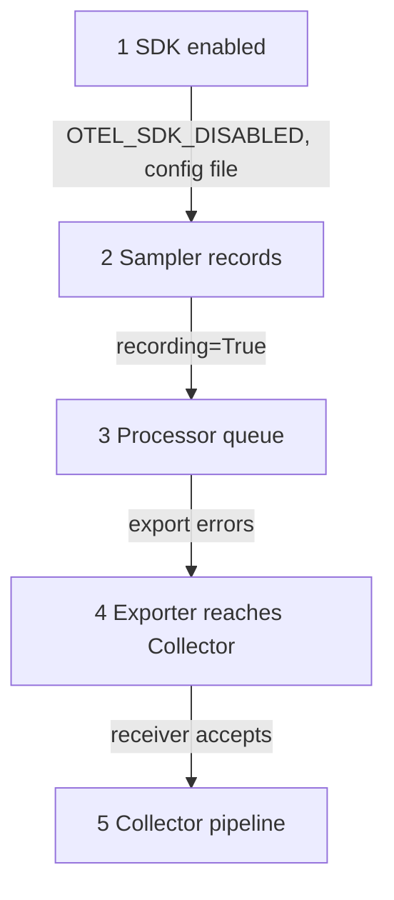

# Declarative Configuration And Failure Modes

Environment variables work well for a handful of scalar settings. They cannot describe a list of processors, several exporters or a sampler with nested rules. The OpenTelemetry project therefore defines a declarative configuration file. This part explains that file and then gives a method to find which configuration layer failed when a signal is missing.

## Why a configuration file

An environment variable holds one string. A pipeline with two span processors, one exporter for the Collector and one for a file, and a parent-based sampler with a ratio, needs structure. Programmatic configuration gives the structure but lives in the code of one language, so each language invents its own shape.

Declarative configuration is a language-neutral YAML file with one data model. The data model is defined as a JSON Schema in the `opentelemetry-configuration` project, and the SDK reads and validates the file at start. An operator writes the same structure for Java, Go or Python, and tools can check the file before it ships.

## The file and the environment variable

The standard variable `OTEL_CONFIG_FILE` holds the path of the file. The older name `OTEL_EXPERIMENTAL_CONFIG_FILE` is deprecated. The specification says that when `OTEL_CONFIG_FILE` is set, the SDK ignores the other SDK environment variables, such as `OTEL_TRACES_SAMPLER`, with one exception: variables that the file itself references through substitution.

That rule changes how you debug. A Deployment can have a correct `OTEL_EXPORTER_OTLP_ENDPOINT` that does nothing, because a file took over the configuration. The first question for any unexpected behavior is whether `OTEL_CONFIG_FILE` is set.

The file refers to environment variables with substitution: `${NAME}`, or `${NAME:-default}` for a default. Only scalar values are substituted, an undefined variable without a default becomes empty, and `$$` writes a literal dollar sign. This is how a file keeps secrets and per-environment values out of the file text.

## Shape of the file

The file starts with a format version field, `file_format`, followed by sections named after the parts of the SDK: the resource, the tracer provider with its sampler and processors, the meter provider with its readers, and the propagator. The snippet below is a sketch of that shape. The key names come from the configuration schema, and the exact keys and the `file_format` value depend on the schema version that your SDK supports, so read the SDK documentation before you write one.

```yaml
file_format: "1.0"
resource:
  attributes:
    - name: service.name
      value: shuttle
tracer_provider:
  processors:
    - batch:
        exporter:
          otlp_http:
            endpoint: ${OTEL_EXPORTER_OTLP_ENDPOINT:-http://collector:4318}/v1/traces
```

Compare it with the environment variables: the file expresses the same exporter endpoint and the same service name, but as nested data with a place for several processors. The Python SDK in the playground reads environment variables, so the playground does not use a file. Support for the file differs per language and per SDK version, and a language that does not support it ignores `OTEL_CONFIG_FILE`, which is why you check the documentation of the selected SDK.

## A method for a missing signal

When telemetry is missing, the failed layer is one of a few, and they come in a fixed order along the path of the data. Check them in that order and stop at the first one that explains the symptom.



The diagram shows the five layers from the application to the Collector pipeline. Layers 1 to 4 belong to the SDK configuration, and layer 5 is the Collector.

The table maps a symptom to a layer:

| Symptom | Likely layer |
| --- | --- |
| Nothing at all, no warning | SDK disabled or a no-op provider |
| Service log says `recording=False` | Sampler |
| Spans present, metrics missing | Metric reader interval or metrics endpoint |
| Metrics present, spans missing | Sampler or traces endpoint without path |
| Export error in the service log | Endpoint, protocol or network |
| Data arrives with the wrong name | Resource configuration |
| Everything arrives late | Batch delay or metric interval |

## Diagnosing a broken service

Use the playground to practice. The commands read the environment, the service log and the Collector log, in the order of the layers.

<!-- astrona:playground:renew -->

Break two settings at once. The command writes an unknown sampler value, which the SDK ignores, and the gRPC port as the endpoint:

```sh
kubectl -n starfleet set env deploy/shuttle OTEL_TRACES_SAMPLER=half OTEL_EXPORTER_OTLP_ENDPOINT=http://collector:4317
kubectl -n starfleet rollout status deploy/shuttle --timeout=300s
```

Layer 1: check the environment for a disabled SDK and a configuration file:

```sh
kubectl -n starfleet get deploy shuttle -o json | jq -r '.spec.template.spec.containers[0].env[] | select(.name | test("DISABLED|CONFIG_FILE")) | .name + "=" + .value'
```

The command prints nothing, so layer 1 is fine. Layer 2: ask the service whether spans are recorded.

```sh
kubectl -n starfleet logs deploy/shuttle | grep -E 'sampler|recording' | tail -3
```

The sampler line shows the default parent-based sampler, because the unknown name `half` was ignored, and the run lines show `recording=True`. Layer 2 is fine, and the fallback is the clue that the name was wrong. Layer 4: look for export errors and then the Collector:

```sh
kubectl -n starfleet logs deploy/shuttle | grep -i -E 'failed|error' | head -3
kubectl -n starfleet logs deploy/collector --since=30s | grep -Ec 'Name +: dock'
```

The service log shows export errors and the Collector count is zero, so the exporter cannot reach a compatible listener. Fix both settings and confirm the spans return:

```sh
kubectl -n starfleet set env deploy/shuttle OTEL_TRACES_SAMPLER=parentbased_always_on OTEL_EXPORTER_OTLP_ENDPOINT=http://collector:4318
kubectl -n starfleet rollout status deploy/shuttle --timeout=300s
```

Two faults hid each other here: the sampler name was wrong but harmless, and the endpoint was wrong and harmful. Fix one fault at a time, and always confirm with fresh telemetry at the Collector, not with the Deployment text.

This part closes the module: the SDK builds a pipeline, reads settings by fixed rules, takes its identity from the resource, and sends data through an exporter that must match the Collector. A file can replace the variables, and a fixed order of checks finds the layer that failed.

## Common pitfalls

> [!WARNING]
> When `OTEL_CONFIG_FILE` is set, the other SDK variables are ignored, so a correct variable can do nothing. A language that does not support the file ignores the variable. A configuration is proven by fresh telemetry at the Collector, not by the Deployment text. Two faults can hide each other, so change one setting at a time.
