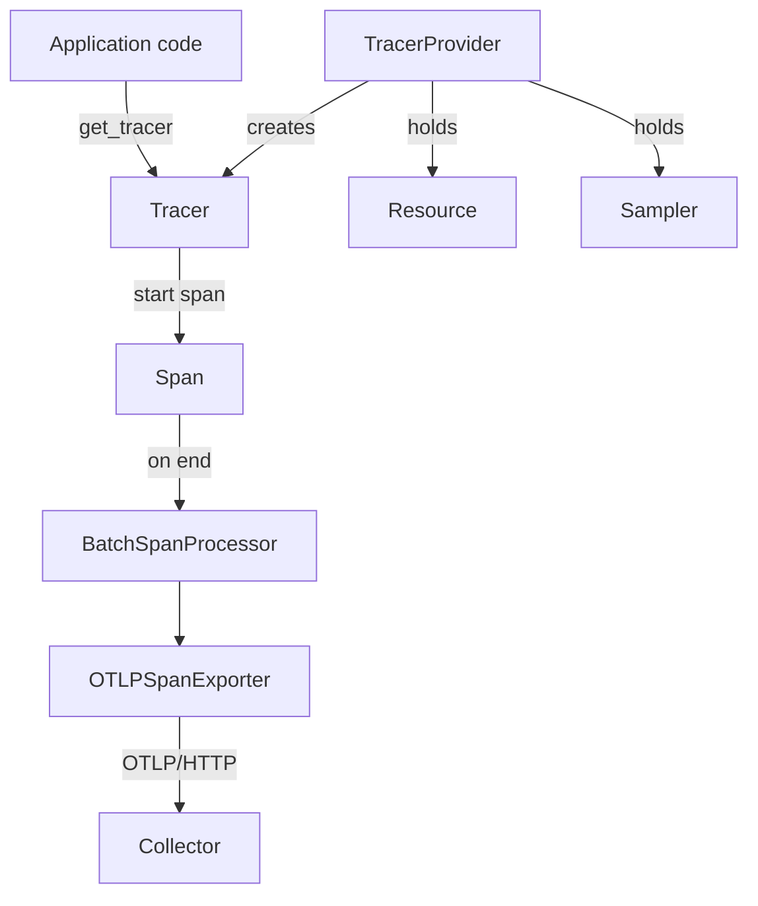

# The Tracer Provider, The Resource And The Tracer

A distributed trace follows one request through every service that handles it. Before any span exists, a program must decide three things: who is producing the telemetry, where the spans go, and which code object creates them. OpenTelemetry answers these with a `TracerProvider`, a `Resource` and a tracer. This part shows how they fit together and reads the first spans of the example application.

## The API and the SDK are two packages

OpenTelemetry splits tracing into two layers. The API (Application Programming Interface) is the set of classes and functions that application and library code calls: `trace.get_tracer`, `tracer.start_as_current_span` and `span.set_attribute`. The SDK (Software Development Kit) is the implementation that records spans, applies sampling and exports them. In Python the API is the package `opentelemetry-api` and the SDK is the package `opentelemetry-sdk`.

The split protects libraries. A library calls only the API. If the application never installs an SDK, the API returns no-op objects: the calls succeed, nothing is recorded and almost no time is spent. If the application installs the SDK and registers a provider, the same calls start to record spans. The library does not change.

The example application `shuttle` is a Python program in the `starfleet` namespace. It uses the SDK because it is the application, and the application owns the configuration. Its `app.py` starts with these lines:

```python
provider = TracerProvider()
provider.add_span_processor(BatchSpanProcessor(OTLPSpanExporter()))
trace.set_tracer_provider(provider)

tracer = trace.get_tracer("starfleet.shuttle", "1.0.0")
```

The next sections explain each of the four lines.

## The tracer provider owns the configuration

A `TracerProvider` is the SDK object that holds everything a trace needs to be produced: the resource, the sampler, the span processors and the limits for span attributes. The constructor `TracerProvider()` with no arguments takes its defaults from the environment. It reads `OTEL_TRACES_SAMPLER` for the sampler and `OTEL_RESOURCE_ATTRIBUTES` and `OTEL_SERVICE_NAME` for the resource.

`add_span_processor` attaches a span processor to the provider. A span processor receives every span when it starts and when it ends. Here the processor is a `BatchSpanProcessor`, which collects finished spans and hands them to an exporter in groups. The exporter `OTLPSpanExporter` sends the groups to the Collector with the OpenTelemetry Protocol (OTLP) over HTTP. It reads its destination from `OTEL_EXPORTER_OTLP_ENDPOINT`.

`trace.set_tracer_provider(provider)` registers the provider as the global provider. The API holds one global provider for the process, and it accepts the call only once. A second call logs a warning and keeps the first provider.



The diagram shows that the provider is the only object that knows the sampler and the resource, and that spans leave the process through the processor and the exporter.

## The resource names the producer

A `Resource` is a set of attributes that describe the entity producing the telemetry, not one request. Every span, metric and log record the provider emits carries the same resource. The most important attribute is `service.name`, because backends group and filter by it.

You rarely build the resource in code. `Resource.create` merges three sources: the SDK defaults (such as `telemetry.sdk.language`, `telemetry.sdk.name` and `telemetry.sdk.version`), the attributes in `OTEL_RESOURCE_ATTRIBUTES` (a comma-separated list of `key=value` pairs) and `OTEL_SERVICE_NAME`. `OTEL_SERVICE_NAME` wins over a `service.name` pair in the list. When nothing sets a service name, the SDK uses a name that starts with `unknown_service`. A backend then shows the telemetry under that placeholder, which is a configuration error to fix.

The Deployment of the `shuttle` sets `OTEL_SERVICE_NAME=shuttle` and `OTEL_RESOURCE_ATTRIBUTES=service.version=1.0.0,deployment.environment.name=playground`. Because the application reads the environment, you change its identity by editing the Deployment, with no code change.

## The tracer names the instrumentation

`trace.get_tracer("starfleet.shuttle", "1.0.0")` returns a tracer for one instrumentation scope. The first argument is the name of the library or module that creates the spans, and the second is its version. This is not the service name. One service can have many scopes: the application code, an HTTP client library and a database driver each use their own tracer name. The Collector shows the scope on the line `InstrumentationScope`, so a reader can tell which code created a span.

A tracer is cheap to create and safe to keep in a module variable. It holds no spans. Its job is one operation: start a span with the provider's sampler and resource.

## Read the first spans

The playground is running the `shuttle` and a Collector. The pod installs the SDK with `pip` when it starts, so the first spans can take a few minutes. Follow the application until it prints `trace 1 finished`.

<!-- astrona:playground:renew -->

Read the end of the application log:

```sh
kubectl -n starfleet logs deploy/shuttle --tail=5
```

The application prints one line for each finished trace. It does not print the spans: the SDK sends them to the Collector. The Collector uses the `debug` exporter at `detailed` verbosity, which writes every span to the Collector log. Read the last minute:

```sh
kubectl -n starfleet logs deploy/collector --since=60s
```

Find the block `ResourceSpans #0`. Under `Resource attributes:` you see the resource: `service.name`, `service.version`, `deployment.environment.name` and the three `telemetry.sdk.*` attributes. The block `ScopeSpans #0` has the line `InstrumentationScope starfleet.shuttle 1.0.0`, which is the name and version given to `get_tracer`. The blocks `Span #0`, `Span #1` and so on hold the spans. The resource and the scope are printed once for all the spans below them, and only the `Span` blocks belong to single spans.

To see which environment variables the provider and exporter read, list the environment of the Deployment:

```sh
kubectl -n starfleet get deployment shuttle -o jsonpath='{range .spec.template.spec.containers[0].env[*]}{.name}={.value}{"\n"}{end}'
```

Every name starts with `OTEL_`. These names are the standard OpenTelemetry environment variables, so the same configuration works for any language SDK that follows the specification.

## What you know now

A Python application calls the tracing API, and the SDK implements it. The `TracerProvider` holds the resource, the sampler and the span processors. The resource describes the service, the tracer names the code that creates spans, and both appear in the Collector output next to the spans. The open question is what a span itself contains and how spans relate to each other.

## Common pitfalls

> [!WARNING]
> Library code must call only the API. If it creates its own `TracerProvider`, it overrides the application configuration. A missing `service.name` does not cause an error: the telemetry arrives under `unknown_service`, so check the resource when a service seems to be missing. `set_tracer_provider` works once per process, and spans started before it runs are not recorded.
