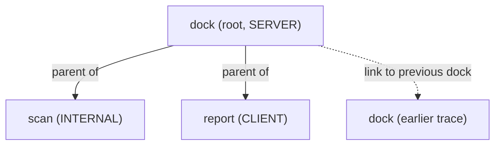

# Span Anatomy And Parent-Child Structure

A span is the unit of a trace: one timed operation, such as handling a request or calling another service. Every field of a span answers a question that an engineer asks during an incident: which request, which operation, how long, did it fail, and what led to it. This part walks through the fields one by one, shows how spans link into a tree, and reads them in the Collector log.

## Identity: trace ID, span ID and parent span ID

Each span has a span context with three identity values. The trace ID is 16 bytes, written as 32 hexadecimal characters, and every span of one trace shares it. The span ID is 8 bytes, written as 16 characters, and identifies this span inside the trace. The parent span ID is the span ID of the span that was active when this span started. The span context also holds trace flags (one of them is the sampled bit) and the trace state, a list of vendor key-value pairs.

A span without a parent is the root span of its trace. The Collector prints an empty `Parent ID` for it. When the OpenTelemetry Software Development Kit (SDK) starts a root span, it generates a new trace ID. When it starts a child span, it copies the trace ID from the parent and generates a new span ID. That copy is the only reason a backend can join the spans of one request.

## Name and kind

The span name is a short, low-variety label for the operation, such as `dock` or `GET /orders/{id}`. Do not put identifiers in the name: a name with a request ID in it makes every span unique and defeats grouping. Put variable values in attributes.

The span kind says how the operation relates to the other side of a call. The API defines five values:

- `INTERNAL` is the default. The operation stays inside the process.
- `SERVER` handles an incoming synchronous request.
- `CLIENT` makes an outgoing synchronous request.
- `PRODUCER` creates a message for later processing.
- `CONSUMER` processes a message that a producer created.

Backends use the kind to draw service maps: a `CLIENT` span in one service and a `SERVER` span in another make one edge. In the `shuttle`, `dock` has kind `SERVER` and `report` has kind `CLIENT`.

## Timing

A span has a start time and an end time, in nanoseconds since the Unix epoch. The duration is the end minus the start. The SDK records the start when the span is created and the end when the code calls `end()`. The `with` statement used by `start_as_current_span` calls `end()` when the block exits, even when an exception leaves it. After `end()`, the span ignores every change, so set attributes before the block closes.

The time of a span covers its children and also the time spent outside them. A parent of 400 milliseconds with children of 200 and 100 milliseconds has 100 milliseconds that no span explains. That remainder can be work in the parent itself, waiting, or code that nobody instrumented.

## Attributes, events and links

Attributes are key-value pairs that describe this one operation. Keys are strings. A value is a string, a Boolean, an integer, a floating-point number or an array of one of those types. You set them at creation, as in `attributes={"shuttle.dock.number": 1}`, or later with `span.set_attribute("scan.objects", 3)`. Set an attribute at creation when a sampler should see it, because a sampler runs once, at creation. The SDK limits the number of attributes per span (128 by default, `OTEL_SPAN_ATTRIBUTE_COUNT_LIMIT`) and drops the rest.

An event is a named point in time inside a span, with its own timestamp and attributes. `dock.add_event("clearance.granted", {"clearance.level": 2})` records that something happened at that moment. An event is not a span and has no duration. The method `span.record_exception(error)` adds an event named `exception` with the attributes `exception.type`, `exception.message` and `exception.stacktrace`.

A link points from this span to the span context of another span, possibly in another trace. A link does not make a parent: it says "this operation is related to that one". Links fit cases where one span has several causes, such as a batch job that processes ten messages, and cases where a new trace starts but the earlier one matters. The `shuttle` links each `dock` span to the `dock` span of the previous trace. You pass links when you create the span: `links=[Link(previous)]`.

## Status

Status says whether the operation succeeded. It has three values: `Unset` (the default, meaning no result was recorded), `Ok` and `Error`. Only `Error` carries a description. Application code sets `Error` when the operation failed, and leaves `Unset` for success. The value `Ok` is a deliberate statement that the operation is correct: once it is set, a later `Error` is ignored, so use it sparingly.

With `start_as_current_span`, an exception that leaves the `with` block sets status `Error` and adds an `exception` event by default. The arguments `record_exception` and `set_status_on_exception` switch these two behaviors off. Status belongs to each span: a failed child does not change the status of its parent. The `shuttle` sets the status of `dock` itself when `report` fails.

## Parent-child structure comes from the current context

The current context is a value, stored per thread or asynchronous task with Python `contextvars`, that holds the active span. When code starts a span without naming a parent, the SDK reads the current context, uses the active span as the parent and, with `start_as_current_span`, makes the new span the active one for the duration of the `with` block. When the block ends, the parent becomes active again.



The diagram shows that `scan` and `report` are siblings with the same parent, and that the link to the earlier `dock` span does not join the two traces.

The function `tracer.start_span` creates a span without making it current. Children then need an explicit parent through the argument `context`. Use `start_as_current_span` unless you manage context yourself.

## Read the structure in the Collector log

<!-- astrona:playground:renew -->

Print a minute of spans and keep the lines that show identity and structure:

```sh
kubectl -n starfleet logs deploy/collector --since=60s | grep -E '^ +(Trace ID|Parent ID|ID|Name|Kind|Status code) '
```

Each span block gives six lines. Pick one `Trace ID` and compare it across the three spans of that trace. It is identical. The `ID` of `dock` appears as the `Parent ID` of `scan` and `report`, and the `Parent ID` of `dock` is empty. Now print the attributes, events and links of the same minute:

```sh
kubectl -n starfleet logs deploy/collector --since=60s | grep -E '^( +-> |Events:|Links:|SpanEvent|SpanLink|Attributes:)'
```

You see `shuttle.dock.number` and `scan.objects` under `Attributes:`, the event `clearance.granted` under `Events:`, and under `Links:` the trace ID and span ID of the previous `dock`. That trace ID differs from the one of the span that holds the link.

The application fails every third trace. Find one with its status:

```sh
kubectl -n starfleet logs deploy/collector --since=120s | grep -E '^( +(Name|Status code|Status message) +:|     -> Name: exception)'
```

In a failed trace, `report` has status code `Error` and an `exception` event, because the exception left its `with` block. `dock` has status code `Error` with the message `report failed`, because the application set it. A successful trace shows `Unset` everywhere.

## What you know now

A span holds identity (trace ID, span ID, parent span ID), a name, a kind, a start and an end time, a status, attributes, events and links. The parent comes from the current context, and the trace ID passes from parent to child. Status belongs to a single span, and a link relates spans without parenting them. The open question is which spans the SDK keeps, and how they leave the process.

## Common pitfalls

> [!WARNING]
> Putting identifiers (a user ID, a request ID) in the span name makes spans impossible to group: use attributes. A long parent with short children means unexplained time, not proof that the parent is slow. Do not add the durations of spans that run at the same time. Do not record secrets or full query text in attributes, because they are exported to every backend. `Ok` cannot be overridden by a later `Error`.
