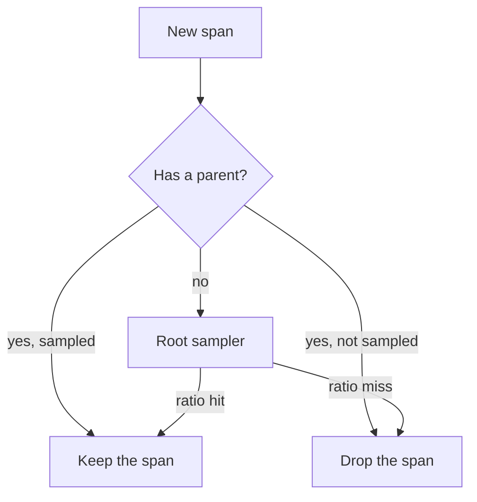

# Span Processors, Samplers And Exporters

Creating a span costs memory and processing time, and exporting it costs network traffic and storage. The SDK therefore does not send every span at once and does not necessarily keep every span. Three components decide what happens: the sampler decides at creation whether a span is kept, the span processor decides when finished spans move on, and the exporter decides how they leave the process. This part explains each decision, shows what it loses when it is set badly, and instruments the example application.

## The sampler decides at creation

A sampler is an object that the `TracerProvider` calls once for every new span, before the span exists. It receives the parent context, the trace ID, the span name, the span kind, the initial attributes and the links. It returns one of three decisions:

- `DROP`: the span is not recorded. The tracer returns a non-recording span. Calls such as `set_attribute` do nothing, and the span is never exported.
- `RECORD_ONLY`: the span is recorded and processors see it, but the sampled flag in its trace flags is not set, and exporters in the standard SDK skip it.
- `RECORD_AND_SAMPLE`: the span is recorded, the sampled flag is set, and the span is exported.

A dropped span still has a valid span context, so code can still pass the trace ID and span ID to the next service. The sampler decision therefore travels with the trace: the sampled flag in the trace flags tells the next service what the first service decided.

The OpenTelemetry Software Development Kit (SDK) ships four samplers. `always_on` samples every span and `always_off` samples none. `traceidratio` samples a fraction of traces: it turns the trace ID into a number and compares it with the ratio, so the same trace ID gives the same answer in every service. `parentbased` wraps another sampler, called the root sampler, and defers to the parent: a span with a sampled parent is sampled, a span with an unsampled parent is dropped, and only a span with no parent asks the root sampler. You select them with `OTEL_TRACES_SAMPLER` (the values are `always_on`, `always_off`, `traceidratio`, `parentbased_always_on`, `parentbased_always_off` and `parentbased_traceidratio`) and give the ratio with `OTEL_TRACES_SAMPLER_ARG`. The default is `parentbased_always_on`.



The diagram shows a `parentbased_traceidratio` sampler: only a root span asks the ratio, and every child follows its parent, so a trace is kept whole or dropped whole.

The choice of `parentbased` matters. A plain `traceidratio` sampler in each service of one request gives the same answer in each service only when all of them use the same ratio. With a parent-based sampler, a downstream service obeys the decision of the first service, whatever its own ratio is. This is head sampling: the decision comes at the start of the trace, before anyone knows whether the request will fail or be slow. A rare error can therefore fall in a dropped trace. Tail sampling decides after the trace is complete, for example in the Collector with the `tail_sampling` processor, but it needs all spans of a trace to reach the same Collector instance.

## The span processor decides when spans move on

A span processor has a hook that runs when a span starts and another that runs when it ends. The SDK includes two processors that pass finished spans to an exporter:

- `SimpleSpanProcessor` exports each span at once, in the thread that ended it. It makes every `end()` wait for the exporter, so use it only for debugging.
- `BatchSpanProcessor` puts finished spans in a queue. A background thread exports them in batches, when the batch is full or when the schedule delay has passed.

The batch processor reads four settings: `OTEL_BSP_SCHEDULE_DELAY` (milliseconds between exports, default 5000), `OTEL_BSP_MAX_QUEUE_SIZE` (default 2048), `OTEL_BSP_MAX_EXPORT_BATCH_SIZE` (default 512) and `OTEL_BSP_EXPORT_TIMEOUT` (default 30000). When the queue is full, the processor drops new spans and logs a warning. The application is never blocked by a slow Collector, but the trace loses spans.

Only finished spans leave the process. A span that has not ended, because the code crashed or the `with` block is still open, is never exported. When the process stops, the provider shuts down and flushes the queue (the SDK registers this at exit by default), but a process that is killed without a clean exit loses the spans still in the queue. Because the Deployment of the `shuttle` sets `OTEL_BSP_SCHEDULE_DELAY` to 2000, spans reach the Collector about two seconds after they end.

## The exporter decides how spans leave

An exporter converts spans to a wire format and sends them. `OTLPSpanExporter`, which speaks the OpenTelemetry Protocol (OTLP), from the package `opentelemetry-exporter-otlp-proto-http` sends protobuf over HTTP. When you set only `OTEL_EXPORTER_OTLP_ENDPOINT`, the exporter adds the signal path to it, so `http://collector.starfleet.svc.cluster.local:4318` becomes `.../v1/traces` for traces. A signal-specific variable such as `OTEL_EXPORTER_OTLP_TRACES_ENDPOINT` is used exactly as written, with no path added. Port 4318 is the standard OTLP/HTTP port and 4317 is the standard gRPC port.

A wrong endpoint does not break the application. The exporter fails in the background thread, logs an error and the spans are lost. When spans are missing, check the exporter log of the application before you check the Collector.

## Try the sampler

<!-- astrona:playground:renew -->

Count how many `dock` spans reached the Collector in the last two minutes. At one trace every five seconds, expect about twenty:

```sh
kubectl -n starfleet logs deploy/collector --since=120s | grep -c -E '^ +Name +: dock$'
```

Now sample half of the traces. The change replaces the pod, and the new pod installs the SDK again, so wait for the rollout and for the line `trace 1 finished`:

```sh
kubectl -n starfleet set env deployment/shuttle OTEL_TRACES_SAMPLER=parentbased_traceidratio OTEL_TRACES_SAMPLER_ARG=0.5
kubectl -n starfleet rollout status deployment/shuttle --timeout=300s
kubectl -n starfleet logs deploy/shuttle --tail=3
```

Wait two minutes and count again:

```sh
kubectl -n starfleet logs deploy/collector --since=120s | grep -c -E '^ +Name +: dock$'
```

The count is about half of the earlier value, but not exactly: the decision comes from random trace IDs. The application log still shows every trace as finished, because dropped spans are created and ended; they are only not exported. Look at the trace IDs of the `dock` spans that remain, and at the spans `scan` and `report` of those traces. Each kept trace has all three spans, because `scan` and `report` follow the sampled parent.

## Instrument one more attribute

Instrumentation with the Python API is ordinary code: get a tracer, start a span in a `with` block, set attributes, and let exceptions pass. Add one attribute to the `scan` span. Edit the ConfigMap and add the line `scan.set_attribute("scan.sector", "alpha")` after the existing `scan.set_attribute("scan.objects", 3)`, with the same indentation. The pod reads `app.py` only on start, so restart the Deployment:

```sh
kubectl -n starfleet edit configmap shuttle-app
kubectl -n starfleet rollout restart deployment/shuttle
kubectl -n starfleet rollout status deployment/shuttle --timeout=300s
```

When the application has finished a trace, search the Collector log for the new attribute:

```sh
kubectl -n starfleet logs deploy/collector --since=60s | grep 'scan.sector'
```

The line `-> scan.sector: Str(alpha)` appears under the attributes of `scan`. Three things made it work: the tracer that the module created, the active span set by `start_as_current_span`, and the exporter path that was already in place.

## What you know now

The sampler decides once, at creation, whether a span is kept, and a parent-based sampler keeps traces whole. The batch processor queues finished spans, exports them on a schedule and drops them when the queue is full. The exporter sends them to the endpoint named in the environment. Each stage can lose spans without breaking the application, so a missing span needs a check at every stage.

## Common pitfalls

> [!WARNING]
> A sampler ratio of `0` keeps no trace, and the application still looks healthy. `traceidratio` without `parentbased` can cut one trace into pieces when services use different ratios. A full batch queue drops spans silently except for a log line. A span that never ends is never exported. A sampled-out trace has no data to look at later, so head sampling cannot be used to find rare errors that the sampler did not see.
