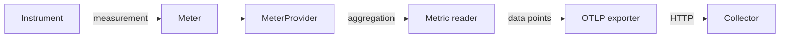

# Meters And Instruments

A metric is a number that a program measures and that a monitoring system collects over time. Counting every request that a service handles is not practical if each request becomes one record that must be stored. The OpenTelemetry metrics design solves this by combining measurements inside the process and sending only the combined result. This part explains the objects that record the measurements: the `MeterProvider`, the `Meter` and the instruments.

## The API And The SDK

OpenTelemetry is an open standard for telemetry (traces, metrics and logs) with libraries for many languages. Each library has two layers. The API (application programming interface) is the set of classes and functions that application code and libraries call to record telemetry. The SDK (software development kit) is the implementation that does the work: it aggregates the measurements and sends them out. If a program installs only the API, every call does nothing. This lets a library record metrics without forcing the application to collect them.

The application starts the SDK once, at start-up. The `MeterProvider` is the SDK object that owns everything about metrics: the resource, the views and the metric readers. The resource describes the process that produces the data, for example `service.name`. The SDK reads the resource from the environment variables `OTEL_SERVICE_NAME` and `OTEL_RESOURCE_ATTRIBUTES`.

A `Meter` is the object that creates instruments. Code asks the provider for a meter with a name and a version. This name is the instrumentation scope: it says which library or module produced the metrics. Here is the start of the `shuttle` program that the playground runs, shortened:

```python
reader = PeriodicExportingMetricReader(OTLPMetricExporter())
metrics.set_meter_provider(
    MeterProvider(resource=resource, metric_readers=[reader], views=VIEWS)
)
meter = metrics.get_meter("shuttle", "1.0.0")
```

The first line builds a metric reader that exports through OTLP (the OpenTelemetry Protocol). The second builds the provider and makes it the global provider. The third asks the global provider for a meter. Nothing in the program sets an endpoint or an interval, because the SDK reads standard `OTEL_*` environment variables for those values.



The diagram shows the path of one measurement: the instrument records it, the provider aggregates it, the reader collects it on a schedule and the exporter sends it to the Collector.

## The Instruments

An instrument is the object that records one kind of measurement under one name. The API defines seven kinds, and each one has a meaning that the backend relies on. The first four are synchronous: the code calls them at the moment something happens.

| Instrument | Call | Meaning | Default aggregation |
| --- | --- | --- | --- |
| Counter | `add(value)` with `value >= 0` | A total that only goes up, such as requests handled | Sum, monotonic |
| UpDownCounter | `add(value)` with any sign | A total that can go up and down, such as the queue length | Sum, not monotonic |
| Histogram | `record(value)` | The spread of values, such as request duration | Explicit bucket histogram |
| Gauge | `set(value)` | The current value at the time of the call | Last value |

The next three are asynchronous, also called observable. The code does not call them at the moment of an event. It registers a callback function when it creates the instrument. The SDK calls the callback once for every collection, and the callback returns `Observation` objects, each with a value and optional attributes. The observable counter, observable up-down counter and observable gauge have the same meaning as their synchronous forms, and the same default aggregation.

```python
def read_cpu_time(options):
    yield Observation(time.process_time())

meter.create_observable_counter(
    "shuttle.cpu.time", callbacks=[read_cpu_time], unit="s"
)
```

An observable counter reports the total value, not the change. Here the callback returns the CPU time that the process has used so far, and the SDK turns the series of totals into the data the exporter needs.

### Choosing the instrument

The choice follows what the number means. Use a counter when you count events and the total never goes down. Use an up-down counter when you add and remove the same thing, such as items in a queue. Use a histogram when you need percentiles or the spread, which is the usual choice for durations and sizes. Use a gauge when only the latest value matters and you cannot add values from different sources in a meaningful way, such as temperature or a fill level.

Use an asynchronous instrument when the program already holds the value in some other place, such as a memory counter in the runtime, and reading it is cheaper than calling the instrument on every change. Use a synchronous instrument when the code runs at the moment of the event. The synchronous `Gauge` was added to the API later than the others, and it fits a value that the code sets while it runs.

### Names, units and descriptions

Every instrument has a name, an optional unit and an optional description. The unit uses the UCUM (Unified Code for Units of Measure) notation: `s` for seconds, `By` for bytes, `Cel` for degrees Celsius. A unit in braces, such as `{request}`, counts a thing that has no standard unit. A name in the shape `shuttle.request.duration` uses dots to group a family. Do not put the unit in the name, because the unit is a separate field.

Instrument names are case-insensitive, and an SDK warns when the same name is registered twice with a different kind or unit. One name should mean one thing in one process.

## Look At The Instruments In The Playground

The playground runs the `shuttle` program, which records one instrument of each main kind, and a Collector that prints what it receives. The shuttle pod installs the SDK with pip when it starts, so the first metrics appear after about two minutes.

<!-- astrona:playground:renew -->

First define a helper that prints the part of the Collector log that describes one metric, from the last 60 seconds:

```sh
metric_block() {
  kubectl -n starfleet logs deploy/collector --since=60s \
    | awk -v name="$1" '/^Metric #/ {show=0} $0 ~ "-> Name: " name " *$" {show=1} show {print}'
}
```

Now print the descriptor lines of the six metrics. `sort -u` removes the repeats from earlier exports:

```sh
for name in shuttle.requests shuttle.queue.depth shuttle.request.duration shuttle.fuel.level shuttle.engine.temperature shuttle.cpu.time; do
  metric_block "$name" | grep -E 'Name:|DataType:|IsMonotonic:' | sort -u
done
```

The Collector prints the `DataType` of each metric. You should see `Sum` with `IsMonotonic: true` for `shuttle.requests` and `shuttle.cpu.time`, `Sum` with `IsMonotonic: false` for `shuttle.queue.depth`, `Histogram` for `shuttle.request.duration`, and `Gauge` for `shuttle.fuel.level` and `shuttle.engine.temperature`. If a metric is missing, the pod has not exported yet. Wait ten seconds and run the loop again.

The result shows that the instrument kind decides the data type. The counter and the observable counter both arrive as a monotonic sum. Both gauges arrive as a gauge, whether the program sets the value or the SDK reads it through a callback. The data type tells the backend which calculations are valid, so the next question is what the SDK does with many measurements before it exports them.

## Common pitfalls

> [!WARNING]
> A counter must never receive a negative value. Use an up-down counter for a total that can fall. Do not use a gauge for a count of events, because the backend cannot add gauge values from several instances or compute a rate from them. Without an SDK installed, the API drops every measurement silently, so a missing metric can mean that the SDK was never started.
