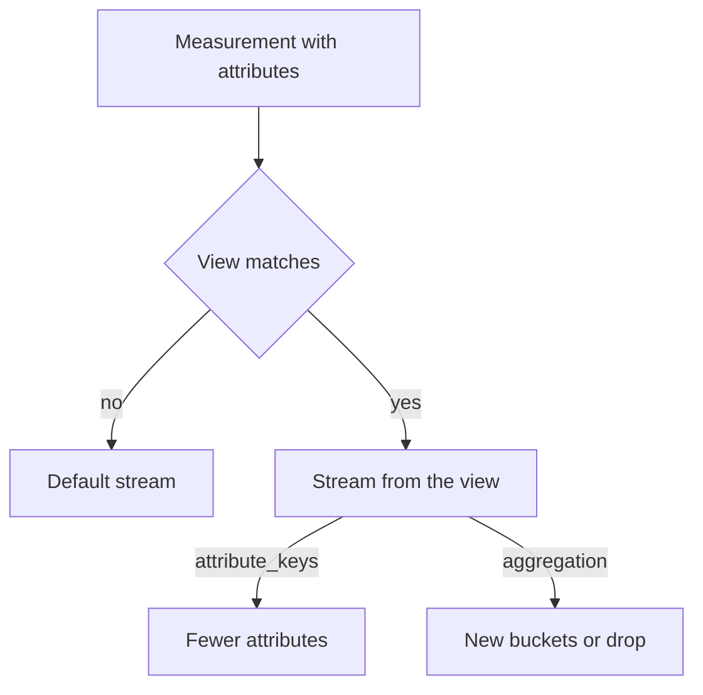

# Aggregation, Temporality And Views

An application can record thousands of measurements in a second. Sending every one of them would cost more than the information is worth. The SDK therefore aggregates: it combines the measurements of one instrument into a small number of data points before it exports. This part explains how the aggregation works, what temporality changes in the result, and how a view lets the operator change both without changing the code.

## Aggregation

Aggregation is the rule that turns many measurements into one data point for a period. Every instrument has a default aggregation that follows its meaning.

| Instrument | Default aggregation | Data point holds |
| --- | --- | --- |
| Counter, observable counter | Sum (monotonic) | The total |
| UpDownCounter, observable up-down counter | Sum (not monotonic) | The total |
| Histogram | Explicit bucket histogram | Count, sum, minimum, maximum and the count in each bucket |
| Gauge, observable gauge | Last value | The latest value |

The SDK keeps one aggregation for every distinct set of attributes. An attribute is a key and value pair, such as `http.route=/dock`, that the code passes with a measurement. One instrument with three routes and two status codes holds up to six aggregations. Each one becomes a time series in the backend.

### How a histogram works

A histogram counts values into buckets. The bucket boundaries are an ordered list of numbers. A value goes into the first bucket whose upper boundary is greater than or equal to the value, so a histogram with five boundaries has six buckets: one for each interval and one for everything above the last boundary. The data point also carries the count, the sum, and the minimum and maximum. The backend estimates percentiles from the bucket counts, so the result is only as precise as the boundaries.

The default boundaries are `0, 5, 10, 25, 50, 75, 100, 250, 500, 750, 1000, 2500, 5000, 7500, 10000`. They fit values in milliseconds. The `shuttle` program records durations in seconds, so almost every value falls into the first two buckets and the percentiles are useless. Two fixes exist. The code can pass `explicit_bucket_boundaries_advisory` to `create_histogram`, which suggests boundaries for that instrument. An operator can also set the boundaries with a view, which takes precedence over the advisory.

An exponential histogram is the second histogram aggregation. It does not use a fixed list. It uses buckets whose width grows by a constant factor, controlled by a scale, and it needs no tuning for the range of the values. In the Python SDK its class is `ExponentialBucketHistogramAggregation`. The backend must support this format, so an operator chooses it deliberately.

## Temporality

Temporality is the period that a sum or histogram data point covers. Cumulative temporality means each data point covers the time from the start of the stream until the export. Delta temporality means each data point covers only the time since the previous export. Take a counter that gets 5, then 3, then 4 new events between three exports:

| Export | Cumulative value | Delta value |
| --- | --- | --- |
| 1 | 5 | 5 |
| 2 | 8 | 3 |
| 3 | 12 | 4 |

Both forms carry the same information. A cumulative series lets the backend read the total directly and detect a restart of the process, because the value drops and the start timestamp changes. A delta series needs no memory in the backend to compute a rate, and the SDK can free the state of a series that received no data, which keeps memory lower when attribute values change over time. A lost delta export loses its events for good, while the next cumulative export contains them again.

A gauge has no temporality, because it reports a single current value. The OTLP exporter chooses the temporality with the environment variable `OTEL_EXPORTER_OTLP_METRICS_TEMPORALITY_PREFERENCE`. It accepts three values, without regard to case.

| Value | Counter, histogram | Up-down counter | Observable counter |
| --- | --- | --- | --- |
| `cumulative` | Cumulative | Cumulative | Cumulative |
| `delta` | Delta | Cumulative | Delta |
| `lowmemory` | Delta | Cumulative | Cumulative |

The observable up-down counter always stays cumulative, like the synchronous one. The specification defines the preferences this way, so an up-down counter keeps its cumulative total in every preference.

## Views

A view is a rule in the `MeterProvider` that selects instruments and changes the stream that the SDK produces for them. A stream is the output of one instrument after the aggregation: its name, unit, attributes and aggregation. Views do not change the code that records. They change what leaves the SDK, so the operator who owns the deployment can fix a noisy metric without a code change.

A view has two parts. The criteria select the instruments: `instrument_name`, `instrument_type`, `meter_name` and others. The stream configuration says what to do with the selected instruments. In the Python SDK the class is `opentelemetry.sdk.metrics.view.View`, and the useful settings are `name` and `description` (rename), `attribute_keys` (keep only these attributes), and `aggregation`. The value `DropAggregation()` removes the metric from the output. The list of views goes to the `MeterProvider`, and the SDK reads it once when the provider starts. A change to the list needs a new process.

If no view matches an instrument, the SDK produces the default stream. If a view matches, the stream follows the view. The `attribute_keys` setting also merges data: measurements that differ only in a removed attribute now fall into the same aggregation, so the number of series drops.



The diagram shows that a view sits between the measurement and the data point, and that it can change the attributes and the aggregation.

## Try It In The Playground

The playground exports every 10 seconds with cumulative temporality, and its views file is empty.

<!-- astrona:playground:renew -->

First paste the helper again if this is a new terminal. It prints the Collector log of one metric from the last 60 seconds:

```sh
metric_block() {
  kubectl -n starfleet logs deploy/collector --since=60s \
    | awk -v name="$1" '/^Metric #/ {show=0} $0 ~ "-> Name: " name " *$" {show=1} show {print}'
}
```

Ask for delta temporality. Changing an environment variable on a Deployment starts a new pod, so wait for the rollout:

```sh
kubectl -n starfleet set env deploy/shuttle OTEL_EXPORTER_OTLP_METRICS_TEMPORALITY_PREFERENCE=delta
kubectl -n starfleet rollout status deployment/shuttle --timeout=300s
```

After about two minutes for the pip install, compare the metrics:

```sh
for name in shuttle.requests shuttle.queue.depth shuttle.request.duration; do
  metric_block "$name" | grep -E 'Name:|AggregationTemporality:' | sort -u
done
```

You should see `Delta` for `shuttle.requests` and `shuttle.request.duration` and `Cumulative` for `shuttle.queue.depth`, as the table above says. Now save this as `configmap-shuttle-views.yaml`. It drops the metric `shuttle.cpu.time`:

```yaml
apiVersion: v1
kind: ConfigMap
metadata:
  name: shuttle-views
  namespace: starfleet
data:
  views.py: |
    from opentelemetry.sdk.metrics.view import DropAggregation, View

    VIEWS = [
        View(instrument_name="shuttle.cpu.time", aggregation=DropAggregation()),
    ]
```

Apply it and restart the program, because it reads the file only at start-up:

```sh
kubectl apply -f configmap-shuttle-views.yaml
kubectl -n starfleet rollout restart deploy/shuttle
```

Wait for the new pod to export, then check that the metric is gone while the others remain:

```sh
metric_block shuttle.cpu.time | wc -l
metric_block shuttle.requests | grep -c 'Name:'
```

The first command should print `0` and the second a number greater than zero. The data of `shuttle.cpu.time` no longer leaves the SDK, although the code still records it. Aggregation, temporality and views decide the content of each data point, so the remaining question is when the data points leave the process and how many series the attributes create.

## Common pitfalls

> [!WARNING]
> A view is read only when the `MeterProvider` is created, so editing the ConfigMap does not change a running pod. Restart the Deployment. Do not use a histogram with default boundaries for values in seconds. The up-down counter stays cumulative even with the `delta` preference, so do not expect a delta there. A backend that expects cumulative data can show wrong values from a delta stream.
