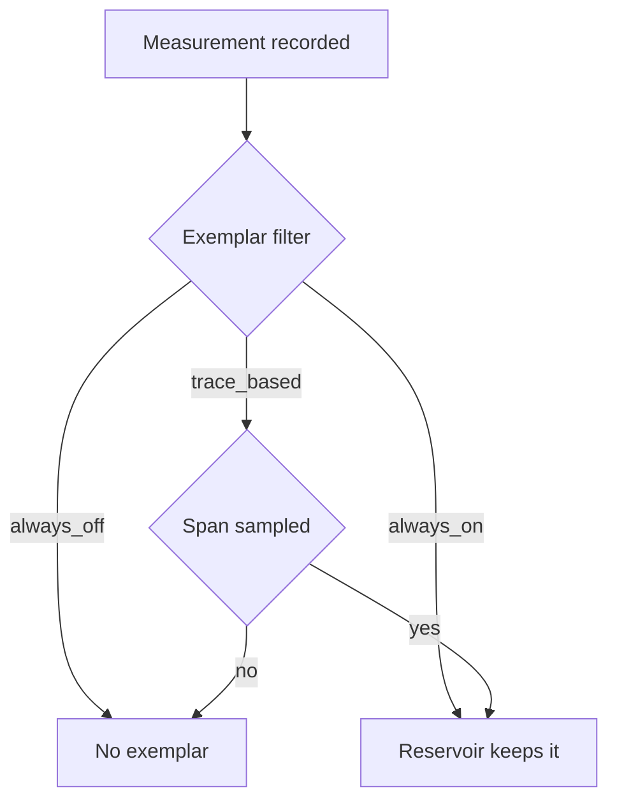

# Readers, Export Interval, Cardinality And Exemplars

A metric that is recorded but never exported helps nobody, and a metric that exports too many series can overload the backend. This part covers the last stage of the metrics pipeline in the SDK: the metric reader that decides when data leaves, the cardinality that decides how much data leaves, and the exemplar that links a single measurement to a trace.

## The Metric Reader

A metric reader is the SDK component that collects the aggregated data from the `MeterProvider` and hands it to an exporter. The provider has one or more readers. Without a reader, the provider records measurements but nothing ever leaves the process.

The periodic exporting metric reader collects on a timer. At each tick it asks the provider for the current data, calls the callbacks of every observable instrument and passes the result to the exporter. The environment variable `OTEL_METRIC_EXPORT_INTERVAL` sets the time in milliseconds between the starts of two exports. The default value in the specification is 60000, which is 60 seconds. `OTEL_METRIC_EXPORT_TIMEOUT` sets the maximum time in milliseconds that one export may take. Its default in the specification is 30000. The OTLP exporter also has its own timeout in `OTEL_EXPORTER_OTLP_METRICS_TIMEOUT`.

A pull reader works the other way. It does not run a timer. It collects when something asks, as in the Prometheus exporter, where the Prometheus server scrapes an HTTP endpoint. The interval is then the scrape interval of the server and not a setting of the SDK.

### What the interval changes

A shorter interval gives the backend more points in time and shows short events earlier. It also costs more network traffic, more processing in the Collector and more stored samples. For sums and histograms the interval changes only the resolution, not the result, because the SDK keeps counting between exports. For a gauge it can change the result: the exported value is the last value at the time of the collection, so a peak between two exports never reaches the backend.

The SDK also exports once when the program ends. `MeterProvider` has a `shutdown_on_exit` argument that is true by default, so the Python SDK flushes the data at a normal exit. The method `force_flush` exports at once. A process that stops without running its exit code, for example after `SIGKILL`, loses the measurements since the last export.

## Cardinality

Cardinality is the number of distinct attribute sets for one metric. Each distinct set is a separate time series with its own aggregation in the SDK, its own points in the Collector and its own storage in the backend. A counter with the attributes `http.route` (3 values) and `http.response.status_code` (2 values) has at most 6 series. If the code adds an attribute that is different on every measurement, such as a request identifier, the number of series grows without a limit.

The `shuttle` program records its histogram with a `request.id` attribute made from a random value. That is a defect. After one hour with five requests per second, the histogram holds 18000 series, and each series holds one measurement. The histogram then tells nothing about the spread, because every bucket count is one.

The specification defines a default cardinality limit of 2000 for each metric stream. When a metric reaches the limit, the SDK should put further measurements into one data point with the attribute `otel.metric.overflow=true` instead of growing. Whether an SDK enforces a limit, and how it is set, differs between languages and versions, so a team must not rely on it. The safe rule is to keep the attribute values bounded in the code or with a view.

Three habits keep cardinality under control. Use the route template (`/users/{id}`) and not the real path. Keep identifiers of users, requests and sessions out of metric attributes, because traces and logs carry them better. Use a view with `attribute_keys` to remove an attribute that you cannot remove from the code. The attribute list of a view is an allow list: every key that is not in the list is removed.

## Exemplars

An exemplar is one example measurement that the SDK stores beside an aggregated data point. It holds the recorded value, the time, the trace ID and span ID of the active span, and the attributes that the aggregation removed. A histogram bucket with a high count can then point to one real trace that fell into this bucket.

The exemplar filter decides which measurements may become exemplars. `OTEL_METRICS_EXEMPLAR_FILTER` accepts three values. `always_off` creates no exemplars. `always_on` considers every measurement. `trace_based` considers a measurement only when it is recorded inside a span that is sampled, and this is the default. A sampled span is a span that the tracer keeps and exports. The exemplar reservoir then chooses which of the considered measurements the SDK keeps for each export. Because the filter looks at the active span, a measurement from an observable callback, which runs outside a request, normally has no trace and no exemplar.



The diagram shows that the filter decides first and the reservoir decides second.

## Try It In The Playground

The playground exports every 10 seconds, and the `shuttle` program records its measurements inside a span.

<!-- astrona:playground:renew -->

First define the helper that prints the log of one metric from the last 60 seconds:

```sh
metric_block() {
  kubectl -n starfleet logs deploy/collector --since=60s \
    | awk -v name="$1" '/^Metric #/ {show=0} $0 ~ "-> Name: " name " *$" {show=1} show {print}'
}
```

Count the series of the histogram. Each `request.id` value is one series, and the Collector prints one data point for each:

```sh
metric_block shuttle.request.duration | grep -c 'HistogramDataPoints #'
```

The number is large, because the program creates a new `request.id` for each measurement, and it grows with the time the pod runs. Now change the interval to 30 seconds and count how often the counter reaches the Collector in two minutes:

```sh
kubectl -n starfleet set env deploy/shuttle OTEL_METRIC_EXPORT_INTERVAL=30000
kubectl -n starfleet rollout status deployment/shuttle --timeout=300s
```

After the new pod has run for about four minutes, count the exports:

```sh
kubectl -n starfleet logs deploy/collector --since=120s | grep -c -- '-> Name: shuttle.requests'
```

You should see a number close to 4, where an interval of 10 seconds would give close to 12. Finally look at the exemplars of the histogram, which the default filter `trace_based` should create because the spans are sampled:

```sh
metric_block shuttle.request.duration | grep -A5 'Exemplar #' | head -12
```

Each exemplar shows a `Trace ID`, a `Span ID` and a value. Set `OTEL_METRICS_EXEMPLAR_FILTER=always_off` with `kubectl set env`, wait for the next export from the new pod, and the exemplar lines disappear. The metric stays the same, but it no longer points to traces. The reader decides when data leaves, cardinality decides how many series leave, and exemplars connect the aggregate back to individual requests.

## Common pitfalls

> [!WARNING]
> Do not put identifiers, timestamps or free text in metric attributes. Each new value is a new series, and no backend setting repairs that cheaply. A short export interval does not make a gauge exact, because the gauge still reports only the value at the time of collection. A process that is killed without a flush loses the data since the last export. Exemplars need a recording inside a sampled span, so a missing exemplar usually means that no active span or no sampling existed.
