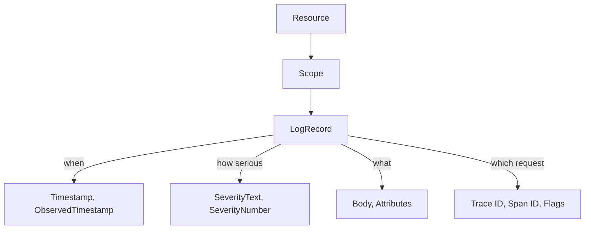

# Log Records, Severity And Attributes

A metric tells you that something changed and a trace tells you where time went. A log record tells you what one component said about one thing that happened. The OpenTelemetry log data model defines the fields of that record, so that a record written by a Python service and a record written by a Go service look the same to the Collector and to the backend. This part reads the fields of a real log record from the `shuttle` service in the playground, and explains what each field is for.

The `shuttle` pod runs a Python program that uses the OpenTelemetry SDK. It sends its log records over the OpenTelemetry Protocol (OTLP) to the `collector` pod. The OpenTelemetry Collector is a separate program that receives telemetry and passes it on. In the playground it passes everything to the `debug` exporter, which prints each record to the Collector's own log. That makes the Collector log the place to inspect what the SDK really sent.

<!-- astrona:playground:renew -->

Start with a small shell function that reads the last 30 seconds of the Collector log. The `shuttle` batches its records and exports them every two seconds, so a 30-second window always holds fresh records. Run it in the terminal:

```sh
recent_logs() { kubectl -n starfleet logs deploy/collector --since=30s; }
```

## The fields of a log record

A log record is one structured entry. The data model gives it a fixed set of top-level fields, and everything else goes into attributes. The fields that matter most are listed here in the order the debug exporter prints them.

- `Timestamp`: the time when the event happened, as the source saw it.
- `ObservedTimestamp`: the time when the SDK or the Collector first saw the record. If the source has no event time, this is the only time.
- `SeverityText` and `SeverityNumber`: how serious the event is, as the source's own label and as a number.
- `Body`: the main content. It is any value: usually a string, but it can also be a map or a list.
- `Attributes`: key-value pairs that describe this one event.
- `Trace ID`, `Span ID` and `Flags`: the trace context that was active when the record was created.
- `EventName`: set only when the record is an event. The debug exporter prints this line only when the name is not empty.

Two more things travel with every record but are not part of it: the Resource and the instrumentation scope. The Resource describes the entity that produced the telemetry, for example `service.name`. The instrumentation scope names the library or module that created the record. The debug exporter prints them above each group of records as `Resource attributes` and `InstrumentationScope`.



The diagram shows that a Resource holds scopes, a scope holds records, and each record carries its own time, severity, content and trace context.

## Severity: text and number

The same word does not mean the same level in every logging library. One library says `WARNING`, another says `WARN`, and a third has no `TRACE` level at all. For that reason the data model stores a number next to the text. The number is the part a backend can sort and filter on, because it means the same thing everywhere.

The number runs from 1 to 24, in six bands of four:

| Band | Numbers | Meaning |
| --- | --- | --- |
| TRACE | 1 to 4 | Very detailed, for following code paths |
| DEBUG | 5 to 8 | Diagnostic detail for developers |
| INFO | 9 to 12 | Normal operation |
| WARN | 13 to 16 | Unexpected but handled |
| ERROR | 17 to 20 | An operation failed |
| FATAL | 21 to 24 | The program cannot continue |

`SeverityText` keeps the original label, so a record can show `SeverityText: WARN` and `SeverityNumber: Warn(13)`. A value of 0 means unspecified. A processor or backend that filters on severity must use the number, because the text is free-form.

## Read a record from the playground

Print only the severity and body lines of the recent records. The `shuttle` sends several levels, so you see more than one band:

```sh
recent_logs | grep -E "SeverityText|SeverityNumber|Body" | head -12
```

The lines come in groups of three: `SeverityText`, `SeverityNumber` and `Body`. The format of the second line is the name of the level followed by its number in brackets. The playground sets `SHUTTLE_LOG_LEVEL` to `INFO`, so you do not see DEBUG records here. That filter runs inside the application, before the SDK sees the record.

Now print the whole first record of each batch, to see the timestamps, the attributes and the trace fields together:

```sh
recent_logs | awk '/LogRecord #0/{p=1} /LogRecord #1/{p=0} p' | head -30
```

Each record has `ObservedTimestamp` and `Timestamp` lines, then `Body`, then an `Attributes:` list. Each attribute line starts with `->` and shows the type of the value, for example `Str(...)` for a string and `Int(...)` for an integer. The last three lines are `Trace ID`, `Span ID` and `Flags`.

## Body versus attributes

The `Body` holds the human-readable message, for example `dispatch completed`. The attributes hold the values that a person or a query would filter on, for example `shuttle.dispatch.number`. Keep the body stable and put the changing values in attributes. A body such as `dispatch 42 failed` is a different string for every dispatch, so a search for the message finds nothing in common. A body `dispatch failed` plus the attribute `shuttle.dispatch.number: 42` can be grouped, counted and filtered.

Attribute names follow the same convention as other signals: lowercase words separated by dots, with a namespace that tells who owns the name. The names `error.type` and `exception.type` are standard names. The name `shuttle.dispatch.number` belongs to the example application. A record cannot carry unlimited attributes. The SDK limits the number of attributes to 128 by default and can limit the length of string values. Attributes over the limit are dropped, and the record counts how many were dropped.

## Resource: the same identity on every signal

Look at the Resource lines above the records:

```sh
recent_logs | grep -A5 "Resource attributes" | head -8
```

The `shuttle` Deployment sets two environment variables, `OTEL_SERVICE_NAME` and `OTEL_RESOURCE_ATTRIBUTES`. The SDK reads both when the program calls `Resource.create`. It then uses the same Resource object for the tracer provider, the meter provider and the logger provider. As a result, a log record, a span and a metric from the `shuttle` all carry `service.name: Str(shuttle)`. Without `OTEL_SERVICE_NAME`, the SDK falls back to an `unknown_service` name, and the records cannot be matched to the service that wrote them.

You now know what a log record contains: when it happened, how serious it was, what it said, which attributes describe it and which trace it belongs to. The open question is how a record gets from a program's `logging` call to the Collector. The next part follows that path through the SDK.

## Common pitfalls

> [!WARNING]
> Do not filter on `SeverityText`: spellings differ between libraries, and only `SeverityNumber` has one meaning everywhere. Do not put changing values such as ids or counts into the body, because the same message then never repeats and cannot be grouped. A record without a `service.name` in its Resource cannot be traced back to a service.
