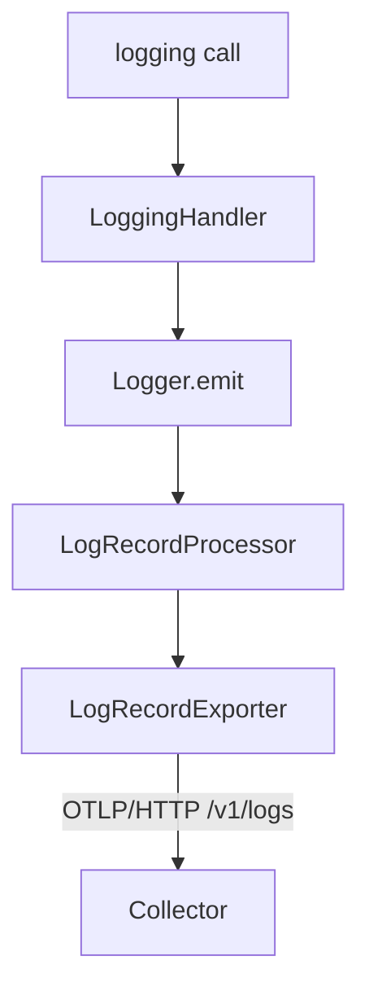

# LoggerProvider, Processors And Exporters

A log record is only useful when it leaves the process. Between the line of code that creates a record and the Collector that receives it, the SDK runs a pipeline of objects, and each object has one job. If you know the objects, you know where a record can be changed, delayed or lost. This part walks along that pipeline for the logs signal and changes one of its settings in the playground.

The pipeline has the same shape as the one for traces and metrics. A provider is the entry point and owns the shared settings. A processor receives every record and decides what happens to it. An exporter turns records into a wire format and sends them. The names differ by signal: the logs signal has a `LoggerProvider`, a `LogRecordProcessor` and a `LogRecordExporter`.



The diagram shows the path of one record: the application calls the logging API, a handler converts the call, the logger emits a record, the processor queues it and the exporter sends it to the Collector.

## LoggerProvider and Logger

The `LoggerProvider` is the root object of the logs SDK. Application code creates it once. It holds the Resource, the list of processors and the limits for attributes. Its method `get_logger(name, version)` returns a `Logger`. The name and version become the instrumentation scope of every record that logger emits, which is why the debug exporter prints `InstrumentationScope` above each group.

A `Logger` has one main method, `emit`. It takes the fields of a record: a body, a severity number and text, attributes, a timestamp, an optional event name and an optional context. If the caller passes no context, the record takes the trace context that is current at that moment. The logger wraps the data in a `ReadWriteLogRecord` together with the Resource and the scope, and hands it to the processors. The `LoggerProvider` also has `force_flush` and `shutdown`. By default the SDK registers `shutdown` to run when the Python process exits, so the last records are not lost on a normal exit.

The OpenTelemetry API has its own provider, which does nothing. Code that calls the API without an installed SDK produces no output and no error. The application must create an SDK `LoggerProvider` and register it with `set_logger_provider`. The environment variable `OTEL_SDK_DISABLED=true` switches the SDK back to a no-operation mode.

<!-- astrona:playground:renew -->

Find the pipeline in the code of the `shuttle`. The program lives in the ConfigMap `shuttle-app`. Print the lines that build the logs pipeline:

```sh
kubectl -n starfleet get configmap shuttle-app -o jsonpath='{.data.app\.py}' | grep -n -E "LoggerProvider|add_log_record_processor|OTLPLogExporter|set_logger_provider|LoggingHandler"
```

The output has four kinds of line: the imports, the creation of the provider with a shared Resource, the registration of a `BatchLogRecordProcessor` that wraps an `OTLPLogExporter`, and the call to `set_logger_provider`.

## Processors

A `LogRecordProcessor` is called for every record, in the order in which the processors were registered. Its method `on_emit` receives the `ReadWriteLogRecord`. Because the record is writable at this point, a processor can add an attribute, remove one or replace a value. This is the supported place to redact sensitive values or to add an attribute that every record should carry. A processor can also implement `enabled`, which tells the logger whether a record with a given severity or scope is worth creating at all. Every processor also implements `shutdown` and `force_flush`.

The SDK ships two processors that send records to an exporter. They differ in when the export happens:

- `SimpleLogRecordProcessor` calls the exporter inside `on_emit`, on the thread that logs. The application waits for every export. Use it for tests and short scripts.
- `BatchLogRecordProcessor` puts records into a queue and exports them from a background thread. The application does not wait for the network. Use it for services.

The batch processor has four settings, each one with an environment variable: `OTEL_BLRP_SCHEDULE_DELAY` is the time between two exports (default 1000 milliseconds), `OTEL_BLRP_MAX_QUEUE_SIZE` is the size of the queue (default 2048), `OTEL_BLRP_MAX_EXPORT_BATCH_SIZE` is the largest batch (default 512) and `OTEL_BLRP_EXPORT_TIMEOUT` is the time limit of one export (default 30000 milliseconds). When the queue is full, the processor drops new records. A dropped record is gone, and the application does not see an error.

## Exporters

An exporter receives a batch of read-only `ReadableLogRecord` objects. It cannot change them. The exporters you meet most are `OTLPLogExporter` from the package `opentelemetry-exporter-otlp-proto-http`, which sends OTLP over HTTP, and `ConsoleLogRecordExporter`, which prints each record as JSON on standard output and is meant for development.

The OTLP/HTTP exporter reads the standard environment variables. `OTEL_EXPORTER_OTLP_ENDPOINT` is a base URL, and the exporter adds the path `v1/logs` for the logs signal. `OTEL_EXPORTER_OTLP_LOGS_ENDPOINT` is a full URL for logs only and is used as written. The `shuttle` points the base URL at the `collector` Service on port 4318, which is the OTLP/HTTP port of the Collector.

The environment variable `OTEL_LOGS_EXPORTER` is different. The SDK reads it only when the application starts through automatic configuration, for example with the `opentelemetry-instrument` command. The `shuttle` builds its providers in code, so that variable would have no effect on it.

## Change a processor setting and watch the effect

List the OpenTelemetry settings of the `shuttle` Deployment:

```sh
kubectl -n starfleet get deploy shuttle -o json | jq -r '.spec.template.spec.containers[0].env[] | select(.name | startswith("OTEL_")) | .name + "=" + .value'
```

Now make the batch processor wait 15 seconds between exports. Changing the environment of a Deployment starts a new pod, and the new pod installs the SDK with `pip` before it runs, so the rollout takes a minute or more:

```sh
kubectl -n starfleet set env deploy/shuttle OTEL_BLRP_SCHEDULE_DELAY=15000
kubectl -n starfleet rollout status deploy/shuttle --timeout=300s
```

Wait about a minute, then count how many batches the Collector received in the last 60 seconds. Each batch starts with a record number zero:

```sh
kubectl -n starfleet logs deploy/collector --since=60s | grep -c "LogRecord #0"
```

With a 15-second delay you see a small number of batches that each hold several records. With the original two-second delay the same records arrive in many small batches. Set the value back when you are done:

```sh
kubectl -n starfleet set env deploy/shuttle OTEL_BLRP_SCHEDULE_DELAY=2000
```

The records are the same in both cases. Only their delay and grouping change. You now know the objects between a log call and the Collector, and which one can change, delay or drop a record. The next part shows how an ordinary Python `logging` call enters this pipeline, and how a record gets its trace identifiers.

## Common pitfalls

> [!WARNING]
> A full queue in the batch processor drops records without an error, so a burst of logs can be lost while the application looks healthy. A process that is killed without a normal exit does not run `shutdown`, and the records still in the queue are lost. Do not use the simple processor in a busy service: every log call then waits for the network.
