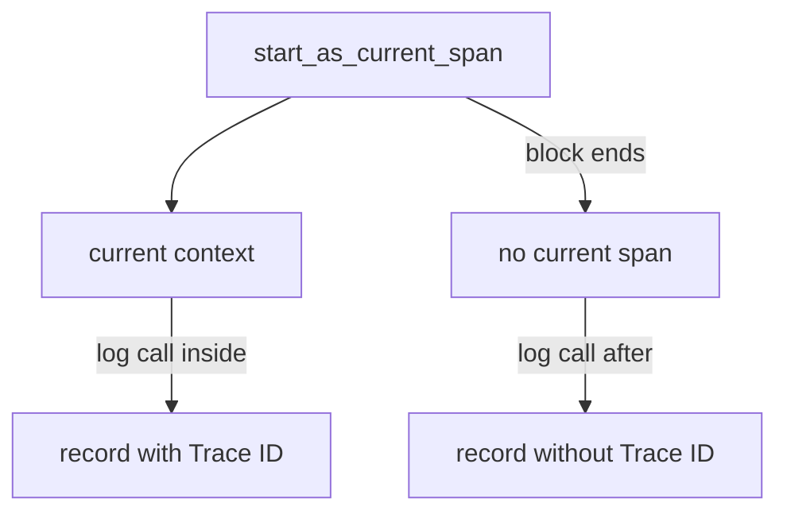

# Bridging Standard Logging And Trace Correlation

Most Python programs already write logs with the standard library module `logging`. Nobody wants to rewrite every `log.info` call to use a new API. OpenTelemetry solves this with a bridge: a handler that attaches to a standard logger, converts each standard record into an OpenTelemetry log record and hands it to the SDK. The same step gives the record its trace identifiers, which is the feature that lets you jump from a failed request to the lines it wrote. This part shows how the conversion works and when the trace identifiers are present.

The bridge in the SDK is the class `LoggingHandler`. A `logging.Handler` is the standard library object that receives records from a logger and writes them somewhere. A program can attach several handlers to one logger. The `shuttle` attaches two: a `StreamHandler` that prints a text line to standard output, and the OpenTelemetry `LoggingHandler`. In version 1.45.2 of the SDK this handler class prints a deprecation warning and points to the handler in the package `opentelemetry-instrumentation-logging`. The idea is the same in both: one handler, one conversion.

<!-- astrona:playground:renew -->

Start with the two outputs of the same call. The text lines of the `StreamHandler` go to the pod log of the `shuttle`:

```sh
kubectl -n starfleet logs deploy/shuttle --tail=6
```

You see time, level and message, and nothing else: no attributes, no trace identifiers and no Resource. The same log call also created an OpenTelemetry record, which went to the Collector. Print the lines of the program that connect the logger to both handlers:

```sh
kubectl -n starfleet get configmap shuttle-app -o jsonpath='{.data.app\.py}' | grep -n -E "getLogger|setLevel|addHandler"
```

## What the handler converts

When the standard library calls `emit` on the handler, the handler builds an OpenTelemetry `LogRecord`. The mapping is fixed:

- `Timestamp` is the time the standard record was created. `ObservedTimestamp` is the time of the conversion.
- `SeverityNumber` comes from the numeric level: 10 becomes DEBUG, 20 becomes INFO, 30 becomes WARN, 40 becomes ERROR and 50 becomes FATAL.
- `SeverityText` is the level name, except that `WARNING` becomes `WARN` and `CRITICAL` becomes `FATAL`, to match the data model.
- `Body` is the formatted message, `record.getMessage()`. If you set a formatter on the OpenTelemetry handler, the body is the output of that formatter instead, which usually adds a time and a level name inside the body.
- `Attributes` are every extra field on the standard record. The `extra={...}` argument of a log call is the way to add them. The handler also adds `code.file.path`, `code.function.name` and `code.line.number`, and for an exception it adds `exception.type`, `exception.message` and `exception.stacktrace`.
- The logger name becomes the instrumentation scope.

Two filters apply before the conversion: the level of the logger and the level of the handler. The `shuttle` reads the variable `SHUTTLE_LOG_LEVEL` and sets it on the logger. A record below that level never reaches any handler, so neither the console nor the Collector sees it.

An exception needs special care. A call such as `log.exception("dispatch failed")` inside an `except` block has exception information, and the handler turns it into the three `exception.*` attributes. The stack trace can be long and can contain values from local code, so a log record with a stack trace is both the most useful and the most sensitive record a service writes. Attribute limits apply to it too: the SDK can cut a long string value at a configured length with `OTEL_LOGRECORD_ATTRIBUTE_VALUE_LENGTH_LIMIT`.

## Where the trace identifiers come from

A trace context is the pair of a trace ID and a span ID, plus flags, that identifies the current operation. The SDK keeps the current context in a Python `contextvars` variable. When code starts a span with `start_as_current_span`, the span becomes part of the current context until the block ends. When a log record is created, the record reads the current context, takes the span in it, and copies its trace ID, span ID and trace flags into the record. The application does not pass them by hand.



The diagram shows that a record gets trace identifiers only if it is created while a span is current. A record created after the block ends has none.

That rule explains the three common reasons for a record without identifiers. The record was created outside any span, for example after the `with` block ended. The record was created in a new thread, because a context variable does not move to a thread that the code starts by hand. Or no SDK tracer provider was installed, so there was no real span. In the debug exporter, an empty value prints as `Trace ID:` with nothing after it.

A thread that must keep the context has to receive it. The standard library function `contextvars.copy_context()` copies the current context, and the new thread runs its work with the `run` method of that copy. Code that starts its own threads has to do this itself, unless an instrumentation package does it for that library.

The trace flags carry the sampling decision. If the sampler decides to drop a trace, the span is not recorded or exported, but it still has valid identifiers and flags with the sampled bit off. A log record created inside such a span carries identifiers that point to a trace that no backend has. The identifiers are present, and the trace is missing.

## Two ways to create a record

The bridge is for existing code. New code can call the Logs API directly: `logger_provider.get_logger(name)` returns a `Logger`, and `logger.emit(...)` takes the severity, body and attributes as arguments. A direct record has no standard library level and no `extra` convention, so the code sets every field itself. The `shuttle` uses this path for its event records, and the bridge for everything else.

Both paths end in the same place. The record goes to the same `LoggerProvider`, through the same processors and exporter, with the same Resource. Because of this, a team can keep its standard logging calls and still get records that look like the ones from code that uses the Logs API.

## Follow a record to its span

Define the helper again, then take the trace ID of one ERROR record. The `shuttle` fails every third dispatch, so a 30-second window holds several. The record prints its trace ID on a line that has the form `Trace ID: <32 hexadecimal characters>`, so the third word of the line is the ID:

```sh
recent_logs() { kubectl -n starfleet logs deploy/collector --since=45s; }
TRACE_ID=$(recent_logs | awk '/SeverityText: ERROR/{f=1} f && /Trace ID:/{print $3; exit}')
echo "$TRACE_ID"
```

Now search the same window for every line that mentions this trace ID. The span of the failed dispatch prints its own `Trace ID` line followed by `Parent ID`, `ID` and `Name`, so the search shows both the log record and the span it belongs to:

```sh
recent_logs | grep -A3 -E "Trace ID *: *$TRACE_ID"
```

The two matches show the join. The log record and the span `dispatch` carry the same trace ID, and the record's `Span ID` equals the `ID` of the span. A backend does the same join when you click from a span to its logs.

You now know how a standard `log.error` call becomes an OpenTelemetry record and why it carries a trace ID only inside a span. The next part looks at records that are not messages, at how long records are kept, and at what must never be written into them.

## Common pitfalls

> [!WARNING]
> Logging after the span block has ended, or in a new thread, produces records without trace identifiers. A formatter on the OpenTelemetry handler turns the body into a formatted line, so the body no longer matches the message. Setting the level only on the handler does not stop records from reaching the console handler. A record with a trace ID does not prove that the trace was kept: with sampling, the trace can be missing.
