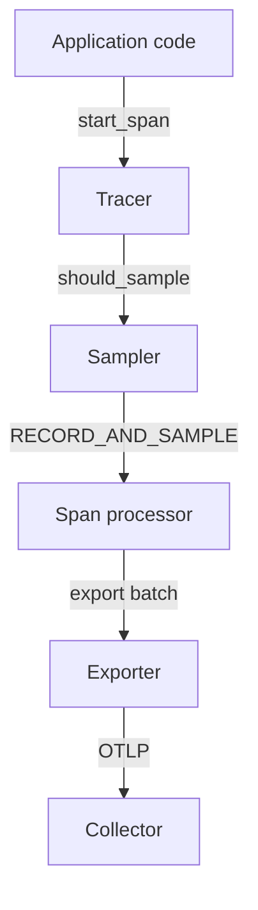

# Providers, Samplers And The Span Path

Application code never talks to an exporter. It calls the OpenTelemetry API, and the SDK (the software development kit, the implementation of the API) turns those calls into data. If a team cannot find a span in the backend, the cause can sit in any stage between the API call and the network. This part follows a span through the first two stages, the provider and the sampler, because they decide whether a span exists at all.

## The provider owns the pipeline

A `TracerProvider` is the SDK object that holds the configuration of the trace pipeline. It owns the resource (the attributes that describe the process, such as `service.name`), the sampler, and the list of span processors. Application code asks the provider for a `Tracer`. The tracer creates spans, and every span uses the sampler and processors of the provider that created the tracer.

The `shuttle` service builds one provider at start. It sets the resource, the sampler comes from environment variables, and one span processor wraps an OTLP/HTTP exporter. The same script reads two sampler variables, `OTEL_TRACES_SAMPLER` and `OTEL_TRACES_SAMPLER_ARG`, which the SDK defines for every language.



The diagram shows that the sampler sits in front of the processor: a span the sampler drops never reaches a processor or an exporter.

## The sampling decision

When code starts a span, the tracer calls the sampler once, before the span exists. The sampler receives the parent context, the trace ID, the span name, the span kind, the start attributes and the links. It returns one of three decisions:

- `DROP`: the span is not recorded. The API still returns a span object, but it is non-recording, so setting attributes on it does nothing.
- `RECORD_ONLY`: the span is recorded, so it keeps attributes and events, but its trace flags do not carry the sampled flag. The built-in exporting processors skip it.
- `RECORD_AND_SAMPLE`: the span is recorded and the sampled flag is set. Processors export it.

A dropped span still has a valid span context with a trace ID and span ID. Code can propagate that context to the next service, and the next service can see that the parent was not sampled. This is why `DROP` does not break the trace structure.

## The built-in samplers

The SDK ships five basic samplers. Their names are the values of `OTEL_TRACES_SAMPLER`:

- `always_on` samples every span. It is the right choice for a development cluster and a risk for a high-traffic service.
- `always_off` samples no span. The pipeline stays alive but exports nothing.
- `traceidratio` samples a fraction of traces. `OTEL_TRACES_SAMPLER_ARG` is the ratio from 0.0 to 1.0.
- `parentbased_always_on`, `parentbased_always_off` and `parentbased_traceidratio` first look at the parent. A sampled parent gives a sampled child, a parent that is not sampled gives a child that is not sampled, and only a root span (a span with no parent) uses the sampler named after the prefix.

The default of the SDK is `parentbased_always_on`. The ratio sampler is deterministic: it derives the decision from the trace ID, so two services that use the same ratio make the same decision for the same trace. A plain `traceidratio` sampler decides for every span on its own and can cut a trace in the middle, which is why services usually use the parent-based form.

## Seeing the sampler at work

Make sure the playground is running. The `shuttle` pod runs `pip install` before it starts, so wait until both pods are ready.

<!-- astrona:playground:renew -->

Check the pods and read the line that the `shuttle` script writes at start. It prints the values of the pipeline variables, so you see what the SDK was told:

```sh
kubectl -n starfleet get pods
kubectl -n starfleet logs deployment/shuttle | grep '\[shuttle\] config'
```

The line starts with `[shuttle] config sampler=parentbased_always_on`. Count the spans the Collector received in the last 20 seconds. The Collector prints each span with a `Name` line, and the `shuttle` names its spans `shuttle.dock`, `shuttle.launch` and `shuttle.scan`:

```sh
kubectl -n starfleet logs deployment/collector --since=20s | grep -cE 'Name +: shuttle\.(dock|launch|scan)$'
```

The count is greater than zero, because `parentbased_always_on` samples every root span. Now change the sampler to `always_off`. The command changes the environment of the Deployment, the pod restarts, and the new pod needs a few minutes to install the SDK:

```sh
kubectl -n starfleet set env deployment/shuttle OTEL_TRACES_SAMPLER=always_off
kubectl -n starfleet rollout status deployment/shuttle --timeout=300s
```

Wait about 30 seconds after the rollout and count again with the same command as before. The count is `0`. The script still creates spans, and the metrics and logs still arrive, but the sampler returns `DROP` for every span. No processor and no exporter is involved in this result.

Now use a ratio. Set the sampler to `parentbased_traceidratio` with a ratio of `0.25`, wait for the new pod, and count over a minute:

```sh
kubectl -n starfleet set env deployment/shuttle OTEL_TRACES_SAMPLER=parentbased_traceidratio OTEL_TRACES_SAMPLER_ARG=0.25
kubectl -n starfleet rollout status deployment/shuttle --timeout=300s
kubectl -n starfleet logs deployment/collector --since=60s | grep -cE 'Name +: shuttle\.(dock|launch|scan)$'
```

The `shuttle` handles two requests every second, so a window of 60 seconds holds about 120 root spans without sampling. You see roughly a quarter of that count, and the number changes between runs, because the trace IDs are random. Each sampled trace also has a `shuttle.refuel` child span that the Collector prints with it, since the child follows its parent.

## What sampling does not do

The sampler runs at the start of the span, before the code has run. This is head sampling. It cannot know that the request will fail or run slowly, so it cannot keep "all the errors". A decision that needs the whole trace belongs in a component that sees finished traces, such as the tail sampling processor of the Collector.

Sampling also applies only to traces. A counter that counts requests is not sampled, so a backend can show 10,000 requests in a metric and 2,500 traces from the same period. That difference is the sampler, not data loss. Sampling at 25 percent makes the exported count one quarter of the true count, so a count of spans must be multiplied by the inverse of the ratio to estimate the real number of requests.

The sampler decides, and the processor delivers. The next question is what happens to a sampled span after it ends: it moves to a span processor, which can hold it in memory for some time before an exporter sends it.

## Common pitfalls

> [!WARNING]
> `OTEL_TRACES_SAMPLER_ARG` is the ratio only for the two ratio samplers. The Python SDK uses a ratio of 1.0 when the argument is missing. A plain `traceidratio` sampler can cut traces in the middle, so use `parentbased_traceidratio` in services that call each other. A span that the sampler dropped does not exist in the backend, and no queue setting can bring it back. Do not compare the number of spans with the value of a request counter without knowing the ratio.
