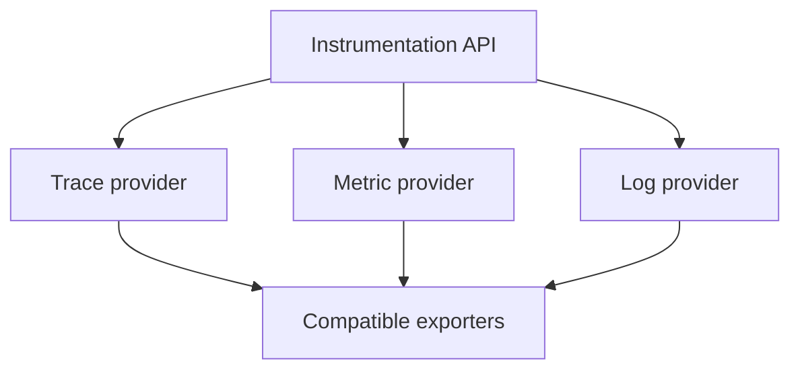

# Signal Providers, Processing, Readers And Shutdown

An SDK pipeline connects API activity to exported data. Its exact components vary by signal and language, but its responsibilities are consistent: record useful observations, apply the selected policy, form exportable data and deliver it through an exporter. Understanding those responsibilities prevents a missing backend record from being attributed automatically to application instrumentation.

The tracing path starts with a tracer supplied by a provider. Creating a span establishes its context and recording behavior under the configured sampling policy. When a recorded span ends, span processors can receive it and pass exportable data toward a destination. A simple processor and a batching processor have different performance characteristics, even when they use the same exporter.

Metrics follow a different contract. Instruments record measurements through a meter, while aggregation and views determine the resulting streams. Readers collect the data and may export it periodically or expose it through another supported mechanism. The temporal meaning of an exported point depends on aggregation and temporality. Replacing a metric reader with a trace processor would not preserve this model.

Logs also have signal-specific processing. A logging bridge can translate application logs into records, and processors can send those records toward export. The record's timestamp, severity, body and context remain meaningful fields. Capturing a log does not imply that it contains a valid trace identifier; correlation depends on the context active when the record was created.

Consider a request that emits a span, increments a counter and writes a log. The three observations can pass through different buffering and export paths. The log may arrive quickly while a batch of spans waits for its scheduled flush. The counter may become visible only at the next collection interval. This timing difference does not necessarily mean the observations describe different application events.

Sampling and aggregation must remain distinct. A trace sampler chooses whether and how selected span evidence is recorded. A metric aggregation combines measurements according to its configured type and dimensions. A sampled trace population can differ from an unsampled request counter population. Comparing them without understanding those policies can produce a false conclusion about missing requests.

Batching reduces the overhead of sending each observation separately. It also creates delay, memory use and a queue whose capacity can be exhausted. If the destination becomes unavailable, queued observations can wait, be retried or eventually be dropped according to the implementation. Increasing capacity buys time but does not create infinite memory or repair an unavailable endpoint.

Lifecycle operations address buffered work. Force-flush asks components to make pending data available within their supported contract. Shutdown stops the pipeline and allows bounded cleanup. Their exact behavior and timeout support are implementation-specific. A process killed without its normal termination path may lose buffered observations. An application should not wait indefinitely for telemetry at the expense of every other shutdown responsibility.

Error visibility belongs beside the pipeline. Export failures and dropped observations need diagnostic evidence that does not recursively depend on the same failing path. Logging the exporter error back through that exporter can create an ineffective loop. Appropriate internal diagnostics and metrics help distinguish collection delay from actual loss.

A useful explanation follows the signal from creation to recording policy, processing, buffering and export. It identifies where the observation could be excluded or delayed. That approach supports diagnosis without claiming that every configured pipeline provides exactly-once delivery or retains every operation.

Signal paths have different recording and export contracts:

The branches preserve signal-specific processing; sharing a destination does not make sampling, aggregation and log correlation equivalent.

## Common pitfalls

> [!WARNING]
> Sampling, aggregation and batching are different policies. Signal pipelines can have different visibility delays. Bounded queues and shutdown operations do not guarantee delivery after abrupt termination or persistent destination failure.
