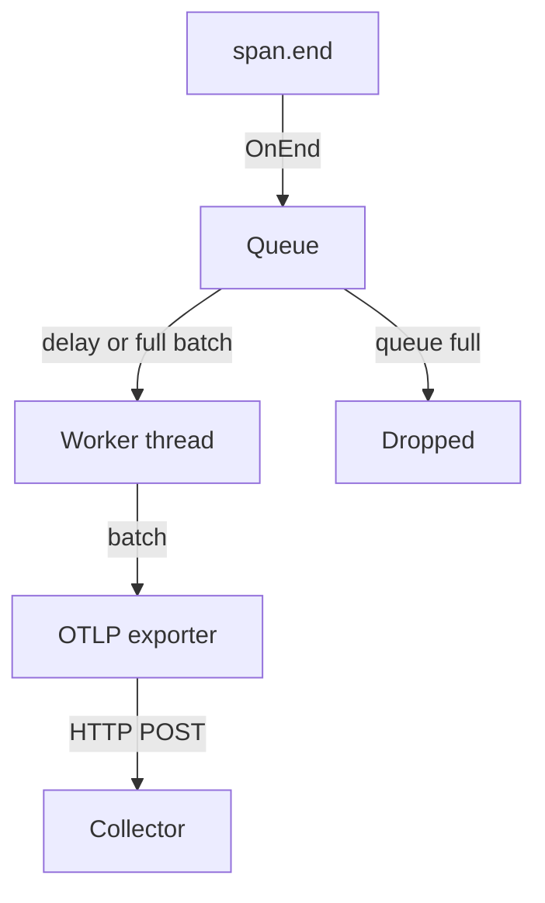

# Span Processors And Exporters

A sampled span that has ended is not sent to the network at once in most services. It goes to a span processor, which decides when and on which thread an exporter sends it. This choice affects the latency of the application, the memory it uses, the delay before a span becomes visible and the number of spans it loses when something goes wrong. This part explains the two built-in processors, the queue of the batching one and the exporter that finishes the path.

## Processors and exporters have different jobs

A span processor is an SDK component with four operations: `OnStart` is called when a span starts, `OnEnd` is called when a span ends, `ForceFlush` asks the processor to hand over what it holds, and `Shutdown` stops it. Processors form a list on the provider and every span goes through the list in order. A processor can also change a span, for example by adding an attribute at start, but the two processors in this part only pass finished spans on.

An exporter knows one destination and one protocol. Its job is to take a batch of finished spans, serialise them and send them, and then report success or failure. The OTLP/HTTP exporter in the `shuttle` sends the spans as Protocol Buffers over HTTP. For traces it appends the path `/v1/traces` to the value of `OTEL_EXPORTER_OTLP_ENDPOINT`, so `http://collector.starfleet.svc.cluster.local:4318` becomes `.../v1/traces`. Port 4318 is the OTLP HTTP port and port 4317 is the OTLP gRPC port. An HTTP exporter that points at 4317 fails.

The processor is the part that calls the exporter. This split lets the same OTLP exporter run behind either processor.

## The simple span processor

The `SimpleSpanProcessor` calls the exporter inside `OnEnd`. The thread of the application that ends the span does the export, and it waits for the HTTP request to finish. The span leaves the process as soon as it ends. No queue exists, so no span can wait in memory.

The cost is the latency of every request in the application. If the Collector takes 200 milliseconds to answer, each `span.end()` takes that long. The OpenTelemetry specification describes this processor as meant for debugging and tests. Use it when you need every span immediately, for example in a short script that must not lose a span, and avoid it in a service that answers user requests.

## The batching span processor

The `BatchSpanProcessor` decouples the application from the export. `OnEnd` only puts the span in a bounded queue in memory, which is fast. A background thread takes spans from the queue and calls the exporter with a batch. Four settings control it, and the SDK reads them from environment variables:

| Variable | Default | Meaning |
| --- | --- | --- |
| `OTEL_BSP_SCHEDULE_DELAY` | 5000 | Milliseconds between two exports |
| `OTEL_BSP_MAX_QUEUE_SIZE` | 2048 | Spans the queue can hold |
| `OTEL_BSP_MAX_EXPORT_BATCH_SIZE` | 512 | Spans in one export call, at most the queue size |
| `OTEL_BSP_EXPORT_TIMEOUT` | 30000 | Milliseconds an export call can take before the processor stops waiting |

The export happens when the schedule delay has passed or when the queue holds a full batch, whichever comes first. The processor never runs two exports at the same time. A batch size that is larger than the queue size is invalid, and the Python SDK raises an error at start.

A span can therefore wait up to five seconds with the defaults before it leaves the process. This is the reason a backend can lag behind the application, and the reason that a short script that exits can finish before the first export.

## What happens when the queue is full

The queue is the pressure valve of the pipeline. The application ends spans at its own speed, and the exporter drains the queue at the speed of the network and the destination. If spans arrive faster than the exporter sends them, the queue grows until it reaches `OTEL_BSP_MAX_QUEUE_SIZE`. Then the processor drops spans. The application does not block and does not see an error. The Python SDK writes a warning in its own logger, `Queue full, dropping`, and the implementation in the version of this course drops the oldest queued item.

A larger queue gives the exporter more time to recover. It also uses more memory, because each queued span holds its attributes, events and links, and it only delays the loss if the destination stays down. If the destination is unavailable for longer than the queue can cover, spans are lost. A faster schedule delay lowers the delay before spans are visible and keeps the queue short, but it sends more, smaller requests.



The diagram shows that a drop happens at the queue, before the exporter, and that a slow destination affects the application only through a full queue.

## Trying both processors

The playground starts with the batching processor and `OTEL_BSP_SCHEDULE_DELAY=2000`. Read the start line of the `shuttle` first. It shows the processor and the queue settings:

<!-- astrona:playground:renew -->

```sh
kubectl -n starfleet logs deployment/shuttle | grep '\[shuttle\] config'
```

You see `span_processor=batch`, `bsp_delay=2000` and `(sdk default)` for the queue and the batch size, which means that the SDK uses 2048 and 512. Look at how the spans arrive in the Collector log. Each export is one OTLP request, and the Collector prints all spans of the request in one `ResourceSpans` block:

```sh
kubectl -n starfleet logs deployment/collector --since=10s | grep -E 'ResourceSpans|Span #'
```

In ten seconds you see several `ResourceSpans` lines and many `Span #` lines under them: each export carries many spans. Now switch to the simple processor, wait for the new pod and run the same command:

```sh
kubectl -n starfleet set env deployment/shuttle SHUTTLE_SPAN_PROCESSOR=simple
kubectl -n starfleet rollout status deployment/shuttle --timeout=300s
kubectl -n starfleet logs deployment/collector --since=10s | grep -E 'ResourceSpans|Span #'
```

There are as many `ResourceSpans` blocks as there are spans in the window, because every `span.end()` sends its own request. The `shuttle.refuel` child also travels alone.

Finally, make the queue overflow. A queue only fills when the exporter cannot keep up, and a healthy local Collector answers in milliseconds. Point the exporter at port 4319, where nothing listens, and shrink the queue to four spans. The exports now fail and retry, the queue stays full, and the SDK writes its warning in the pod log:

```sh
kubectl -n starfleet set env deployment/shuttle SHUTTLE_SPAN_PROCESSOR=batch OTEL_EXPORTER_OTLP_ENDPOINT=http://collector.starfleet.svc.cluster.local:4319 OTEL_BSP_MAX_QUEUE_SIZE=4 OTEL_BSP_MAX_EXPORT_BATCH_SIZE=2
kubectl -n starfleet rollout status deployment/shuttle --timeout=300s
kubectl -n starfleet logs deployment/shuttle | grep -c 'Queue full'
```

Wait a minute and run the last command again: the count grows, and the log also holds the exporter errors for the unreachable port. The application keeps handling requests without any error, and the Collector receives no span. Restore the working endpoint and remove the two queue variables before you go on. A trailing dash after a name makes `kubectl set env` delete that variable:

```sh
kubectl -n starfleet set env deployment/shuttle OTEL_EXPORTER_OTLP_ENDPOINT=http://collector.starfleet.svc.cluster.local:4318 OTEL_BSP_MAX_QUEUE_SIZE- OTEL_BSP_MAX_EXPORT_BATCH_SIZE-
```

Spans can now leave the process on time, in batches, with a queue that protects the application. One question is left: what happens to the spans in the queue when the process stops?

## Common pitfalls

> [!WARNING]
> The simple processor makes every `span.end()` wait for a network request. The batching processor never blocks, but it drops spans silently when the queue is full, and the only trace is a warning in the application's own log. `OTEL_BSP_MAX_EXPORT_BATCH_SIZE` must not be larger than `OTEL_BSP_MAX_QUEUE_SIZE`. `OTEL_BSP_SCHEDULE_DELAY` is in milliseconds, so a value of `5` means five milliseconds, not five seconds. A bigger queue buys time but does not repair an unavailable destination.
