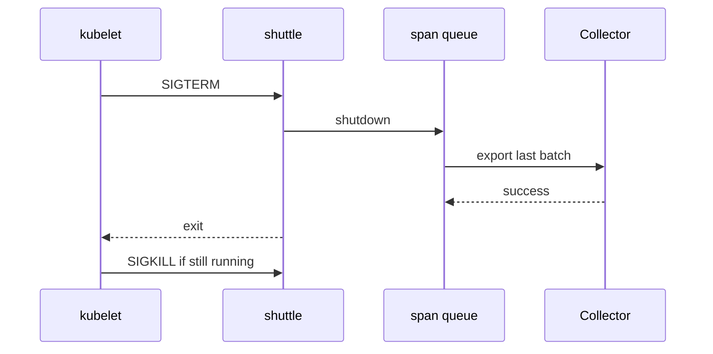

# Flush And Shutdown

The batching span processor keeps finished spans in memory for up to a few seconds. In a service that runs for days this delay is harmless. In a pod that Kubernetes stops during a deployment, it decides whether the last spans of the old process arrive or vanish. This part explains the two lifecycle operations of the SDK, force flush and shutdown, who calls them, how long they can take, and why some stops lose data no matter how large the queue is.

## Two operations with different jobs

`ForceFlush` asks a provider and its processors to hand over everything they hold now. The batching span processor wakes its worker thread, which exports the queued spans, and the call returns when the export has finished or when the timeout has passed. The provider keeps running and accepts new spans. A flush fits a short job that must send its data before it sleeps, for example a function in a serverless platform that can be frozen after it returns.

`Shutdown` ends the pipeline. The provider calls `Shutdown` on every processor once. The batching processor flushes its queue, stops the worker thread and calls `Shutdown` on the exporter, which releases its connections. Spans that end after the shutdown are not exported. The specification also allows a timeout on both operations, and the result tells the caller whether the work finished in time. In the Python SDK, `force_flush` and `shutdown` on a provider take a timeout in milliseconds, and the default is 30000 for the trace provider.

Neither operation can export data that the application has not yet handed to the processor. A span that has started and not ended is not in the queue, so neither operation sends it.

## Who calls shutdown

The application can call `shutdown` itself. The Python trace and log providers also register an `atexit` handler by default, so a normal exit of the interpreter runs the shutdown. Other runtimes differ, and some need the application to call it. The result is: a process that leaves in an orderly way flushes, and a process that does not, does not.

A container stops in two steps. Kubernetes sends `SIGTERM` to the main process of the container and waits for `terminationGracePeriodSeconds`, 30 seconds by default. If the process is still running after that time, Kubernetes sends `SIGKILL`, which no process can catch. The pod spec sets the grace period, and the kubelet on the node enforces it.

The `shuttle` script shows both outcomes through the variable `SHUTTLE_ON_TERM`. With the value `shutdown`, a handler for `SIGTERM` calls `shutdown` on the tracer, meter and logger providers and then exits. With the value `exit`, the handler calls `os._exit(0)`, which ends the process at once without running the `atexit` handlers, so nothing is flushed.



The diagram shows that the last batch leaves before the process exits only if the shutdown finishes inside the grace period.

## Why a flush can still fail

A flush is bounded, so it can fail in four ways. The grace period can be shorter than the work: with `terminationGracePeriodSeconds: 1` the kubelet sends `SIGKILL` before the exporter finishes. The destination can be down, so the export waits for its timeout. The signal can reach the wrong process: a shell script that starts the application as a child and does not pass the signal on stops without the application seeing it. The process can be killed from outside, for example by the kernel when it runs out of memory, and then no handler runs at all.

The sizes interact. A queue of 4096 spans exported in batches of 512 needs at least eight export calls. If each call takes five seconds because the Collector is slow, shutdown needs 40 seconds, which is longer than the default grace period. The timeout of one export, `OTEL_BSP_EXPORT_TIMEOUT` (30000 milliseconds by default), is also longer than the default grace period. Set the grace period from the worst case you accept, and keep the queue small enough to drain inside it.

A well-behaved service therefore does four things: it handles `SIGTERM`, it calls shutdown with a timeout, it leaves time for the application's other cleanup, and it accepts that a hard kill can lose the last seconds of data. It does not wait for telemetry forever, because delaying the exit of a pod blocks a rollout.

## Comparing the two exits

Start from the working playground state. Make sure the playground is running and the pod uses the batching processor and the correct endpoint. Set the exit mode that skips the flush and a long schedule delay, so spans wait in the queue when the pod stops:

<!-- astrona:playground:renew -->

```sh
kubectl -n starfleet set env deployment/shuttle SHUTTLE_SPAN_PROCESSOR=batch SHUTTLE_ON_TERM=exit OTEL_BSP_SCHEDULE_DELAY=20000
kubectl -n starfleet rollout status deployment/shuttle --timeout=300s
```

Wait about 30 seconds so some spans are queued. Delete the pod and read what the old pod logged. You see the `exiting without flush` line and no `shutdown complete` line:

```sh
old_pod=$(kubectl -n starfleet get pods -l app=shuttle -o jsonpath='{.items[0].metadata.name}')
kubectl -n starfleet delete pod "$old_pod" --wait=false
kubectl -n starfleet logs "$old_pod" | tail -n 3
```

The queued spans of the last seconds never reach the Collector. Because the schedule delay is 20 seconds, up to 20 seconds of spans were waiting. Now repeat with the orderly exit:

```sh
kubectl -n starfleet set env deployment/shuttle SHUTTLE_ON_TERM=shutdown
kubectl -n starfleet rollout status deployment/shuttle --timeout=300s
```

Wait 30 seconds again, delete the pod in the same way and read its log. This time the last lines are `SIGTERM: shutting down providers` and `shutdown complete`, and the Collector log shows a final export from the old pod just before it ends:

```sh
old_pod=$(kubectl -n starfleet get pods -l app=shuttle -o jsonpath='{.items[0].metadata.name}')
kubectl -n starfleet delete pod "$old_pod" --wait=false
kubectl -n starfleet logs "$old_pod" | tail -n 3
```

Keep one more fact in mind: after the shutdown call the provider no longer accepts spans, so code that runs after it records nothing.

You can now follow a span from the sampler to the exporter and explain what happens to it when the process stops. The same ideas apply to metrics and logs, but their pipelines aggregate and batch in different ways.

## Common pitfalls

> [!WARNING]
> `SIGKILL` cannot be handled, so no queue size or batch setting protects spans in a process that is killed. A grace period shorter than the shutdown work cuts the flush off. A flush or shutdown call without a timeout can hold up a rollout. The sampler also matters here: dropped spans were never in the queue, so a flush cannot bring them back. Do not claim that a configured pipeline delivers every span.
