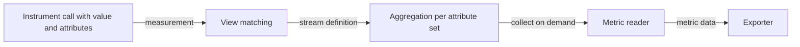

# Meter Providers, Views And Aggregation

A metric instrument records a single number each time application code calls it. A service that handles a thousand requests per second would produce a thousand numbers per second per instrument, and sending each of them would be wasteful. The metric pipeline therefore does not export measurements. It combines them into aggregated streams inside the process and exports the result at intervals. This part follows a measurement from the instrument to the aggregated stream and shows how views change that stream.

## Meter providers and instruments

The meter provider is the root object of the metric pipeline. It holds the resource, which describes the service, a list of metric readers and a list of views. Application code asks the provider for a meter, usually one per library or module, and asks the meter for instruments. The `shuttle` service creates a counter `shuttle.requests`, a histogram `shuttle.request.duration` and a counter `shuttle.fuel.used`.

Every call such as `add` on a counter or `record` on a histogram carries a value and a set of attributes. The SDK looks up which streams match the instrument and sends the measurement to each one. If no view matches, the provider creates one default stream for the instrument.



The diagram shows that the reader pulls from the aggregation when it collects. The instrument itself never triggers an export.

## Default aggregations

An aggregation defines how many measurements become one data point. A counter uses the sum aggregation by default, so the stream holds one total per combination of attribute values. A histogram uses the explicit bucket histogram aggregation, which counts how many values fell into each bucket and also keeps the sum, the count, the minimum and the maximum. The default bucket boundaries of the SDK run from 0 to 10000, and they suit durations in milliseconds. A histogram that records seconds puts nearly every value into the first two buckets, which makes percentiles useless. Other aggregations exist: last value for gauges, the exponential histogram that adapts its buckets to the data, and drop, which discards the stream.

One data point exists for each unique set of attribute values. This is the cardinality of the stream. A counter with the attributes `shuttle.route` and `shuttle.client` holds as many points as there are route and client pairs. If one attribute carries a user identifier, the number of points grows without limit and so does the memory of the process and the cost at the backend. Attributes are the main source of metric cost.

## Synchronous and asynchronous instruments

Instruments come in two kinds. A synchronous instrument, such as a counter, an up-down counter or a histogram, is called by application code at the moment something happens. An asynchronous instrument, such as an observable gauge, is given a callback function, and the SDK calls that function when a reader collects. Asynchronous instruments suit values that are read from outside the code path, for example the size of a queue or the memory of the process. A callback that is slow delays the collection, and therefore the export, so it should only read a value and return.

## The cardinality limit

The SDK protects the process against unbounded attribute sets. Each stream has a cardinality limit, and the default in the Python SDK is 2000 attribute sets. When the limit is reached, new attribute sets are no longer stored separately. Their measurements are added to one overflow point that carries the attribute `otel.metric.overflow` with the value true. The limit prevents an out-of-memory failure, but it also means that the data for the extra attribute sets cannot be told apart. A view can set a different limit for a stream. The better fix is to remove the attribute that causes the growth.

## Views

A view changes how a stream is built, before the first measurement is aggregated. It has two parts. The selection part chooses instruments by name, by type, by the meter that created them, or by a combination. The name may contain a wildcard. The configuration part can set a new stream name and description, a list of attribute keys to keep, and the aggregation. In the Python SDK a view is a `View` object that is passed to the meter provider in the `views` argument.

Three uses matter most in practice. A view with `attribute_keys` keeps only the listed attributes, so the SDK merges the points that differ only in the removed ones. A view with an explicit bucket histogram aggregation sets boundaries that fit the unit of the data. A view with the drop aggregation removes a stream completely, and the instrument still accepts calls, but nothing is stored or exported. A view cannot turn a measurement into a different instrument type, and the application code stays unchanged.

The sketch below shows the three views as Python code. The classes come from the module `opentelemetry.sdk.metrics.view`, and the list goes to the `views` argument of the `MeterProvider`:

```python
views = [
    View(instrument_name="shuttle.requests", attribute_keys=["shuttle.route"]),
    View(
        instrument_name="shuttle.request.duration",
        aggregation=ExplicitBucketHistogramAggregation([0.05, 0.1, 0.25, 0.5, 1.0]),
    ),
    View(instrument_name="shuttle.fuel.used", aggregation=DropAggregation()),
]
provider = MeterProvider(metric_readers=[reader], views=views)
```

Each `View` selects one instrument by name and changes one property of its stream. The reader in the last line is the next topic.

If several views match one instrument, the SDK creates one stream for each of them. Two views that give the same name to streams with a different shape produce a conflict, and the SDK reports a warning. The measurements are still recorded.

## Looking at views in the playground

Make sure the playground is running, then read the metrics the Collector received in the last 40 seconds. The names and the attributes of the streams are in this output:

<!-- astrona:playground:renew -->

```sh
kubectl -n starfleet get pods
kubectl -n starfleet logs deploy/collector --since=40s | grep -E 'Name:|shuttle\.(client|route)' | head -n 20
```

The Collector prints the metric names and one attribute set for each data point. Without views, the counter `shuttle.requests` has the attributes `shuttle.route` and `shuttle.client`. Now ask the script to apply the `keys` view, which keeps only `shuttle.route` on that counter, and wait for the new pod:

```sh
kubectl -n starfleet set env deployment/shuttle SHUTTLE_VIEWS=keys
kubectl -n starfleet rollout status deployment/shuttle --timeout=300s
```

After the next export, about ten seconds later, repeat the grep from before. The attribute `shuttle.client` is gone, and the number on each point is the total across all clients. The SDK removed the attribute inside the process, so the Collector could not have recovered it. Now drop a whole stream and add the bucket view:

```sh
kubectl -n starfleet set env deployment/shuttle SHUTTLE_VIEWS=keys,buckets,drop-fuel
kubectl -n starfleet rollout status deployment/shuttle --timeout=300s
kubectl -n starfleet logs deploy/collector --since=40s | grep -c 'shuttle.fuel.used'
```

The count is zero, because the stream `shuttle.fuel.used` no longer exists, and the application still calls `add` on it. The histogram now uses the boundaries from 0.05 to 1.0, which fit values in seconds.

The three views changed the data without any change to the instrumentation code. This is why views are the tool of the operator: the author of a library chooses what to measure, and the owner of the service chooses what to keep. Exporting is the second half of the story, and it follows the schedule of the reader.

## Common pitfalls

> [!WARNING]
> A view applies only to instruments that are created after the provider has it, and a change needs a new process, because the SDK reads views at start. A view that selects the wrong name matches nothing and fails silently. Removing an attribute merges points, so it can hide the difference that an alert needs. Dropping a stream is easy to forget, and the missing metric then looks like a bug in the application. Never put unbounded values such as user identifiers into metric attributes.
