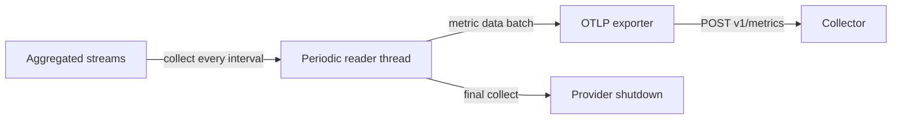

# Metric Readers And Temporality

The previous stage of the metric pipeline keeps aggregated streams in memory. Nothing leaves the process until a metric reader collects them. The reader decides when data is collected, which form it has and where it goes. This part explains the periodic exporting reader, the interval and timeout settings, and the two temporalities in which a sum or a histogram can be reported. It ends with the lifecycle of the reader, because a metric reader loses data in a different way than a span processor.

## What a reader does

A metric reader is the link between the meter provider and an exporter. When the reader collects, it asks the provider for the current state of every stream, runs the callbacks of asynchronous instruments and receives a batch of metric data. There are two common kinds of reader. A pull reader waits until a client asks, and the Prometheus exporter works this way: the scrape request triggers the collection. A push reader collects on a timer and calls an exporter, and the periodic exporting metric reader is the push reader of the SDK. OTLP exporters use it.

The periodic reader runs its own thread. Every interval it collects, calls the exporter with a timeout, and goes back to sleep. Two settings control it: the export interval, `OTEL_METRIC_EXPORT_INTERVAL`, in milliseconds with a default of 60000, and the export timeout, `OTEL_METRIC_EXPORT_TIMEOUT`, with a default of 30000. The timeout limits one export and should be shorter than the interval.



The last edge in the diagram shows that a provider shutdown triggers one more collection, so a clean stop does not lose the data of the last interval.

## The interval as a trade-off

A short interval gives a fresh view and a larger load: more requests, more data points at the backend and more cost. A long interval is cheap and coarse. A service that exports every 60 seconds shows a spike that lasts ten seconds only as a small bump in one data point. The default of 60 seconds fits dashboards. An alert that has to fire within a minute needs a shorter interval, and a short job needs an interval shorter than its run time or an explicit flush before it ends.

An interval does not change what is measured. The SDK aggregates every measurement regardless of the interval, so the sum of a counter is exact. Only the resolution in time changes.

## Cumulative and delta temporality

Temporality says what a data point of a sum or histogram covers. In cumulative temporality each point holds the total since the start of the stream, and the start time stays the same. In delta temporality each point holds only the change since the previous export, and the start time moves forward with every export.

The two forms suit different backends. Cumulative data is easy to consume: a backend that misses one export loses nothing, because the next point contains the full total. A backend that stores cumulative data can compute a rate from two points and detects a process restart when the total falls. Delta data is smaller to keep in the process, because the exporter can forget a stream that had no change, and it suits backends that sum increments themselves. It has one weakness: an export that fails or a process that is killed loses the increments for good.

The OTLP specification lets a user choose with `OTEL_EXPORTER_OTLP_METRICS_TEMPORALITY_PREFERENCE`. The value `cumulative` is the default. The value `delta` applies delta to counters and histograms and keeps up-down counters cumulative. The value `lowmemory` is a variant for synchronous instruments. In the Python SDK the exporter takes a `preferred_temporality` argument, and the `shuttle` script reads the variable itself and passes the mapping. Do not assume that every SDK reads the variable without checking its documentation.

## Forcing a collection

The meter provider has a `force_flush` method that asks every reader to collect and export now, within a timeout. This is the right tool for a batch job, a command line program or a function that may be frozen after it returns: the job calls it once at the end, and the data of the last, incomplete interval is sent. The call does not change the schedule of the reader, and the next periodic export still happens at its time. In a long-running service the call is rarely needed.

The table summarises the choices of this part.

| Setting | Short value | Long value |
| --- | --- | --- |
| Export interval | Fresh data, more load | Coarse data, less load |
| Export timeout | Fails fast on a slow destination | Waits longer, may overlap the next export |
| Cumulative temporality | Robust to a missed export | More memory for idle streams |
| Delta temporality | Small and simple to sum | A missed export loses increments |

## Changing the reader in the playground

Make sure the playground is running. The service exports every ten seconds with cumulative temporality. Look at the temporality of the counter in the Collector log:

<!-- astrona:playground:renew -->

```sh
kubectl -n starfleet logs deploy/collector --since=40s | grep -E 'AggregationTemporality|IsMonotonic' | sort | uniq -c
```

You should see the line `AggregationTemporality: Cumulative`. The Collector prints the field in its own text format, so adapt the pattern if your version prints it differently. Switch the service to delta and wait for the new pod:

```sh
kubectl -n starfleet set env deployment/shuttle OTEL_EXPORTER_OTLP_METRICS_TEMPORALITY_PREFERENCE=delta
kubectl -n starfleet rollout status deployment/shuttle --timeout=300s
```

After the next export the same grep shows `Delta`. The value of the counter `shuttle.requests` is now small and the same on each export, because each point contains only the requests of the last interval. Under cumulative temporality it grew with every export. Now make the reader slow and observe the gap:

```sh
kubectl -n starfleet set env deployment/shuttle OTEL_METRIC_EXPORT_INTERVAL=60000
kubectl -n starfleet rollout status deployment/shuttle --timeout=300s
kubectl -n starfleet logs deploy/collector --since=45s | grep -c 'Name:'
```

Run the last command several times over two minutes. The Collector still receives spans and logs without a pause, but metrics arrive once a minute, and the count is zero for most of the time. The application behaves in the same way as before, so only the telemetry shows the change.

Restore a short interval before you move on, so that the next part shows metrics and logs at the same time:

```sh
kubectl -n starfleet set env deployment/shuttle OTEL_METRIC_EXPORT_INTERVAL=10000
```

## Lifecycle and data loss

The periodic reader does not use a queue. Between two collections, the aggregated state lives in the memory of the process, and it is bounded by the cardinality limit and not by a queue size. The data is lost in three cases: the process is killed before the next collection, the exporter fails and the temporality is delta, or an export exceeds its timeout. A clean shutdown of the provider performs a last collection, in the same way as the shutdown of the span processor performs a last export.

A sound configuration chooses an interval that the backend can afford, a timeout shorter than the interval, a temporality that the backend expects, and a shutdown path that runs. These choices belong to the owner of the service and not to the author of the instrumentation, in the same way as views do.

## Common pitfalls

> [!WARNING]
> A timeout that is longer than the interval lets exports overlap or queue up behind each other. Delta data sent to a backend that expects cumulative data produces totals that look like resets. A very short interval can overload a backend, and a long interval hides short events. A short-lived process that exits before the first interval sends nothing at all, unless it calls flush or shutdown. Do not read a quiet metric stream as a healthy service without checking that exports still arrive.
