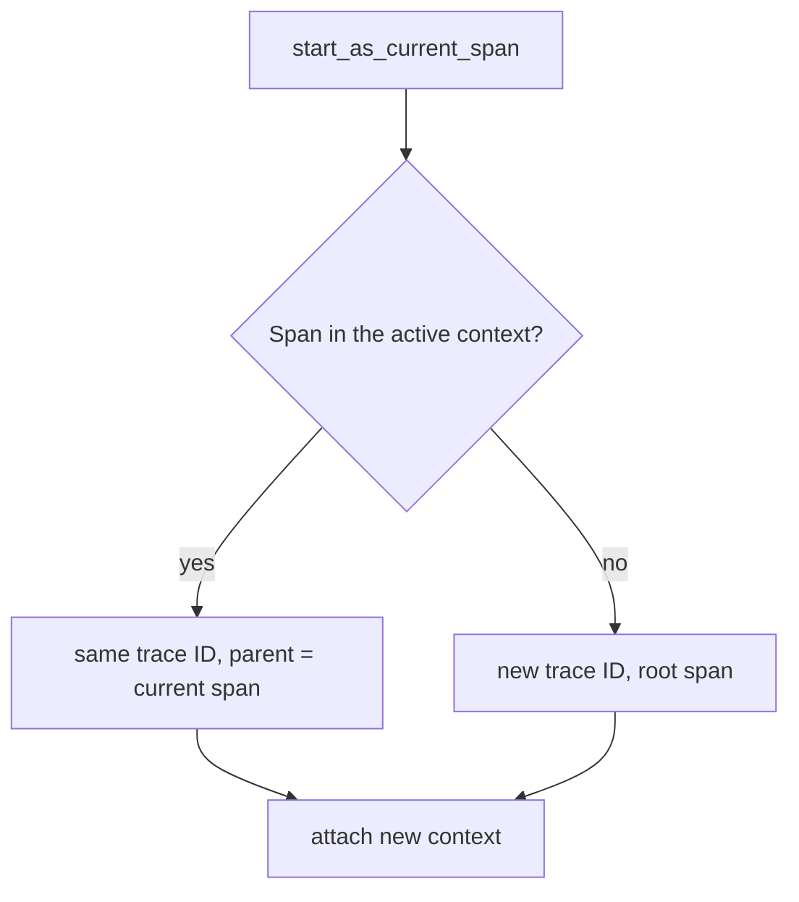

# The Context Object And The Active Context

A trace is only useful when every span knows which span started it. Inside one process, the OpenTelemetry API solves this with a Context object. This part explains what a Context holds, what the active context is, how a new span picks its parent from it, and how you can read all of this in the log of a running service.

## What a Context is

A Context is an immutable mapping from keys to values. It carries values that belong to one unit of work, for example one incoming request. OpenTelemetry stores two kinds of values in it: the current span and the baggage. Other libraries can store their own values under their own keys.

Immutable means that you never change a Context. Every function that adds a value returns a new Context and leaves the old one as it was. For example, `trace.set_span_in_context(span)` returns a new Context that holds the span, and `baggage.set_baggage("mission", "survey", ctx)` returns a new Context that holds the baggage entry. This rule lets two parts of a program hold different Contexts without affecting each other.

The Context API is part of the OpenTelemetry API, not of the SDK. The API package defines the functions and the data. The SDK package supplies the real tracer that reads and writes the span in the Context. Without an SDK, the same calls still work, but spans are non-recording and they only carry the span context along.

## The active context

A Context is only a value. The active context (also called the current context) is the Context that the API returns when code calls `context.get_current()` with no argument. The API keeps the active context in storage that belongs to the current thread of execution. In Python this storage is a `contextvars.ContextVar`, so each thread and each asynchronous task has its own active context.

Two functions change the active context. `context.attach(ctx)` makes `ctx` the active context and returns a token. `context.detach(token)` restores the context that was active before the matching attach. Always detach in a `finally` block. If code skips the detach, the next unit of work that runs on the same thread starts with a stale context and may attach its spans to the wrong request.

The function `tracer.start_as_current_span(name)` does the attach and detach for you. It creates the span, puts it in a new Context, attaches that Context, runs the `with` block, and then detaches and ends the span. Inside the block, `trace.get_current_span()` returns this span.

## How a new span finds its parent

A span has a parent span ID, or none if it is a root span. The SDK tracer decides this when it creates the span. It uses the Context that you pass in the `context` argument. If you pass none, it uses the active context.

The tracer reads the current span from that Context. If a valid span context is there, the new span gets the same trace ID and takes the span ID of the current span as its parent span ID. If there is none, the tracer creates a new trace ID and the span is a root span. The sampler then decides whether the span is recorded, and by default (`parentbased_always_on`) it follows the decision of the parent.



The diagram shows that the parent comes only from the Context. The SDK never looks at the call stack or at the clock.

## Span context versus Context

Two similar names cause confusion. A Context is the mapping described above. A SpanContext is the small immutable object that identifies one span. It has the trace ID, the span ID, the trace flags, the trace state and one boolean, `is_remote`. The trace flags hold the sampled bit. The trace state is a list of vendor-specific key-value pairs.

The span object itself lives only in the process that created it. The SpanContext is the part that can leave the process, because it is only a few identifiers. A propagator serializes the SpanContext into a request header. On the other side, a propagator builds a SpanContext again and marks it with `is_remote=True`. This flag tells the receiver that the parent span ran in another process.

## A worked example of the parent choice

Take the `shuttle` loop. The call `dispatch()` runs with an empty active context, so the SDK creates a new trace ID and `shuttle.dispatch` is a root span. Inside the block, the active context holds `shuttle.dispatch`. If the code now starts another span with `start_as_current_span("shuttle.encode")`, the tracer finds `shuttle.dispatch` in the active context. The new span gets the same trace ID, and its parent span ID is the span ID of `shuttle.dispatch`.

When the inner block ends, `context.detach` restores the previous context, and `shuttle.dispatch` is the current span again. When the outer block ends, the active context is empty again. The next loop iteration starts another root span with a new trace ID.

## Reading the context in a running service

In the playground, the `shuttle` Deployment starts a `shuttle.dispatch` span every five seconds and prints one `PROPAGATION` line for it. The `probe` Deployment prints one line for each request it handles. Both Python pods run `pip install` for the SDK first, so check that they are running.

<!-- astrona:playground:renew -->
```sh
kubectl -n starfleet get pods
```

When `shuttle`, `probe` and `collector` show `Running`, read the recent lines of the `shuttle`:

```sh
kubectl -n starfleet logs deploy/shuttle --tail=12 | grep '^PROPAGATION'
```

Each line has the fields `role`, `span`, `trace_id`, `span_id` and `parent_span_id`. A line with `role=client` and `span=shuttle.dispatch` has `parent_span_id=none`. This span is a root span, because the loop calls `dispatch()` with no span in the active context. The `trace_id` is 32 hexadecimal characters and the `span_id` is 16.

The application code shows how this happens. It runs `with tracer.start_as_current_span("shuttle.dispatch", kind=SpanKind.CLIENT) as span:`, then reads `ctx = context.get_current()`, adds the baggage with `baggage.set_baggage`, and attaches the new Context with `context.attach(ctx)`. Print the code of the Deployment to see it:

```sh
kubectl -n starfleet get configmap shuttle-app -o jsonpath='{.data.app\.py}' | sed -n '/^def dispatch/,/^print/p'
```

The command prints the `dispatch` function. The `finally` block ends with `context.detach(token)`, which restores the context that was active before the attach. The ordering of attach and detach is the whole contract of the active context.

## Passing a Context explicitly

The active context is a convenience. Every API that takes a context also accepts it as an argument: `tracer.start_span(name, context=ctx)`, `propagate.inject(carrier, context=ctx)` and `baggage.get_all(ctx)`. When code works with a Context that belongs to some other unit of work, passing it explicitly is safer than attaching it.

The `probe` does this. It extracts a Context from the request headers into the variable `ctx` and passes it as `context=ctx` to `start_as_current_span`. The span then gets its parent from that Context, not from the active context of the server thread, which holds no span. The next part shows what goes wrong when code forgets to pass or attach a Context at a thread boundary.

You now know that a Context is an immutable mapping, that the active context is a per-thread value changed with attach and detach, and that a span takes its parent from the Context it is created in. The open question is what happens when the work moves to another thread or task, where the active context is not the one you expect.

## Common pitfalls

> [!WARNING]
> Never call `context.attach` without a `context.detach` in a `finally` block: the context leaks into the next unit of work on the same thread. A Context is immutable, so `baggage.set_baggage` has no effect on the active context until you attach the Context it returns. A span without a span in the active context is a root span; that is a valid trace, not an error, so a missing parent is found by reading `parent_span_id`, not by waiting for an exception.
