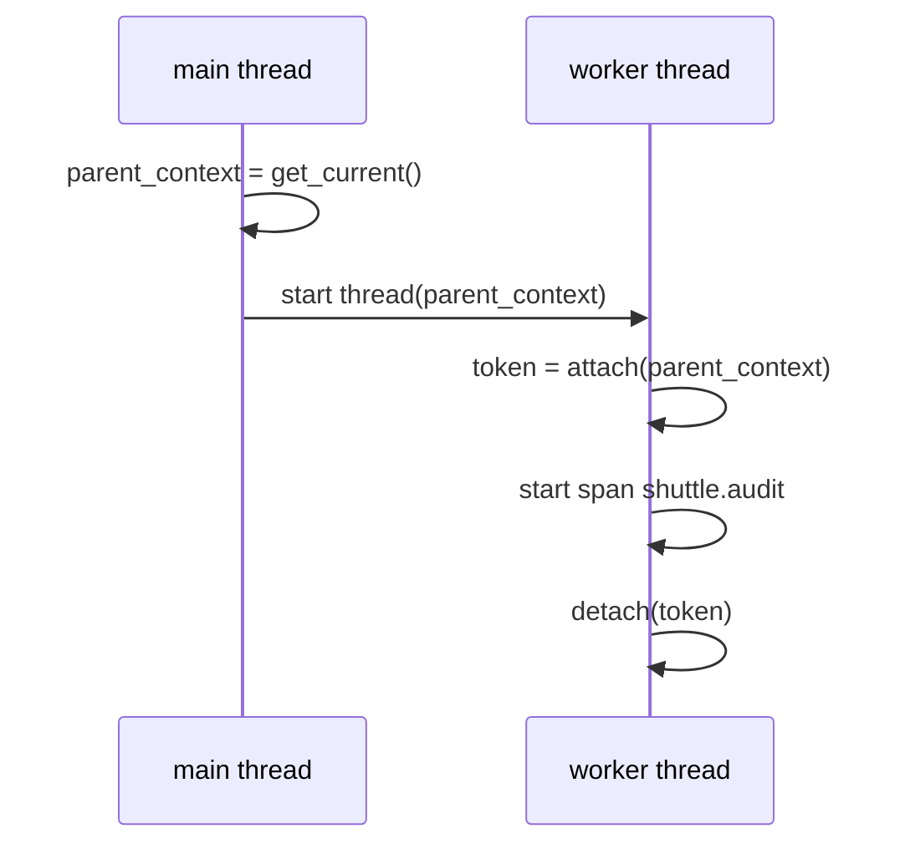

# Keeping Context Across Threads And Asynchronous Work

The active context belongs to one thread or one asynchronous task. Real services hand work from one thread to another all the time: a thread pool, a background worker, a callback or a queue consumer. This part shows why the active context does not follow that work automatically, how to carry it across the hand-off, and how to see the difference in the span parents.

## Why the context does not move by itself

Python stores the active context in a `ContextVar`. A new operating-system thread starts with an empty set of context variables. It does not copy the values of the thread that created it. As a result, `context.get_current()` in a new thread returns the empty root Context, and a span started there has no parent.

The same rule holds for `concurrent.futures.ThreadPoolExecutor.submit` and for `loop.run_in_executor`: the function runs on a pool thread that has its own active context. In contrast, `asyncio.create_task` copies the current context into the new task when the task is created, and `asyncio.to_thread` copies it into the worker thread. So asynchronous tasks inside one event loop usually keep the context, while raw threads never do.

Other languages have the same problem with different tools. In Java the active context is stored in a thread-local variable, and code wraps a `Runnable` with `Context.current().wrap(runnable)` to carry it. In Go the context is a value that code passes as the first argument of each function, so a goroutine keeps the context only when the caller passes it in. The shared rule is the same: the hand-off point must move the Context on purpose.

## The fix: capture, attach, detach

The pattern has three steps. First, capture the Context in the thread that has it: `parent_context = context.get_current()`. Second, hand the value to the other thread as an argument. Third, in that thread, call `context.attach(parent_context)` before starting spans and `context.detach(token)` in a `finally` block when the work ends.



The diagram shows that the Context travels as an ordinary argument. After the attach, the span in the worker thread finds the `shuttle.dispatch` span in the active context and becomes its child.

The playground `shuttle` has this pattern in its `audit` function. It attaches the captured Context only when the environment variable `SHUTTLE_ATTACH_CONTEXT` is `true`, so you can see both behaviours with the same code.

## Seeing a lost context

The playground starts with `SHUTTLE_ATTACH_CONTEXT=false`. Each iteration of the `shuttle` loop prints one line for `shuttle.dispatch` and one for `shuttle.audit`, which runs in a worker thread.

<!-- astrona:playground:renew -->
```sh
kubectl -n starfleet logs deploy/shuttle --tail=12 | grep '^PROPAGATION'
```

Find a line with `role=worker` and `span=shuttle.audit`. Its `parent_span_id` is `none`, and its `trace_id` is different from the `trace_id` of the `role=client` line printed just before it. The worker span started a new trace. In a trace viewer this shows as a separate one-span trace for every request, while the main trace has a `shuttle.dispatch` span with no child for the audit work.

Nothing failed. The HTTP call to the `probe` still works, the exporter still sends both spans, and the collector receives them. The break is visible only in the relationships.

## Carrying the context into the thread

Set the variable on the Deployment. This changes the pod template, so Kubernetes starts a new pod, and the new pod installs the SDK again. Wait for the rollout:

```sh
kubectl -n starfleet set env deployment/shuttle SHUTTLE_ATTACH_CONTEXT=true
kubectl -n starfleet rollout status deployment/shuttle --timeout=300s
```

Read the log again after a few seconds:

```sh
kubectl -n starfleet logs deploy/shuttle --tail=12 | grep '^PROPAGATION'
```

Now a `role=worker` line has a `parent_span_id` that is not `none`. Its `trace_id` equals the `trace_id` of the `role=client` line of the same iteration, and its `parent_span_id` equals the `span_id` of that client line. The worker span is a child of `shuttle.dispatch`, because the `audit` function attached the captured Context before it started its span.

## Where each kind of boundary needs a decision

The right action depends on the kind of boundary. The table lists the common cases for a Python service. The last column names the component that moves the Context.

| Boundary | Does the active context follow? | What moves the Context |
| --- | --- | --- |
| Function call in the same thread | Yes | Nothing, the thread-local value stays |
| `asyncio.create_task` | Yes, a copy is made at creation | The `asyncio` library |
| `asyncio.to_thread` | Yes, a copy is made | The `asyncio` library |
| `Thread`, `ThreadPoolExecutor.submit`, `run_in_executor` | No | Your code, or an instrumentation library |
| HTTP request to another service | No | A propagator and the HTTP client instrumentation |
| Message in a queue | No | A propagator and the messaging instrumentation |

An instrumentation library is a package that adds this work for a known library, for example a threading instrumentation that wraps the thread start. If your application uses a library without such a package, your own code must do the hand-off.

## Queues and other asynchronous hand-offs

A thread pool lives inside one process, so the Context can travel as a Python object. A message queue is different, because the producer and the consumer are separate processes and the message is bytes. The Context must be serialized into the message metadata (for example message headers) by a propagator, and the consumer must extract it. A messaging instrumentation library does this for the clients it supports.

The consumer then has a choice. If it handles one message, the consumer span can be a child of the producer span. If one consumer span handles a batch, or the work starts long after the message was sent, a span link is more accurate: the new span has its own trace and links to the span contexts of the messages. A link states that two spans are related without claiming that one caused the other to start.

The part you finished covers the same process and the same machine. The question left open is the bytes that leave the process: what exactly does the `shuttle` write into the HTTP request so that the `probe` can find the span that sent it?

## Common pitfalls

> [!WARNING]
> A new thread and a thread-pool task start with an empty active context, so spans there become root spans while every request still succeeds. Detach in a `finally` block after you attach in a worker, because pool threads are reused and a leaked context attaches the next job to the wrong trace. Do not make a parent only to complete a picture: when work starts later or serves many messages, use span links instead of a false parent.
