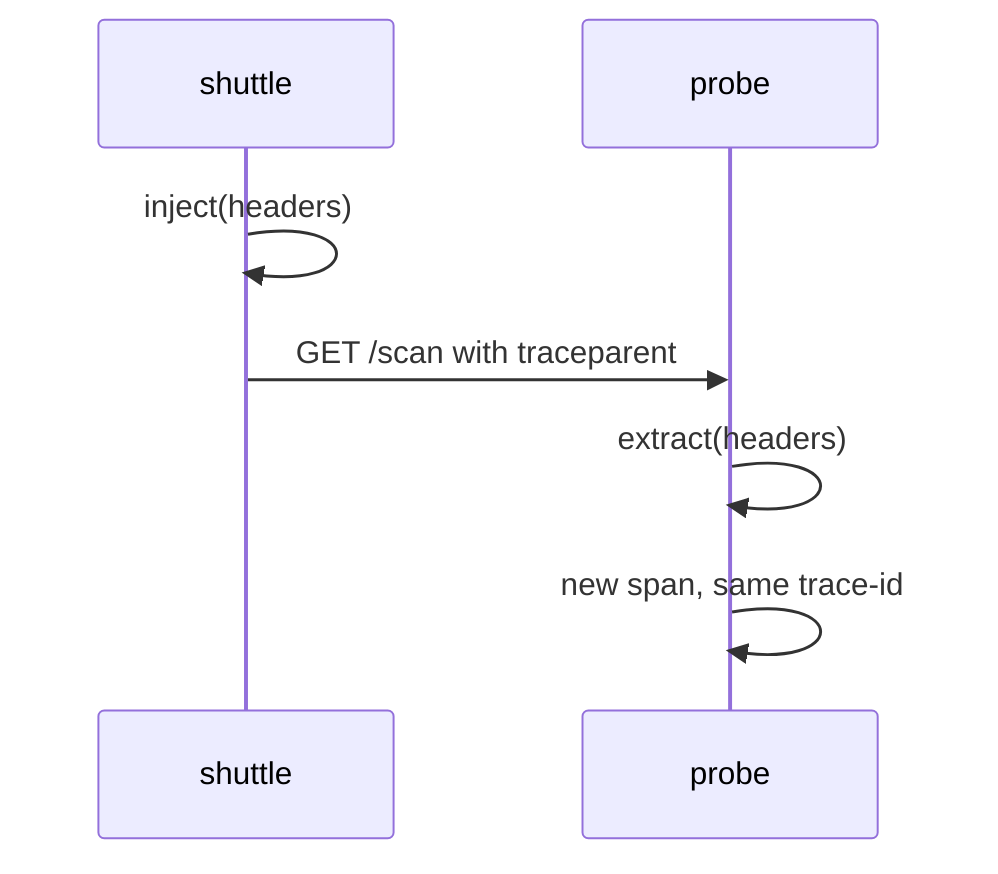

# The W3C traceparent And tracestate Headers

When the `shuttle` calls the `probe`, the two services run in different processes, so the Context cannot be passed as an object. The caller must write the identity of its current span into the request, and the receiver must read it back. The format for this is the W3C (World Wide Web Consortium) Trace Context standard. This part explains its two HTTP headers, `traceparent` and `tracestate`, field by field, and shows the real header in the playground.

## The traceparent header

The `traceparent` header carries the identity of the span that sent the request. It is one line of four fields, separated by dashes:

```text
version-trace-id-parent-id-trace-flags
```

The W3C specification gives this example: `00-4bf92f3577b34da6a3ce929d0e0e4736-00f067aa0ba902b7-01`. The fields are:

- `version`: two lowercase hexadecimal characters. The value `00` is the version that exists today. The value `ff` is invalid.
- `trace-id`: 32 lowercase hexadecimal characters, which are 16 bytes. All zeros is invalid.
- `parent-id`: 16 lowercase hexadecimal characters, which are 8 bytes. It is the span ID of the span that made the call. All zeros is invalid.
- `trace-flags`: two hexadecimal characters, which are 8 bits of flags. Bit 0 is the sampled flag. `01` means the caller sampled the trace, and `00` means it did not.

The name `parent-id` can mislead. It does not name the parent of the sender. It names the sender itself, because from the point of view of the receiver, the sender span is the parent of the span the receiver is about to create.

## How the receiver uses it

The receiver parses the header and builds a SpanContext with `is_remote=True`. The new server span takes the `trace-id` as its own trace ID and the `parent-id` as its parent span ID. It creates a new span ID for itself. A span in the same trace, with a parent in another process, is exactly what a trace viewer needs to draw the call between two services.



The diagram shows the order: the `shuttle` injects first, the HTTP request carries the header, and the `probe` extracts before it starts its span.

If the header is missing or invalid, the receiver does not fail the request. The propagator ignores the bad value and the receiver starts a new trace. This is why a broken header never produces an error, only a split trace.

## The tracestate header

The `tracestate` header carries extra tracing data that belongs to specific vendors or tools. It is a comma-separated list of `key=value` members, for example `vendor1=opaque,vendor2=value`. The specification allows up to 32 members. A tool must pass the header on without change, except that it may move its own member to the left end of the list. Leftmost means most recently updated.

`tracestate` never replaces `traceparent`. A receiver that finds a `tracestate` without a valid `traceparent` ignores it. In the OpenTelemetry API, the trace state is a field of the SpanContext, and the W3C propagator writes the header only when that field is not empty. The playground services never set a trace state, so the requests carry no `tracestate` header.

## Reading a real header

The `probe` prints the `traceparent` header of each request it receives. In the playground, read the newest lines:

<!-- astrona:playground:renew -->
```sh
kubectl -n starfleet logs deploy/probe --tail=6 | grep '^PROPAGATION'
```

Copy the value after `traceparent=` from one line. It has the same shape as the example above: `00`, then 32 characters, then 16 characters, then `01`. The last field is `01` because the `shuttle` samples every trace with the default sampler `parentbased_always_on`. Print the same value split into the four fields:

```sh
kubectl -n starfleet logs deploy/probe --tail=1 | grep '^PROPAGATION' | sed 's/.* traceparent=\([^ ]*\).*/\1/' | tr '-' '\n'
```

The command prints four lines. Now find the `shuttle` line that has the same trace ID and a `span_id` equal to the third field:

```sh
kubectl -n starfleet logs deploy/shuttle --tail=20 | grep '^PROPAGATION' | grep ' role=client '
```

The matching line is `span=shuttle.dispatch`. The third field of the header is the span ID of the `shuttle.dispatch` span, which confirms that `parent-id` names the sender. The `probe` line has the same `trace_id`, `remote=true`, and a `parent_span_id` equal to that value. Its own `span_id` is new.

## Versions and unknown fields

The first field exists so the format can grow. A receiver that sees a version higher than the one it knows must still try to read the first three fields it understands, as long as they have the expected length. It must not read the version `ff`. A receiver that sees version `00` must reject a header that has extra fields after the flags.

In practice, every OpenTelemetry SDK writes version `00`, so the rule matters only when you build or test your own parser. For the exam, remember the four fields, their lengths and what the sampled bit means.

## Why the flags matter

The sampled bit travels with the trace. With the default sampler `parentbased_always_on`, a service that receives `trace-flags` of `01` records its own span, and a service that receives `00` does not. This keeps every service in one trace making the same decision, so a trace is complete or absent, not torn.

The flag has a second consequence. If a service in the middle creates a new trace instead of continuing, the flag value of the first service no longer protects the downstream spans. A single dropped header changes both the trace identity and the sampling decision of all work after that point.

You now know the format of the header that crosses the process boundary and how the receiver turns it into a parent. The open question is who writes and reads it: which component calls inject and extract, and how a service chooses which header formats to use.

## Common pitfalls

> [!WARNING]
> A `parent-id` is the span ID of the sender, not the ID of the sender's parent. A header with an all-zero trace ID or span ID, an uppercase letter or a wrong length is invalid, and the receiver silently starts a new trace instead of returning an error. Do not paste a trace ID into a request body or a log message and expect a receiver to continue the trace: only a propagator that reads the `traceparent` header does that.
