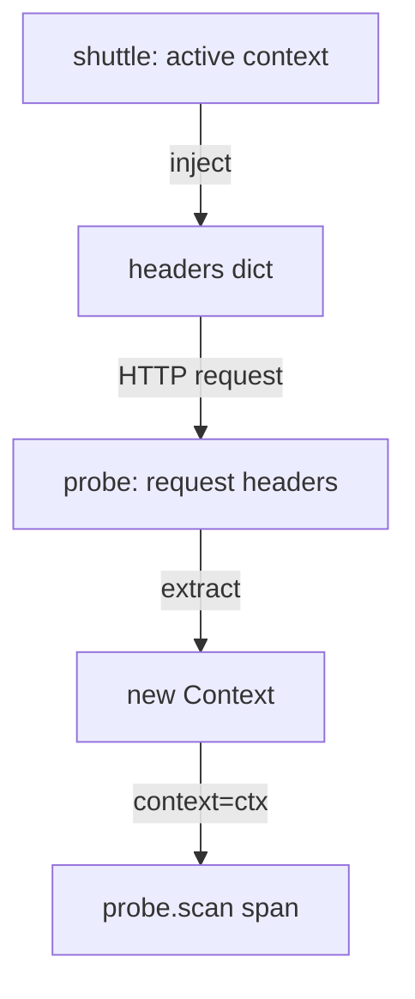

# Propagators: Inject, Extract And OTEL_PROPAGATORS

The W3C header format is only a format. Something must write it into an outgoing request and read it from an incoming one. In OpenTelemetry that component is a propagator. This part explains the propagator interface, the carrier with its setter and getter, the global propagator, and the `OTEL_PROPAGATORS` environment variable that chooses which formats a service uses. Then you change the variable on a running service and watch the effect.

## What a propagator does

A propagator is an object that implements two operations. `inject` takes a Context and a carrier and writes the values of the Context into the carrier. `extract` takes a carrier and a Context and returns a new Context that holds the values it read from the carrier. A propagator also reports its `fields`, the names of the header keys it writes, which lets other code clear them.

A carrier is the object that holds the serialized values. For HTTP it is the set of request or response headers. For a message queue it is the message headers. The propagator does not know the carrier type. It uses a setter, a small function that writes one key, and a getter, a function that reads one key. For a plain Python dictionary, the default setter and getter are enough. For another type, such as a framework request object, the code passes its own getter and setter.

The API package gives you two convenience functions in `opentelemetry.propagate`. `inject(carrier)` uses the active context and the global propagator. `extract(carrier)` returns a new Context built from the carrier. Neither function starts a span. Extraction only builds the parent, and the code must then use that Context when it creates the server span.

## The two calls in the example services

The `shuttle` builds a dictionary named `headers`, calls `propagate.inject(headers)` and sends the dictionary as the HTTP headers of the request. The `probe` copies the request headers into a dictionary with lowercase keys, calls `propagate.extract(carrier)` and passes the returned Context to `start_as_current_span(..., context=ctx)`.



The diagram shows that the Context crosses the process boundary only as header text. The `probe` span gets its parent from the Context that `extract` returns.

In real services you rarely call these functions yourself. The HTTP client and server instrumentation libraries do it for you, using the global propagator. You still need to know the calls, because they decide where to look when a trace splits.

## Choosing propagators with OTEL_PROPAGATORS

The global propagator is built once, when the `opentelemetry.propagate` module is imported. It is a composite propagator: a list of propagators that inject in order and extract in order. The environment variable `OTEL_PROPAGATORS` is a comma-separated list of names. If the variable is not set, the default is `tracecontext,baggage`.

The values defined by the OpenTelemetry specification are `tracecontext`, `baggage`, `b3`, `b3multi`, `jaeger`, `xray`, `ottrace` and `none`. The value `tracecontext` is the W3C `traceparent` and `tracestate` format. The value `baggage` is the W3C `baggage` header. The value `b3` and `b3multi` are the Zipkin formats with one header or several. `jaeger`, `xray` and `ottrace` are older vendor formats. The value `none` turns propagation off.

Which names work depends on the SDK. In Python, `tracecontext` and `baggage` come with the API package. The `b3` names need an extra package, `opentelemetry-propagator-b3`. If the variable names a propagator that is not installed or is misspelled, the Python API raises a `ValueError` when the module is imported, and the process fails at start. Check the log of a pod that restarts after a change of this variable.

## The headers each name owns

Each name in the list writes and reads its own header keys. Knowing them helps when you read a captured request.

- `tracecontext`: `traceparent` and `tracestate`.
- `baggage`: `baggage`.
- `b3`: one header, `b3`.
- `b3multi`: the headers `X-B3-TraceId`, `X-B3-SpanId`, `X-B3-Sampled` and related ones.
- `jaeger`: `uber-trace-id`.

## Two services must agree

Injection and extraction are separate decisions in two processes. The caller injects with its own list, and the receiver extracts with its own list. A trace continues only when the receiver list has a propagator that reads what the caller wrote. If the caller uses `tracecontext` and the receiver uses only `b3`, the receiver finds nothing it understands and starts a new trace.

A common reason to list several propagators is a migration. A service can use `tracecontext,b3` while its callers move from one format to the other. It injects both headers and extracts the first format that yields a valid span context.

## Changing the propagator on the probe

In the playground, both services start with the default list. The `probe` line shows `remote=true` and a `parent_span_id`. Check this first:

<!-- astrona:playground:renew -->
```sh
kubectl -n starfleet logs deploy/probe --tail=4 | grep '^PROPAGATION'
```

Now set the `probe` list to `baggage` only. The `probe` still receives the `traceparent` header, but its propagator cannot read it:

```sh
kubectl -n starfleet set env deployment/probe OTEL_PROPAGATORS=baggage
kubectl -n starfleet rollout status deployment/probe --timeout=300s
```

Read the lines of the new pod after a few seconds:

```sh
kubectl -n starfleet logs deploy/probe --tail=4 | grep '^PROPAGATION'
```

The `probe` lines now have `remote=false` and `parent_span_id=none`, but the `traceparent=` field still shows the header it received. The header arrived, and the `probe` did not use it. The `shuttle` request still returns status 200, so no part of the service reports an error. Restore the default by removing the variable:

```sh
kubectl -n starfleet set env deployment/probe OTEL_PROPAGATORS-
```

The trailing dash in `OTEL_PROPAGATORS-` is the `kubectl set env` syntax for removing a variable.

## Turning propagation off on the caller

Setting `OTEL_PROPAGATORS=none` on the `shuttle` has the opposite effect. The `shuttle` still creates spans and exports them, but it injects nothing. Its client line shows `traceparent=none` and `baggage=none`, and the `probe` always starts a root span. Both service names appear in the collector, and nothing connects them.

You now know which component writes and reads the headers and how the list in `OTEL_PROPAGATORS` decides what a service understands. The open question is what the second default propagator, `baggage`, carries and why it needs more care than `traceparent`.

## Common pitfalls

> [!WARNING]
> `OTEL_PROPAGATORS` is read once, at start, so you must restart the process after you change it. A propagator name that is not installed stops the process at import in Python, while an unknown name in some other SDKs is ignored with a warning, so read the startup log. Both ends of a call must share at least one format: a caller that injects `b3` and a receiver that extracts `tracecontext` produce two traces without an error.
