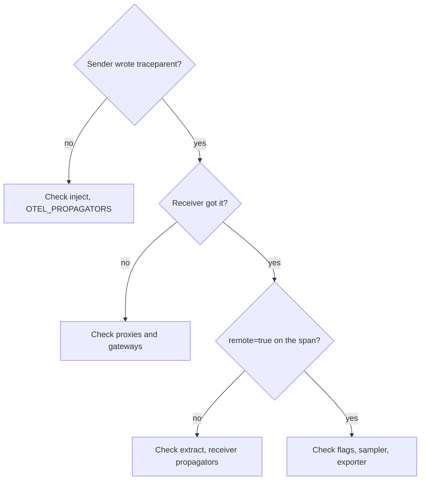

# Diagnosing Broken Propagation

Broken propagation rarely produces an error. Requests succeed, spans are exported, and the only symptom is a trace that is split into pieces or spans that are missing. This part lists the ways propagation breaks, gives a method that finds the broken hop, and shows two failures on the playground services: a receiver that ignores the header and a sampling decision that removes the downstream spans.

## The places where propagation breaks

A context travels through five steps: the active context in the sender, the injection into the carrier, the transport, the extraction in the receiver, and the active context in the receiver. A failure in any step gives the same symptom, so you need to know which component does each step.

| Step | Component | Typical failure |
| --- | --- | --- |
| Active context in the sender | Your code, thread and task libraries | Work in a new thread has no parent |
| Inject | The global propagator and the client instrumentation | `OTEL_PROPAGATORS=none`, or a client that is not instrumented |
| Transport | Proxies, gateways, message adapters | A proxy removes or rewrites headers |
| Extract | The global propagator and the server instrumentation | The receiver list does not read the sender format |
| Active context in the receiver | Your code | Spans created without the extracted Context |

A sixth cause sits next to these: the sampling decision. A trace can be intact in the `traceparent` header and still produce no spans in the backend.

## A method for finding the broken hop

Work in the order of the data. First, look at what the sender wrote. The `shuttle` client line has a `traceparent=` field, and its value is `none` when nothing was injected. Second, look at what the receiver got. The `probe` line has the same field for the header it received. If the sender wrote it and the receiver did not get it, the transport removed it. If the receiver got it and still shows `remote=false`, the extraction failed. If both agree and the collector shows no spans, check the sampled flag.



The diagram shows the checks in the order that isolates one component at a time.

## Failure one: the receiver ignores the header

Start with the default state. Both services use `tracecontext,baggage`. Check that the trace is connected:

<!-- astrona:playground:renew -->
```sh
kubectl -n starfleet logs deploy/probe --tail=4 | grep '^PROPAGATION'
```

The lines have `remote=true`. Break the receiver with a propagator list that has no `tracecontext`:

```sh
kubectl -n starfleet set env deployment/probe OTEL_PROPAGATORS=baggage
kubectl -n starfleet rollout status deployment/probe --timeout=300s
```

After the new pod runs, the `probe` lines show `remote=false` and `parent_span_id=none`, but the `traceparent=` field still holds the header. The sender wrote the header and the receiver got it, so the failure is in the extract step. The fix is the propagator list of the receiver:

```sh
kubectl -n starfleet set env deployment/probe OTEL_PROPAGATORS=tracecontext,baggage
kubectl -n starfleet rollout status deployment/probe --timeout=300s
```

The `remote=true` lines come back. The same symptom appears if a proxy removes the header, but then the `traceparent=` field of the `probe` line shows `none`. This is why you read both ends before you change anything.

## Failure two: the trace is intact and the spans are not recorded

Sampling is the decision whether a span is recorded and exported. The environment variable `OTEL_TRACES_SAMPLER` chooses the sampler. The value `always_off` records nothing. With `parentbased_always_on`, a root span is sampled, and a child follows the decision of its parent. Set `always_off` on the `shuttle`:

```sh
kubectl -n starfleet set env deployment/shuttle OTEL_TRACES_SAMPLER=always_off
kubectl -n starfleet rollout status deployment/shuttle --timeout=300s
```

Read the lines of the new pods:

```sh
kubectl -n starfleet logs deploy/probe --tail=4 | grep '^PROPAGATION'
```

The `traceparent=` value now ends with `-00`, the unsampled flag, and the `probe` lines still have `remote=true`. Propagation works. The `probe` uses its default sampler, `parentbased_always_on`, which follows the parent, so it does not record its span either. The collector receives no new spans from either service. Remove the setting to restore the default:

```sh
kubectl -n starfleet set env deployment/shuttle OTEL_TRACES_SAMPLER-
```

This is a case where a repair of the headers would change nothing. The context is correct, and the sampler is the component that dropped the data.

## Other causes worth checking

Some failures need other tools in a real system. A reverse proxy or a service mesh can drop headers it does not know, and its configuration must list `traceparent` and `baggage`. A message adapter that copies only some message properties loses the context. A service that makes an outgoing call from a thread without the Context sends a request with no parent, because a new thread has an empty active context. An invalid header, for example with a wrong length, is ignored and the receiver starts a new trace.

Do not fix any of these by trusting the data that you received. A trace ID that a client sent is useful for correlation. It does not prove who the client is, and it must not decide authorization. If you must stop an outside caller from joining your trace, the entry service can ignore the incoming `traceparent` and start its own, linking to the incoming context.

You now have a method for each step of the path and have seen the two most common silent failures. The method is the same in a large system: compare what the sender wrote with what the receiver got, then check how the receiver used it, then check what the sampler did.

## Common pitfalls

> [!WARNING]
> Changing a propagator list on only one side of a call does not repair a split trace; read what the sender wrote and what the receiver got first. A successful response proves nothing about propagation. A header with the flag `00` is a correct header whose trace is deliberately not recorded, so do not search for a missing header when the sampler dropped the spans. Do not accept an incoming trace ID as proof of identity.
