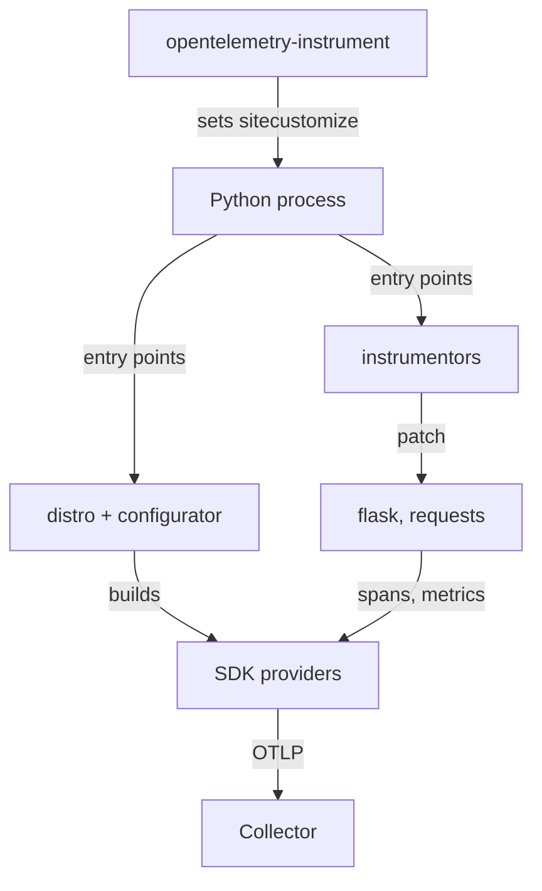

# What An Instrumentation Agent Does

Most applications were written before anyone asked them for telemetry. Adding the OpenTelemetry API calls by hand to every web handler and every outgoing request takes time, and a team may not own the code. An instrumentation agent solves this by adding the telemetry from the outside. This part shows which pieces make that work, what happens when the process starts, and how to see the result.

## Two things called agent

The word agent names two different things in OpenTelemetry. A language instrumentation agent runs inside the application process. It attaches recording code to supported libraries, so the process produces spans, metrics and log records without source changes. A Collector agent is a separate program, the OpenTelemetry Collector, deployed next to the application. It receives, processes and forwards telemetry. This module is about the first meaning. The next module is about the second.

The two do not replace each other. The instrumentation agent creates the telemetry. The Collector only moves and changes telemetry that something else already created. If a library produces no spans, no Collector setting can make them appear.

## The three Python commands

The Python agent comes as three commands from three packages. Each command has one job.

- `opentelemetry-distro` installs the API, the SDK (software development kit) and a distro. The distro is a small package that sets default options, for example that the exporter is OTLP (OpenTelemetry Protocol). It also provides the two commands below.
- `opentelemetry-bootstrap -a install` reads the packages that are installed in the current Python environment and installs the matching instrumentation package for each. If `flask` is installed, it installs `opentelemetry-instrumentation-flask`.
- `opentelemetry-instrument` starts your program with the agent attached.

The example application `scout` uses exactly this. Its ConfigMap `scout-app` holds the start script. The order matters: bootstrap only sees packages that are already installed, so the application libraries (`flask`, `requests`) come first.

## One real example

The playground runs `scout`, a Flask web application with the routes `/healthz`, `/status`, `/relay` and `/dock`. Its file `app.py` imports Flask and `requests` and nothing from OpenTelemetry. Look at the start script that the container runs:

<!-- astrona:playground:renew -->

```sh
kubectl -n starfleet get configmap scout-app -o jsonpath='{.data.start\.sh}'
```

The script runs `pip install` for Flask, `requests` and `opentelemetry-distro[otlp]` at pinned versions, then `opentelemetry-bootstrap -a install`, then `exec opentelemetry-instrument python /app/app.py`. The `[otlp]` extra adds the OTLP exporter package. The word `exec` replaces the shell with the new process, so the application is the main process of the container.

Count the OpenTelemetry references in the application code:

```sh
kubectl -n starfleet get configmap scout-app -o jsonpath='{.data.app\.py}' | grep -ci opentelemetry
```

The count is `0`. The application has no OpenTelemetry code, and still the Collector receives telemetry from it. See which instrumentation packages the bootstrap command installed:

```sh
kubectl -n starfleet exec deploy/scout -- pip list | grep -i opentelemetry
```

The list shows the API, the SDK, the OTLP exporters, the distro and several `opentelemetry-instrumentation-*` packages. Among them are `flask` and `requests`, the two libraries `scout` uses. The others match other installed packages for which an instrumentation package exists. The exact list depends on the packages that `pip` installed.

## What happens when the process starts

The mechanism has four steps, and different components do them.

1. `opentelemetry-instrument` prepares the environment of the new process. It makes Python load a `sitecustomize` module from the agent package at interpreter start. Python runs a `sitecustomize` module before the program code.
2. That module loads the configurator and the distro through entry points. An entry point is a name that a package registers so that other code can find it. The distro sets defaults. The configurator builds the SDK: tracer provider, meter provider and logger provider, with the exporters named in the `OTEL_*` variables.
3. The module then loads every registered instrumentor. An instrumentor is the code that knows how to record telemetry for one library. Before it patches anything, it checks that the installed library version is in the range it supports. If the version is outside the range, it skips the library.
4. Each instrumentor patches its library with monkey patching. Monkey patching means replacing a function at runtime with a wrapper that calls the original function and records a span around it. The Flask instrumentor wraps the Flask request handling. The `requests` instrumentor wraps the function that sends an HTTP request.



The diagram shows that one process holds the application, the SDK and the patched libraries, and that only the export step leaves the process.

## Reading the result at the Collector

The Collector in the playground uses the `debug` exporter with detailed verbosity. It prints every span, metric and log record it receives. Ask for the span names of the last minute:

```sh
kubectl -n starfleet logs deploy/collector --since=60s | grep -E 'Name +:' | sort | uniq -c
```

You see names such as `GET /relay` and `GET /dock`. These are server spans from the Flask instrumentor: the name is the HTTP method and the route. You also see a name `GET` without a route. That is a client span from the `requests` instrumentor, created when the `/relay` handler calls `/status` on the same application. The server span for that inner request has the name `GET /status`.

The relation between these spans is a trace. The `/relay` server span is the parent. The client span is its child. The inner `/status` server span is the child of the client span. The agent propagates the trace context in the HTTP headers, which is how the same trace crosses the inner request.

## Who does what, in short

The application code serves requests. The instrumentor of a library creates the spans for that library. The SDK, built by the configurator, adds the resource, batches and exports. The Collector receives and prints. When a span is missing, ask which of these did not do its step. A missing instrumentation package, a library version outside the supported range and a disabled instrumentation all stop step three or four, and the SDK and the Collector then have nothing to send.

You now know the pieces and the start-up order of the Python agent. The open question is how to steer it: the same container can report a different service name, drop a library or skip a URL without a change in the code.

## Common pitfalls

> [!WARNING]
> Run `opentelemetry-bootstrap -a install` after the application libraries are installed, not before. It only sees packages that already exist, so a library installed later gets no instrumentation. Pin the distro and the exporter to versions that belong together, and remember that every instrumentation package follows the version of the distro. Do not set up a second tracer provider in the application code: the agent already set one, and a second call is ignored with a warning.
