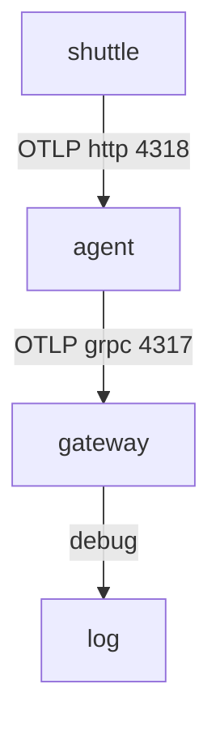

# Agent And Gateway Roles

An application can send telemetry straight to a backend. That is simple, and it puts the backend address, the credentials and the retry behavior into every application. The OpenTelemetry Collector moves this work out of the applications. A Collector can run in two roles, and a real cluster often runs both. This part defines the roles, shows both in the playground and explains the consequence of each placement.

## The Collector in one paragraph

The OpenTelemetry Collector is a program that receives telemetry, changes it and sends it on. Its configuration has four parts. A receiver accepts data, for example the `otlp` receiver for OpenTelemetry Protocol. A processor changes data in flight. An exporter sends data out. A pipeline connects receivers, processors and exporters for one signal, either traces, metrics or logs. The `service` section lists the pipelines.

The Collector has no built-in role. Role is a name for how you deploy it. The same binary is an agent in one place and a gateway in another place.

## The two roles

A Collector in the agent role runs close to the applications that send to it: on the same node, in the same pod or on the same host. It receives the local telemetry and does the work that must happen near the source. The work includes batching, adding resource attributes about the host, and limiting memory. Then it exports the data to the next tier or to a backend.

A Collector in the gateway role is a central service that many agents and applications send to. It runs as a normal Deployment behind a Kubernetes Service and can scale by adding replicas. It holds the settings that should exist once for a whole environment: the credentials for the backend, routing to several backends, and processing that needs data from many sources.

The two roles combine. Applications send to the agent on their node, and each agent sends to the gateway. The gateway sends to the backend. The playground has this shape: `shuttle` sends to `agent`, `agent` sends to `gateway` and `gateway` prints with the `debug` exporter.



The diagram shows two hops. The application knows only the address of the agent, and the agent knows only the address of the gateway.

## Why add an agent at all

An application that sends directly to a gateway or a backend must keep telemetry in memory until the send works. The SDK has a bounded queue for this, and it drops data when the queue is full. A local agent shortens the network path. The application hands data to a process on the same node, which is fast and rarely fails. The agent then owns retries and queues for the longer path.

Other reasons are operational. A change of the backend address becomes a change of the agent configuration, not of every application. Host attributes can be added in one place. Resource limits on the agent protect the node from a telemetry burst. The cost is one more component that you must run, size and update.

## Sidecar and DaemonSet

In Kubernetes there are two usual placements for an agent. A sidecar is a second container in the same pod as the application. A DaemonSet runs one pod of the agent on every node.

- A sidecar shares the pod lifecycle and the network namespace, so the application sends to `localhost`. The configuration can differ per workload. The price is one Collector per pod, which multiplies memory use.
- A DaemonSet shares one agent between all pods of a node. It uses less memory in total. The applications must reach the agent on their own node, and the agent must tell apart the data of different pods.

Neither is better in general. The sidecar suits a workload with its own pipeline needs or strong isolation rules. The DaemonSet suits a cluster where many small pods send similar data.

## How an application reaches the node-local agent

A normal Kubernetes Service load-balances over all pods behind it, so a request from a pod could reach the agent on another node. The playground Service `agent` uses `internalTrafficPolicy: Local`. With this policy, kube-proxy sends cluster-internal traffic only to endpoints on the same node as the client. If the node has no agent pod, the request fails instead of going elsewhere. Other options exist: a `hostPort` on the agent, the node address given to the application through the Kubernetes downward API, or `hostNetwork`. Each of these has an authority cost that a later part examines.

## Try it in the playground

Start with the objects. List the pods and the Service policy:

<!-- astrona:playground:renew -->

```sh
kubectl -n starfleet get pods -o wide
kubectl -n starfleet get service agent -o jsonpath='{.spec.internalTrafficPolicy}{"\n"}'
```

You see one `agent` pod, one `gateway` pod and one `shuttle` pod. The second command prints `Local`. Now read what `shuttle` does with its address:

```sh
kubectl -n starfleet get deployment shuttle -o json | jq -r '.spec.template.spec.containers[0].env[] | .name + "=" + .value'
```

The variable `OTEL_EXPORTER_OTLP_ENDPOINT` is `http://agent:4318`. The application has no address of the gateway. Read the data at the end of the chain:

```sh
kubectl -n starfleet logs deploy/gateway --since=60s | grep -E 'service.name|Name +:|shuttle.jumps' | sort | uniq -c
```

The gateway shows the spans `plan-jump` and `engage-drive` and the metric `shuttle.jumps` from the service `shuttle`. The data crossed two Collectors on the way.

## What happens when a tier is down

Stop the gateway and watch the agent. Scale the gateway to zero replicas:

```sh
kubectl -n starfleet scale deployment/gateway --replicas=0
kubectl -n starfleet logs daemonset/agent --since=60s | tail -n 5
```

The agent log reports failed exports. The `otlp` exporter of the Collector has a retry setting and an in-memory sending queue, and both are bounded. While the gateway is gone, the agent queues and retries. When the queue is full, the agent drops data and logs it. The application is not affected, because it only talks to the agent.

Bring the gateway back before you continue:

```sh
kubectl -n starfleet scale deployment/gateway --replicas=1
```

The queue is memory only. If the agent pod restarts while the gateway is down, the queued data is lost. A local endpoint is not a durable store. A persistent queue needs extra configuration, a storage extension, and a place on disk, which in turn needs host access.

## Who does what

The SDK in the application creates data and holds a small queue. The agent receives it near the source and adds host facts. The gateway applies central policy and talks to the backend. When data is missing, locate the hop: does the application reach the agent, does the agent reach the gateway, does the gateway export?

You now have the roles and the placements. What an agent should do to the data it passes on, and why the order of those steps matters, is the next question.

## Common pitfalls

> [!WARNING]
> A Collector has no fixed role: do not look for an agent setting, because the role comes from placement. A Service without `internalTrafficPolicy: Local` can send telemetry to the agent on another node, and the host attributes then describe the wrong node. A local agent is not a durable queue: it holds data in memory and drops it when the queue is full or the pod restarts. Restore anything you scale down before you move on.
